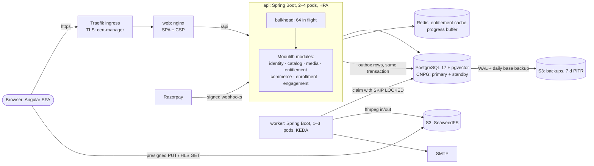

# Masternova-Spring

An EdTech platform: **Java 25 · Spring Boot 4 · Spring Modulith · Angular 22 · PostgreSQL · Redis · Kubernetes**.

> **The one sentence:** it's an EdTech platform, but the real project is the backend problem
> underneath it. **How do you sell access to a video, and then make sure only the people who
> paid can watch it**, without ever double-charging anyone, and without melting under load?

Three sub-problems fall out of that:

1. **Get the video ready to stream:** resumable uploads straight to S3 → a leased, retried
   transcode pipeline → HLS ([media LLD](docs/lld/media.md), [pipeline](docs/lld/video-pipeline.md)).
2. **Take the money exactly once:** idempotency keys, a transactional outbox, a forward-only
   order state machine, webhook dedupe ([orders](docs/lld/order-state-machine.md)).
3. **Decide who's allowed to watch:** an entitlement policy chain, cached, with short-lived
   playback tickets ([entitlement engine](docs/lld/entitlement-engine.md)).

A ground-up rebuild of the NestJS Masternova, built to practise production Java, low-level design,
Angular and a full DevOps chain. Progress: [`ROADMAP.md`](ROADMAP.md).

## Architecture

A **modular monolith plus a worker** ([ADR-0001](docs/adr/0001-spring-modulith-modular-monolith.md)),
deployed by GitOps to Kubernetes.



| Part | What it is |
|---|---|
| `backend/api` | HTTP API. One Spring Modulith module per bounded context, boundaries enforced by a test |
| `backend/worker` | Outbox relay, email, the transcode pipeline (leases, heartbeats, retries) |
| `backend/kernel` | Plain-Java shared kernel: event contracts, `Money`, `@DesignPattern` |
| `frontend` | Angular 22 SPA (standalone, signals, Material 3), StudyNotion design |
| `patterns` | ⭐ Every design pattern used: a note, the real class, a runnable lab copy |
| `deploy` | k3d cluster, two Helm charts, Argo CD (GitOps), the observability stack |

More: [architecture HLD](docs/hld/01-architecture.md) · [API conventions](docs/api/conventions.md) · [ADRs](docs/adr/)

## Proof: measured, broken on purpose, scanned

Phase D5 measured the design instead of asserting it. Everything below ran on one laptop (8 vCPUs
shared by three k3d nodes and the load generator), so the shapes transfer and the absolute
numbers don't.

| Claim | Evidence |
|---|---|
| **Meets its SLO (p95 < 300 ms) up to 150–200 rps**, a realistic read-heavy mix | [capacity](docs/hld/03-capacity.md): k6, open model, one row per rate |
| **Degrades instead of collapsing past that.** Before: virtual threads queued ~1,500 requests per pod for 10 connections until pods restarted in a spiral. After a **Bulkhead** (fast 503s) and a 2 s pool timeout: p95 35 s → 4.3 s at 300 rps, 0 restarts | [capacity §3–5](docs/hld/03-capacity.md), [pattern note 18](patterns/docs/18-bulkhead.md) |
| **Survives its parts dying.** api pod `kill -9` at 100 rps: 42 of 18,001 requests lost. Postgres primary deleted: failover in 21 s. Worker killed mid-transcode: the lease lapses, the job finishes, once | [resilience drills](docs/hld/04-resilience-drills.md) |
| **Restores to any second of the last 7 days.** RPO ≤ 60 s; a deleted row brought back in 57 s | [drills §4](docs/hld/04-resilience-drills.md), [runbook](docs/runbooks/restore-database.md) |
| **Ships without secrets or missing headers.** gitleaks over all history, OWASP ZAP baseline + a strict CSP in CI, Trivy, CodeQL, cosign-signed images | [security scans](docs/hld/05-security-scans.md) |
| **Is observable.** RED metrics, traces api → outbox → worker, 3 SLOs with burn-rate alerts, a runbook per alert | [runbooks](docs/runbooks/), `make obs` |

The drills found real bugs, and each one is in the docs: a pool timeout surfaced as a 500, a
storage server wedged with no liveness probe, enabling backups took the primary down for 10
minutes, and a secrets scan passed by scanning nothing.

## Run it

Prerequisites: JDK 25, Node 22 + pnpm, Docker.

```bash
make up      # postgres, redis, mailpit, S3 (SeaweedFS)
make api     # http://localhost:8080/api/v1/meta/ping
make web     # http://localhost:4200
make seed    # 200 courses + seeded users (instructor@seed.test / seed-password)
```

Or everything in containers, or on Kubernetes:

```bash
make stack                                   # http://localhost:8081
make k8s-up k8s-platform k8s-images k8s-deploy   # https://masternova.localhost:8443
```

| Service | URL |
|---|---|
| Web (dev / container / cluster) | http://localhost:4200 · http://localhost:8081 · https://masternova.localhost:8443 |
| API | http://localhost:8080/api/v1 · health at `/actuator/health` |
| Mailpit (every dev email) | http://localhost:8026 |
| Grafana / Prometheus (`make obs`) | http://localhost:3001 · http://localhost:9091 |

## Test

```bash
make test           # backend unit + Modulith + Testcontainers ITs, pattern lab, frontend lint + Vitest
make e2e            # Playwright against the running stack (make k8s-e2e: against the cluster)
make scan           # Trivy · make secrets-scan: gitleaks · make zap: OWASP ZAP baseline
load/capacity-sweep.sh 50 100 150 200    # k6 against the SLOs
```

## Pattern catalog

Start at [`patterns/README.md`](patterns/README.md): 19 patterns, each with a note
(problem → UML → code → when *not* to use it → interview Q&A), the production class (marked
`@DesignPattern`) and a Spring-free runnable copy. The catalog is checked by tests.

Demo: a 3-minute walkthrough, [script](docs/demo-script.md).
