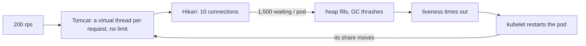

# Capacity: the api against its SLOs

**Last updated:** 2026-10-24 (D5.1, D5.2: pool sizing) · **Status:** measured on the local k3d cluster

The question: **how much traffic does the api take while it still meets its SLOs, and what happens
past that?** The SLOs (D3.5, [runbooks](../runbooks/api-latency.md)): **p95 < 300 ms** and
**99.5 % of requests without a 5xx**.

## 1. The test

[`load/slo-mix.js`](../../load/slo-mix.js) is a k6 script with an **open model**: a
`constant-arrival-rate` executor starts *N* requests per second whether or not earlier ones came
back. A slow api then shows up as latency and dropped iterations. A closed loop of virtual users
would quietly send less, which is the coordinated-omission trap.

The mix is read-heavy, like a catalog site. Per 100 requests:

| Anonymous | | Logged-in learners (50 seeded) | |
|---|---:|---|---:|
| course list | 35 | my learning | 5 |
| category filter, highest rated | 15 | course progress | 5 |
| course detail | 15 | progress heartbeat (a write) | 5 |
| reviews | 5 | | |
| keyword search | 10 | | |
| typeahead | 5 | | |

Thresholds are the SLOs for the whole mix and for each request kind, plus `dropped_iterations == 0`
(k6 itself kept up). [`load/capacity-sweep.sh`](../../load/capacity-sweep.sh) runs one 3-minute
step per rate and prints one table row per step.

**Setup:** `make k8s-seed COURSES=10000` · api 2–4 pods (HPA on CPU at 70 % of a 250 m request,
2 CPU limit, 1 GiB) · Hikari's default 10 connections per pod · CNPG primary + standby ·
everything, k6 included, on **one laptop: 8 vCPUs shared by three k3d nodes and the load
generator**. Each sweep starts on warm pods (1 min at 50 rps first).

## 2. Results

**Before** (the `main` image, `sha-aaaf771`):

| rate/s | achieved/s | p50 ms | p95 ms | p99 ms | max ms | failed | dropped | api pods | SLOs |
|---:|---:|---:|---:|---:|---:|---:|---:|---:|---|
| 50 | 49 | 5.6 | 15.6 | 43.3 | 246 | 0 % | 0 | 3→3 | ✅ |
| 100 | 99 | 5.7 | 39 | 208.6 | 1988 | 0 % | 0 | 3→4 | ✅ |
| 150 | 148 | 5.4 | 70.1 | 310.3 | 1690 | 0 % | 0 | 4→4 | ✅ |
| 200 | 197 | 20.9 | 814.5 | 1858.7 | 3993 | 0 % | 209 | 4→4 | ❌ |
| 300 | 167 | 1219.2 | **35431.9** | 52264.7 | 60033 | 13.9 % | 23213 | 4→4 | ❌ |

Two api pods restarted during the 300 rps step.

**After** (the bulkhead and fail-fast from §4):

| rate/s | achieved/s | p50 ms | p95 ms | p99 ms | max ms | failed | dropped | api pods | SLOs |
|---:|---:|---:|---:|---:|---:|---:|---:|---:|---|
| 50 | 49 | 7.3 | 31.8 | 111.4 | 1238 | 0 % | 0 | 3→4 | ✅ |
| 100 | 99 | 5.6 | 27.3 | 87.9 | 614 | 0 % | 0 | 4→4 | ✅ |
| 150 | 148 | 4.3 | 31 | 148.2 | 1269 | 0 % | 0 | 4→4 | ✅ |
| 200 | 198 | 4.3 | 61.8 | 280.4 | 926 | 0 % | 0 | 4→4 | ✅ |
| 300 | 280 | 572.4 | **4293** | 6468.2 | 13401 | 13.69 % | 2713 | 4→4 | ❌ |

No restarts. Failures here are fast 503 `OVERLOADED`, not 60 s timeouts.

**The knee is 150–200 rps** (9,000–12,000 requests a minute) on this laptop. 150 passed in every
clean run; 200 passed once (p95 62 ms, the 150/200 rerun on a quiet host) and failed once (p95 815
ms). The bulkhead doesn't explain that difference: at 200 rps it never fills. The host's noise
does. The api isn't what runs out first; the host's 8 vCPUs are. At 200 rps and above, the k3d
nodes themselves start missing heartbeats.

## 3. What broke past the knee (before)

The first sweep looked like a slowdown, but it was a collapse: p95 went from 30 ms to 25 s, and the
ready api pods fell from 4 to 1. Three findings, each from evidence rather than a guess:

1. **The connection pool, not the CPU, was where requests waited.** A restarted pod's log:

   ```
   HikariPool-1 - Connection is not available, request timed out after 153262ms
     (total=10, active=10, idle=0, waiting=1513)
   ```

   **Virtual threads mean Tomcat never says no.** Platform threads used to be an accidental limit
   (200 threads, then refused connections). Now every request gets a thread, and ~1,500 per pod
   queued for 10 connections, holding memory as they waited.

2. **Liveness turned overload into a restart spiral.** The probe had a 1 s timeout × 3. A pod
   whose JVM was stalled by GC and queueing failed it, was killed, and its traffic sank the next
   pod.

3. **Wait time past a 30 s pool timeout became a 500.** `GlobalExceptionHandler` treated a pool
   timeout as a bug (`INTERNAL`), at the moment the logs could least afford a stack trace per
   request.



## 4. What changed

| Change | Where | Why |
|---|---|---|
| **Bulkhead:** at most 64 requests per pod at once; wait 50 ms for a slot, then 503 `OVERLOADED` + `Retry-After: 1` | `platform.overload.ConcurrencyLimitFilter` ([pattern note 18](../../patterns/docs/18-bulkhead.md)) | Puts back the limit virtual threads removed, at the door, before any work is done. `/actuator` is never limited |
| **Fail fast at the pool:** Hikari `connection-timeout` 30 s → 2 s (`DATABASE_POOL_TIMEOUT_MS`), and a pool timeout is a 503 `OVERLOADED`, not a 500 | `application.yaml`, `GlobalExceptionHandler` | The second line: a request that got in but finds no connection doesn't wait 30 s |
| **Probes:** liveness 5 s × 6, startup 5 s per check; readiness unchanged (1 s × 2) | `deploy/helm/masternova/templates/_helpers.tpl` | A busy pod is not a hung one. Overload is shed by readiness (out of the Service) and the bulkhead, never by a restart |

Metrics: `masternova_overload_rejected_total` and `masternova_overload_in_flight` on
`/actuator/prometheus`.

## 5. Reading the result

- **At 300 rps (2× the knee) the system degrades instead of collapsing:** p95 4.3 s instead of
  35 s, max 13 s instead of 60 s (k6's timeout), 280 req/s served instead of 167, no restarts. The
  SLO still fails, as it should: the laptop can't serve 300 rps. What the bulkhead buys is that
  the requests it admits stay serviceable, and the rest learn at once to retry.
- **Below the knee nothing changes.** The bulkhead holds 64 permits, and in-flight requests at
  150 rps are about 150 × 0.01 s ≈ 2 (Little's law), so it never binds.
- **p95 is still seconds at 300 rps.** That wait happens before the filter: in Traefik and in
  the CPU run queue of a host that k6 also uses. A per-pod limit can't fix a shared CPU. Real
  capacity comes from more cores, not a smarter queue.

## 6. Caveats

- **One laptop.** The load generator, the ingress, three nodes, Postgres and the app share 8
  vCPUs. The absolute numbers say little about a real cluster; the *shapes* (where requests queue,
  how failure spreads) are what transfer.
- **The host was not quiet for every step.** One bulkhead step at 150 rps measured
  `max = 1,042,558 ms`. k6's request timeout is 60 s, so that's the k6 process itself frozen for
  17 minutes: the Mac slept mid-step. That row was rerun. An earlier attempt ran with the Mac
  swapping (load average 87); it was discarded.
- **SeaweedFS was spinning during some runs.** The D5.3 drills found it wedged at 5.1 cores
  (of the laptop's 8) near its memory limit ([drills §4](04-resilience-drills.md)). For how long
  isn't known; it's the likeliest reason some runs measured far worse than their neighbours.
- The api never got to use its own 4-pod HPA ceiling well: CPU-based HPA reacts in ~1 min, while
  the collapse took under a minute. Scaling on in-flight requests is a follow-up, not done here.

## 7. Reproduce

```bash
make k8s-seed COURSES=10000          # 10,000 courses + learner2..learner50
load/capacity-sweep.sh 50 100 150 200 300
# one step, with its thresholds: RATE=150 k6 run load/slo-mix.js
```

Raw summaries and logs land in `load/results/<timestamp>/` (gitignored).

## 8. Pool sizing (D5.2)

**Measured, at 100 rps** (one api pod's Hikari meters, sampled every 10 s, differences over 40 s):

| Meter | Value |
|---|---|
| connections checked out | 42 per second per pod |
| held per checkout (`hikaricp_connections_usage`) | **4.5 ms** mean |
| waited per checkout (`hikaricp_connections_acquire`) | 0.28 ms mean |
| busy on average (Little's law: 42 × 0.0045) | **0.19 of 10** |

Ten connections per pod are ~50× what a pod uses at 100 rps. They matter only when queries
slow down, and then they hurt: 4 pods × 10 let 40 statements run at once against a Postgres
whose CPU is shared with everything else, so each one runs slower and holds its connection longer.
HikariCP's own guidance (connections ≈ cores × 2 + disks, *for the whole database*) points the same
way.

**A/B at 300 rps** (2× the knee), alternating so drift hits both sides, 4 warm pods each:

| Pair | pool 10: p95 / failed | pool 5: p95 / failed |
|---|---|---|
| 1 | 10.1 s / 79 % | **3.6 s / 49 %** |
| 2 | 6.6 s / 61 % | **5.0 s / 24 %** |

**Pool 5 won both pairs** on p95, throughput and errors, but the *size* of the gain isn't
trustworthy: an earlier pool-5 run served 300 rps with a p95 of 87 ms, so run-to-run noise on this
laptop is larger than the effect.

**And then the integration tests found what the load mix couldn't: a hot row.**
`CourseAuthoringIT` sends ten concurrent edits to *one* course. Each waits on that row's lock
**while holding a connection**; with 5 connections and Hikari's 2 s timeout, half the edits got 503
`OVERLOADED` instead of 200 or 409. The read-heavy mix never has two requests fighting over one
row, so the A/B couldn't see it. With 10 connections the test passes.

**Decision: the default stays at Hikari's 10** (`DATABASE_POOL_SIZE` to change it). A gain inside
the noise doesn't pay for a measured failure mode. The measurement still matters: at 0.19 busy
connections per pod the pool isn't the limit below the knee, so a pool change wouldn't move it.

At the bulkhead's 64 permits and a pool of 10, a pod admits up to 54 requests that wait for a
connection, for at most 2 s (`connection-timeout`), before a 503. That's deliberate: the wait
absorbs bursts the pool can catch up with, and the timeout caps the cost when it can't.
