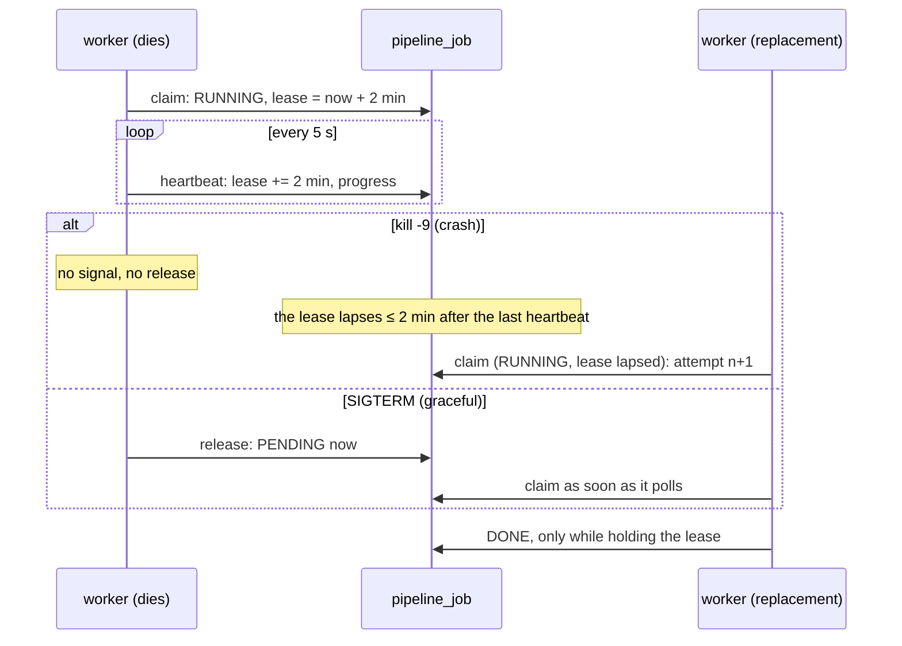

# Resilience drills: kill things on purpose

**Last updated:** 2026-10-24 (D5.3, D5.4) · **Status:** run on the local k3d cluster

Each drill breaks one part of the running system, under load where it matters, and checks a claim
the design makes. The scripts are in [`load/chaos/`](../../load/chaos/); each prints what clients
saw, and the raw k6 output lands in `load/results/` (gitignored).

**How to kill.** `kubectl delete pod --force --grace-period=0` is **not** a crash. It removes the
API object at once, but the kubelet still sends SIGTERM with a 1–2 s grace, so the process shuts
down gracefully. The first round of drills used it and measured that path by mistake: the "killed"
worker released its jobs. A crash (OOM kill, node loss) gets no signal, so the drills now
`kill -9` the container's main process from its k3d node (`crictl inspect` → host pid). The
graceful path is drilled separately, with a plain `kubectl delete`.

| # | Drill | Claim under test | Result |
|---|---|---|---|
| 1 | Worker crashes mid-transcode (`kill -9` at 21 %) | A job whose worker dies is taken over once its lease lapses (2 min), and runs to DONE exactly once | ✅ READY **258 s** after the kill. The transcodes took 3 attempts (limit 10), every job DONE once, nothing DEAD |
| 2 | Worker deleted mid-transcode (SIGTERM at 21 %) | Shutdown releases the job, so the replacement doesn't wait for the lease | ✅ READY **130 s** after the delete. The job resumed on the new pod (attempt 2) |
| 3 | api pod `kill -9` at 100 rps | Two replicas, readiness and the Service: a crashed pod costs only its in-flight requests | ✅ **42 of 18,001** requests failed (0.23 %): the crashed pod's in-flight ones. p95 30 ms; the kubelet restarted the container, readiness kept it out until it was up |
| 4 | Postgres primary `kill -9` at 100 rps | CNPG fails over to the standby; the api reconnects without a restart; clients get fast, retryable errors in the gap | ⚠️ **No failover.** The kubelet restarted the container in place and CNPG kept it as the primary: serving again after **70 s** (crash recovery replays WAL). 6,390 of 17,471 requests failed (36.6 %), p95 4.9 s. No api restart |
| 4b | Postgres primary deleted (SIGTERM) at 100 rps | the same, by the graceful path | ✅ the standby was promoted and serving in **21 s**; 1,843 of 17,896 requests (10.3 %) failed, p95 2.0 s; no api restart |

## 1. Worker: crash vs graceful



- **The crash costs the lease.** 258 s = up to 2 min of lapsed lease + a JVM boot + a full
  restart of the transcode (ffmpeg has no resume point). Graceful saves the lease: 130 s.
- **Exactly once holds at the output, not at the attempts.** Attempts went to 3 for the
  transcodes, but `pipeline_job`'s unique `(asset_id, type, rung)` means there was never a second
  job, and "DONE only while holding the lease" means a late finisher changes nothing.
- A shorter lease would take over a crash sooner, but a long GC pause or a slow node would lose a
  healthy job. 2 min against a 5 s heartbeat (24 missed beats) stays.

## 2. api pod crash

Two replicas behind a Service lose only what the crashed JVM was holding: 42 requests at 100 rps,
about 0.4 s of one pod's share. The kubelet restarts the container in the same pod; readiness keeps
it out of the Service until the startup probe passes. Nothing waits on the HPA.

A graceful delete (the D4.8 drill, `rollout-drill.js`) loses nothing: `preStop` sleeps 5 s so the
endpoint is gone before Tomcat stops accepting.

## 3. Postgres failover

Two different stories, depending on how the primary dies:

| | Pod deleted (SIGTERM) | Container crashed (`kill -9`) |
|---|---|---|
| What CNPG did | promoted the standby | let the kubelet restart the container in place; the same instance stayed primary |
| Serving again after | **21 s** | **70 s** (Postgres crash recovery) |
| Requests failed at 100 rps | 1,843 (10.3 % of 3 min) | 6,390 (36.6 %) |

**Why no failover on a crash** (observed; the reading of CNPG's rules is ours, not verified in its
source): the pod never went away. The kubelet restarted the container within seconds, and the
operator treated the instance coming back as the same primary recovering rather than a lost
primary to replace. For this database, recovering in place took 70 s; failing over took
21 s. Options, not done here: CNPG's liveness/readiness timings for the instance, or a quorum-based
failover. Both trade a faster failover for a risk of promoting during a short blip.

**What clients saw, both times:** fast, retryable errors, not hangs. During the gap almost every
request got a 503 `OVERLOADED` after Hikari's 2 s timeout (D5.1): 939–1,552 per api pod. Five per
pod reached a connection that died mid-statement and became 500 `INTERNAL`. They're 503
`DATABASE_UNAVAILABLE` now (§4); the drill ran on the image before that fix.

The api never restarted. Its liveness doesn't check the database (D4), and Hikari replaced the
dead connections on its own: `masternova-db-rw` follows the primary.

## 4. Backup and point-in-time restore (D5.4)

WAL archiving and base backups go to S3 (the in-cluster SeaweedFS for the drill) through CNPG's
**Barman Cloud plugin**, not the in-tree `barmanObjectStore`: the `standard` Postgres images have
no barman-cloud binaries, and the plugin brings them as a sidecar.
[`load/chaos/pitr-drill.sh`](../../load/chaos/pitr-drill.sh):

1. an on-demand base backup (11 s);
2. a marker row; **T**; the marker deleted (the "accident");
3. `pg_switch_wal()` and wait until that segment is archived;
4. a **new** cluster restored to T, from the bucket;
5. the marker is back in the restore and still gone from the live database.

| | Result |
|---|---|
| Correctness | ✅ the deleted row is back at T; 10,000 / 10,000 courses |
| **RPO** | ≤ 60 s (`archive_timeout: 60s`); 0 for anything older than the last archived segment |
| **RTO**, images cached | **57 s** create → Ready |
| RTO, cold node | **73 min**: image pulls on this network (sidecar 7 min, Postgres image after failed pulls) |

Runbook: [restore-database.md](../runbooks/restore-database.md).

## 5. Found by the drills

| Finding | Fix |
|---|---|
| **SeaweedFS wedged.** After ~19 h through host sleep cycles and large uploads it spun at 5.1 cores at 475 Mi of a 512 Mi limit; its own `AssignVolume` RPCs timed out. Readiness took it out of the Service, and the api answered every upload with a fast 503 `STORAGE_UNAVAILABLE`, as designed. But nothing restarted it: there was no liveness probe | A liveness probe (`/healthz`, 6 × 5 s); memory 512 Mi → 1 Gi; `GOMEMLIMIT=768MiB`. It held 855 MB of *anonymous* memory after a few 167 MiB uploads: Go's GC paces on the heap, not the cgroup. After the change, one 167 MiB upload took it from 139 Mi to 535 Mi (anon 556 MB): still under the soft limit, so whether the GC holds it at ~768 Mi is not yet observed. The liveness probe is the safety net either way. |
| **A failover surfaced as a few 500s.** Most requests in the gap got 503 `OVERLOADED` (no connection within 2 s). The ones on a connection that died mid-statement (`PSQLException`, SQLSTATE `08006`) fell through to 500 `INTERNAL` | `GlobalExceptionHandler`: SQLSTATE class `08` and `57P01–03` → 503 `DATABASE_UNAVAILABLE` + `Retry-After` (API conventions §1) |
| **Enabling backups took the database down for ~10 min.** CNPG's default `primaryUpdateMethod: restart` restarts the primary *in place* for a change that needs a restart (here: adding the sidecar). Its node took 10 min to pull the sidecar image, with no primary meanwhile | `primaryUpdateMethod: switchover` in the chart: the standby, already updated and running, is promoted first |
| **The first PITR drill "passed" while its restore had timed out.** A `grep` after the script hid its exit code, and the script's cleanup didn't run on failure (the drill schema stayed in the live database) | `trap` cleanup in the script; drill results are read from the script's own verdict line |
| **The SeaweedFS spin was also load-test noise.** A storage server spinning at 5 cores on an 8-vCPU laptop explains some of the D5.1 runs that measured far worse than their neighbours | Recorded in [capacity §6](03-capacity.md) |

## 6. Reproduce

```bash
load/chaos/kill-worker-mid-transcode.sh             # crash; GRACEFUL=1 for SIGTERM
load/chaos/kill-under-load.sh api                   # crash; GRACEFUL=1 for a pod delete
load/chaos/kill-under-load.sh primary
load/chaos/pitr-drill.sh                            # KEEP=1 keeps the restored cluster
```

The drills need `ffmpeg` and `jq` on the host, and `docker exec` into the k3d nodes (crash mode).
