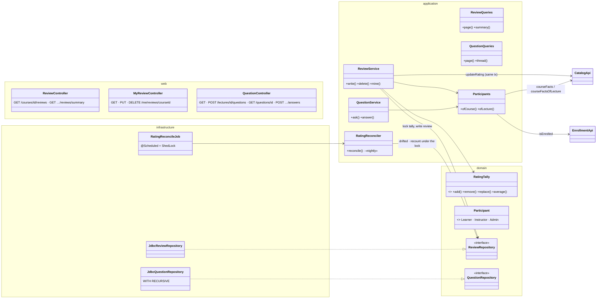
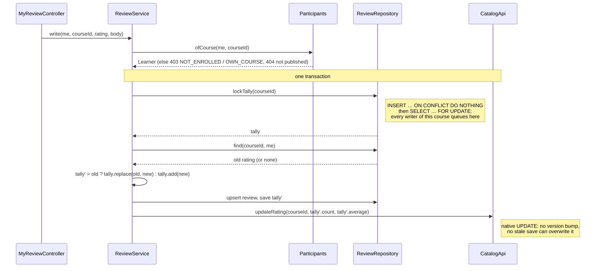

# Engagement — Low Level Design

> **One-liner:** learners rate and review the courses they take, and ask questions under a
> lecture. The rating shown on every catalog card stays **exact** under concurrent reviews,
> edits and deletions, and is repaired nightly if something writes around it.

**Module:** `backend/api/src/main/java/com/masternova/api/engagement` · **Status:** built (Phase 11: 11.1, 11.2, 11.5)
**Last updated:** 2026-10-21 · **Angular:** `frontend/src/app/features/catalog` (reviews on the
course page), `features/learn` (the lecture's Q&A panel)
**Pairs with:** [ADR-0023](../adr/0023-exact-rating-tally-pushed-in-the-review-transaction.md)
(the rating aggregate) · [`catalog.md`](catalog.md) §2 (the denormalised counters) ·
[`progress.md`](progress.md) (who is enrolled) · [API conventions §16](../api/conventions.md#16-reviews-and-qa)

## 1. Problem

A course card shows "4.6 ★ (1,204)" and the catalog sorts by it (`HIGHEST_RATED`, Phase 5).
The number comes from reviews: one per learner per course, editable, deletable. Learners also
want to ask "why does this command fail on Windows?" under the lecture they're watching and get
an answer from the instructor or another learner, with replies to replies.

## 2. Forces

- **A derived number that must be exact.** The average is read on every list page, so it is
  stored on `course` (catalog owns that row) instead of computed per request. Every review
  write, edit and delete must move it exactly once, including two concurrent first reviews of
  the same course and a learner double-submitting.
- **Writes that go around the code.** Deleting a user cascades their reviews (`ON DELETE
  CASCADE`) without any Java running. Somebody fixing data with SQL does the same. The stored
  number then drifts, silently, forever, unless something recounts.
- **Rounding drift.** `rating_average` is `NUMERIC(3,2)`. An average updated incrementally from
  the previous average (`(avg × n + r) / (n + 1)`) accumulates rounding error. The exact state
  has to be integers.
- **Who may speak.** Reviews and questions are for enrolled learners. An instructor can't review
  their own course, but must be able to answer questions on it.
- **Recursive data.** A thread is a tree (question → answers → replies). It has to be read in one
  query, in reading order, and bounded so one huge thread can't take a request down.
- **Paging while people post.** New questions arrive while someone pages down a lecture's list.

## 3. Domain model

| Type | Kind | Invariant |
|---|---|---|
| `Review` | row (`review`), one per `(course, user)` | `rating` 1–5 (DB `CHECK`); `body` ≤ 2,000 chars, may be empty (a rating alone); `author_name` is a snapshot of the display name at the last write (catalog LLD §3: the most-read query never calls identity) |
| `RatingTally` | value object (`record`) | five star counters, each ≥ 0. `count` and `sum` are **derived**, never stored, so they can't disagree with the stars. `add`, `remove`, `replace` return a new tally; the average is `sum / count` rounded HALF_UP to 2 places, 0 when empty |
| `course_rating` | row, one per reviewed course | the stored tally: the **serialisation point** of every review write for that course (§5) |
| `Question` | row (`question`), on a lecture | title 1–150, body ≤ 5,000; `answer_count` = its answers; `course_id` copied from the lecture at creation (the list and the access check need it, and a lecture never changes course) |
| `Answer` | row (`answer`), in a question | `depth` 1–3 (1 = answers the question, 2–3 = replies); a reply's parent is in the same question (composite FK) and `depth = parent.depth + 1` (checked on insert); **422 `REPLY_TOO_DEEP`** beyond 3 |
| `Participant` | sealed result of the access check | `Learner` (enrolled), `Instructor` (teaches it), `Admin`; anything else is 403 `NOT_ENROLLED` |

**Why a depth cap of 3.** A deeper tree is unreadable on a phone and is how a thread turns into
a chat. Udemy and Stack Overflow keep it at two levels. Three still allows "answer → follow-up
→ reply". It also bounds the recursive query.

## 4. Class design



**Module API:** none. Engagement is a leaf: it calls `CatalogApi` (facts, `updateRating`),
`EnrollmentApi.isEnrolled` (new in Phase 11; enrollment's first public type) and
`IdentityApi.displayName`. Nobody calls it.

**Repositories:** plain SQL behind interfaces in `domain/`, `JdbcClient` implementations in
`infrastructure/` (enrollment's choice): every write is a locking statement or an upsert whose
exact SQL is the point, and the thread read is a recursive CTE JPA can't express.

## 5. Main flows

**Writing a review** (create and edit are one `PUT`):



- ⭐ **The lock comes first.** Reading the old rating and *then* locking would let two
  concurrent first reviews by the same learner both see "no review" and count twice. With the
  tally row locked first, the second writer reads the first one's committed review and does a
  `replace`. Proven by `ReviewIT` (20 concurrent writes of different ratings by one learner →
  count 1, the tally equals the final row).
- **Catalog's number moves in the same transaction** (as `enrollment_count` does): a review that
  commits has moved the card's average; one that rolls back hasn't.
- **Delete** locks, removes the row, `tally.remove(old)`. Deleting a review you don't have is
  204 too (idempotent).

**Nightly reconciliation** (`RatingReconcileJob`, one replica, ~3 minutes after start, then every
24 h):

1. One query finds the drifted courses: the tally differs from a `GROUP BY` over `review`
   (including tallies whose reviews were all cascade-deleted).
2. Each one is repaired in its **own short transaction**: lock the tally row, recount *that
   course* (a fresh statement, so a review committed while we waited is counted), write, push to
   catalog.
3. Catalog's columns are compared with every tally (500 locked tallies per transaction, an
   `UPDATE … WHERE … IS DISTINCT FROM`), which repairs a course saved by a pre-Phase-11 pod with
   the average it had loaded (its entity still wrote the column).
4. A non-zero repair count is logged at WARN: something wrote around the code.

⭐ Recounting in step 1's snapshot and writing that would be wrong: a review committing between
the snapshot and the write would be erased by the "repair". The lock-then-recount in step 2 is
what makes the job safe to run while learners are reviewing.

**Q&A:** `POST /lectures/{id}/questions` and `POST /questions/{id}/answers` check the
participant, insert, and bump the question's `answer_count` / `last_activity_at` in the same
transaction. Both are creates without a version, so they take an `Idempotency-Key` (API
conventions §4): a retried post doesn't post twice. The thread read:

```sql
WITH RECURSIVE thread AS (
    SELECT a.*, ARRAY[a.created_at::text || a.id::text] AS path
    FROM answer a WHERE a.question_id = :q AND a.parent_id IS NULL
  UNION ALL
    SELECT c.*, t.path || (c.created_at::text || c.id::text)
    FROM answer c JOIN thread t ON c.parent_id = t.id
)
SELECT … FROM thread ORDER BY path LIMIT 501
```

`ORDER BY path` is depth-first reading order: each answer, then its replies, oldest first. The
501st row only says "truncated". The depth cap (3) bounds the recursion, so a corrupted parent
loop is impossible (the FK only points at an existing earlier row).

## 6. Patterns used

| Pattern | Class (`@DesignPattern` role) | The force that justified it | Catalog note |
| ------- | ----------------------------- | --------------------------- | ------------ |
| Value Object | `RatingTally` | the exact state is five integers; count, sum and average are derived, so they can't disagree | [Java 01](../../patterns/java/01-records-and-value-objects.md) |

**Not an Observer (ADR-0023).** The roadmap planned "reviews → an event → catalog's average".
That would put the card's number in a second transaction that can fail or lag, for a write that
is already inside a transaction catalog's API can join. The same-transaction call is what
`enrollment_count` does (Phase 10). Observer stays where the reader is really decoupled (the
worker's emails, enrollment following entitlement).

## 7. Alternatives rejected

| Option | Why not |
| ------ | ------- |
| `AVG(rating)` per request | runs on every catalog list page, for every card; and `HIGHEST_RATED` needs an indexed column to sort by (catalog LLD §9) |
| Incremental `(avg × n + r) / (n + 1)` on catalog's columns | `NUMERIC(3,2)` rounds at every step; after thousands of reviews the stored average is not the average. The tally keeps integers |
| `SELECT … FOR UPDATE` on the review row only | there is no row to lock before the first review; two concurrent first reviews both insert-or-update and both count |
| A trigger on `review` maintaining `course_rating` | correct, and survives cascades, but it hides a business rule in SQL no Java test exercises by name, and catalog's columns would need a cross-module trigger too |
| An `ltree` / materialised path column for threads | a write-time path is fast to read but has to be maintained; with ≤ 3 levels and ≤ 500 answers, the recursive CTE is a few index lookups per level |
| Questions and answers in one self-referencing table | the list query would filter `parent_id IS NULL` over every reply; titles and counters exist only on questions. Two tables keep both `CHECK`s honest |

## 8. Failure modes

| Failure | How it is detected | Behaviour | Recovery |
| ------- | ------------------ | --------- | -------- |
| A user is deleted (reviews cascade) | the nightly recount differs | the stored average is stale until the job runs | `RatingReconcileJob` repairs it, logs `WARN` |
| The catalog update fails | exception in the review transaction | the whole review rolls back: 500, nothing half-written | retry the `PUT` (idempotent) |
| Hot course: many reviews at once | lock wait on the tally row | writes for that course queue (each holds the lock for ~2 statements) | none needed below ~100 reviews/s per course; beyond that, buffer like progress (ADR-0022) |
| A thread with > 500 answers | the 501st row | `truncated: true`, the first 500 in reading order | paging a single thread is out of scope (§11) |
| A double-clicked "Post" | same `Idempotency-Key` | the stored 201 again, one row | — |

## 9. Data & indexes

`V25__engagement_review.sql`: `review` (`UNIQUE (course_id, user_id)` = "one each" and the learner's
lookup; `(course_id, created_at DESC, id DESC)` = the newest-first keyset page), `course_rating`
(PK `course_id`); `V26__engagement_qa.sql`: `question` (`(lecture_id, created_at DESC, id DESC)` = the lecture's page),
`answer` (`(question_id, parent_id)` = each level of the recursive CTE; `UNIQUE (question_id, id)`
for the composite FK that keeps a reply in its parent's question). All FKs to `course`,
`lecture` and `app_user` are `ON DELETE CASCADE`: a deleted course takes its engagement with it.

Transactions: one per review write (lock → write → catalog), one per post. The reconciler opens
one per repaired course, never one for the whole run.

## 10. Tests that prove it

- `RatingTallyTest`: add/remove/replace laws, the average rounds HALF_UP, empty = 0, no counter
  below 0.
- `ReviewIT`: create → edit → delete moves the tally and catalog's columns exactly; **20 concurrent
  `PUT`s by one learner → count 1**; 10 learners concurrently → count 10, sum exact; not enrolled →
  403; the instructor → 403 `OWN_COURSE`; a draft → 404; newest-first pages and the summary,
  public. Mutation-checked: reading the old rating before taking the lock fails the 20-writer test
  (10 reviews counted for one learner).
- `RatingReconcileIT`: cascade-deleting a user → drift found → repaired, catalog updated; a stale
  catalog summary (a pre-Phase-11 pod's save) repaired; a review committed while the job waits on
  the lock is kept.
- `QuestionIT`: keyset pages with no duplicates while new questions arrive; the thread in reading
  order; depth 4 → 422; an answer from the instructor is flagged; not enrolled → 403; a retried
  post with the same key → one row.

## 11. Interview notes — 60-second recall

Reviews feed a number every catalog card shows, so it's stored, and a stored derived number must
be exact. The exact state is **five integer counters** (`RatingTally`); average and count are
derived. Every review write **locks the course's tally row first**, then reads the old rating, so
concurrent writes, double-submits and edits serialise and each moves the tally once. Catalog's
column is updated in the **same transaction** through its API. What writes *around* the code
(a cascade from a deleted user) is caught by a nightly job that finds drift with one `GROUP BY`
and repairs each course under the same lock, re-counting *after* the lock so it can't erase a
review committed meanwhile. Q&A is a depth-capped tree read with one `WITH RECURSIVE` ordered by a
path array.
