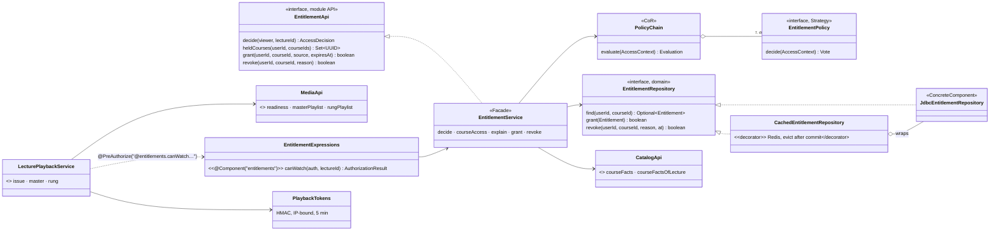
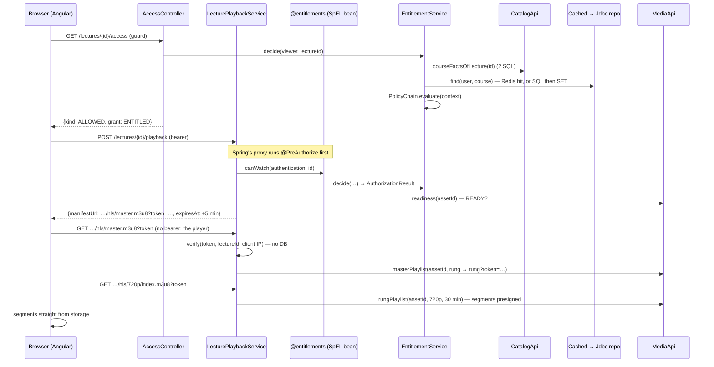
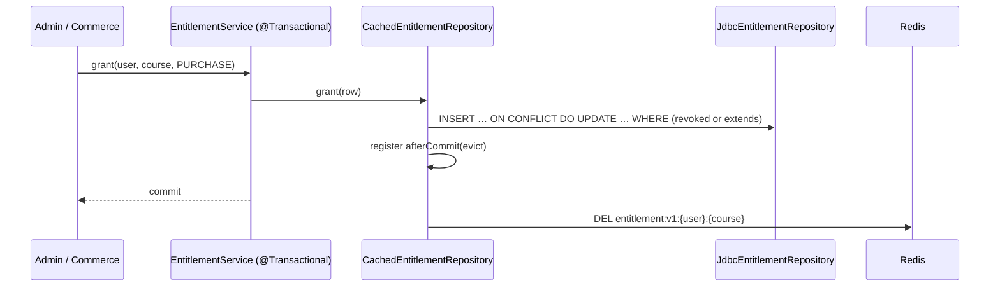

# Entitlement engine — Low Level Design

> **One-liner:** decide whether **this viewer may play this lecture**, correctly (an explicit
> denial always wins, everything fails shut), fast (one cached row lookup, the rest fetched once)
> and explainably (every denial carries a stable reason, and an admin can see every policy's
> vote). Then hand the player a short playback token bound to that user, that lecture and that IP.

**Module:** `backend/api/src/main/java/com/masternova/api/entitlement` · **Status:** built (Phase 8: 8.1–8.7)
**Last updated:** 2026-10-14 · **Angular:** `frontend/src/app/features/learn` (player + guard),
`features/catalog/access-cta` + `curriculum` (call to action, locks) · note: [`patterns/angular/07`](../../patterns/angular/07-access-ui-and-discriminated-unions.md)
**Pairs with:** [ADR-0016](../adr/0016-cache-the-entitlement-row-not-the-decision.md) (cache) ·
[ADR-0017](../adr/0017-short-ip-bound-playback-token.md) (playback token) ·
[ADR-0013](../adr/0013-hls-for-playback.md) (HLS) · [`media.md`](media.md) §4 (the ticket this
replaces for learners) · [API conventions §10–11](../api/conventions.md#10-denials-carry-a-reason)

## 1. Problem

A learner opens a lecture. Somebody has to answer "may they watch it?", and the answer has many
reasons behind it, which keep growing:

- an **admin** may watch anything; the course's **instructor** may watch their own course, even
  as a draft;
- anyone may watch a **free** course or a **preview** lecture;
- a learner who **bought** the course may watch it, until the entitlement **expires**;
- a **refunded** learner may not, even if the course is later made free;
- nobody but its instructor may watch an **unpublished** course.

Phase 9 (commerce) and Phase 10 (enrollment) add the writers: a purchase grants, a refund
revokes. Next quarter someone adds coupons or subscriptions. Each new reason must not be able to
silently override an old one.

Then the answer must reach a `<video>` that can't send our `Authorization` header (ADR-0013), so
it travels as a token in the playlist URL. That URL must not be worth sharing.

## 2. Forces

- **Multiple actors, many independent rules:** seven reasons today, written by different people
  over time. Whoever adds the eighth won't read the other seven.
- **Security, fail-closed:** a bug (an empty rule list, a rule that throws, an unexpected case)
  must deny, never grant. The opposite default turns one bad refactor into free access to every
  paid course.
- **Read-heavy, write-rare:** the decision runs on every course page and every playback; the
  entitlement row changes about twice in its life (bought, maybe refunded).
- **Inputs owned by other modules:** price, publish status and the preview flag are catalog's;
  the row is ours. A cache of the *decision* would need invalidating from catalog's writes.
- **Retries:** grants arrive from payment webhooks (Phase 9), which redeliver. A grant must be
  idempotent; 50 concurrent copies → one row.
- **A client that can't send headers:** native HLS fetches playlists itself (ADR-0013), so the
  credential is in the URL, where it leaks into history, logs and screenshots.
- **The UI needs reasons, not booleans:** "buy", "renew", "contact support" and "no longer
  available" are four different buttons (API conventions §10).

## 3. Domain model

| Type | Kind | Invariant |
|---|---|---|
| `Entitlement` (`entitlement`) | value object (record), one row per `(user, course)` | `status(now)` is exactly one of `ACTIVE`, `EXPIRED` (`expires_at ≤ now`), `REVOKED` (`revoked_at` set; wins over expiry). A grant never shortens an active one. |
| `EntitlementSource` | enum, module API | `PURCHASE` (Phase 9) · `FREE_ENROLLMENT` (Phase 10) · `ADMIN_GRANT` |
| `AccessContext` | value object (record) | everything a policy may look at, fetched **once** before any policy runs: the viewer (`userId?`, `admin`), `CourseFacts` (from catalog), the lecture (or none: the course-wide question), the entitlement row (or none), `now`. Policies can't query. |
| `Vote` | sealed: `Allow(AccessGrant)` · `Deny(DenialReason)` · `Abstain` | what one policy says. `Abstain` is "not my business": *this lecture is not a preview* is no reason to deny. |
| `AccessDecision` | sealed: `Allowed(AccessGrant)` · `Denied(DenialReason)`, module API | the reduced answer. No third state: the chain always decides. |
| `AccessGrant` | enum, module API | `ADMIN` · `OWNER` · `FREE_COURSE` · `PREVIEW_LECTURE` · `ENTITLED` |
| `DenialReason` | enum, module API | `NO_ENTITLEMENT` · `ENTITLEMENT_EXPIRED` · `ENTITLEMENT_REVOKED` · `COURSE_NOT_PUBLISHED` · `ACCESS_CHECK_FAILED` (a policy threw) |
| `PlaybackToken` | value object, signed | `lectureId · assetId · userId · expiresAt`, HMAC-SHA256 over the payload **and the client IP** (the IP is signed, never carried: ADR-0017). Lives 5 minutes. |

**The reduction** (no short-circuit, ADR-free because it's the pattern's point, §6):

1. Run **every** policy, in `@Order`. A policy that throws counts as `Deny(ACCESS_CHECK_FAILED)`.
2. Any `Deny` → `Denied(the first Deny's reason)`. **Explicit denial always wins.**
3. Else any `Allow` → `Allowed(the first Allow's reason)`.
4. Else (all abstained, or no policies at all) → `Denied(fallback)`: `ENTITLEMENT_EXPIRED` if the
   viewer's row is expired, otherwise `NO_ENTITLEMENT`. **Closed by default.**

`@Order` never changes *whether* access is granted, only *which* reason is reported when several
policies agree. `PolicyChainTest` proves it by running the same policies in both orders, and
`PolicyMatrixTest` runs every row of the decision table through the chain reversed. That's why
the personal reason (revoked, 30) comes before the general one (not published, 40): a refunded
learner on an archived course reads "your access was withdrawn", which is the truer story.

**The seven policies:**

| `@Order` | Policy | Votes |
|---|---|---|
| 10 | `AdminPolicy` | `Allow(ADMIN)` for an admin |
| 20 | `OwnerPolicy` | `Allow(OWNER)` for the course's instructor |
| 30 | `RevokedEntitlementPolicy` | `Deny(ENTITLEMENT_REVOKED)` for a non-staff viewer whose row is revoked: a refund beats a preview lecture and a course made free later |
| 40 | `PublishedCoursePolicy` | `Deny(COURSE_NOT_PUBLISHED)` for a non-staff viewer of a course that isn't on sale (draft, in review, archived) **unless they hold an active entitlement**: people who paid keep a course its instructor unpublished to edit, or retired |
| 50 | `FreeCoursePolicy` | `Allow(FREE_COURSE)` if the price is 0 **and was set** (`priceSet`: 0 also means "not priced yet") |
| 60 | `PreviewLecturePolicy` | `Allow(PREVIEW_LECTURE)` for a preview lecture |
| 70 | `ActiveEntitlementPolicy` | `Allow(ENTITLED)` if the row is `ACTIVE` at `now` |

The two `Deny` policies must **scope themselves** (that is the price of "deny wins"): without it,
"course not published" would lock the instructor out of their own draft. Both ask the same
predicate, `AccessContext.isStaff()` (admin or owner), written once.

## 4. Class design

**Module API** (`com.masternova.api.entitlement`): `EntitlementApi`, `AccessDecision`,
`AccessGrant`, `DenialReason`, `EntitlementSource`. Phase 9 calls `grant`/`revoke`, and
`heldCourses` (added in 9.2: which of a cart's courses the buyer holds ACTIVE, one cached lookup each); any module
can guard a method with `@PreAuthorize("@entitlements.canWatch(authentication, #lectureId)")`.

**What the module needs from others** (each a public API, never a table):

- **catalog** gains its first module API, `CatalogApi`, returning `CourseFacts`: instructor,
  availability (`UNPUBLISHED` / `PUBLISHED` / `ARCHIVED`), price, `priceSet`, and each lecture's
  `(id, preview, assetId)`. Two statements whatever the curriculum size.
- **media** exposes the playlist rewriting it already does for the owner's preview
  (`masterPlaylist`, `rungPlaylist`), so the lecture routes reuse it instead of copying it.
- **identity**: `CurrentUser` (who is calling).

**Layering:** policies and the chain are in `domain/` (plain Java, unit-tested without Spring);
`@Component @Order` is the only Spring they carry. The Redis decorator, the JDBC repository and the
SpEL bean are in `infrastructure/`.

## 5. Main flow

**Learner opens a lecture** (the player route's guard, then playback):

**The interesting failure paths:**

- **Denied:** `@PreAuthorize` gets an `EntitlementAuthorization` (an `AuthorizationDecision`
  that carries the `DenialReason`) and throws `AuthorizationDeniedException`; the platform's
  handler reads the reason through a platform interface and answers 403 `FORBIDDEN` with
  `reason: NO_ENTITLEMENT` (etc.). The SPA maps the reason to a button.
- **Token expired mid-watch** (an ABR switch 40 minutes in fetches a new rung playlist): 403
  `PLAYBACK_TOKEN_INVALID`. The player asks for a new token (which **re-runs the decision**: a
  refund now takes effect) and reloads at the same position (ADR-0017).
- **Revoked:** the next decision denies. Redis is evicted after the revoke commits; the TTL is
  the backstop if the eviction is lost.

**Grant / revoke** (admin endpoints now; commerce in Phase 9):

## 6. Patterns used

| Pattern | Class (`@DesignPattern` role) | The force that justified it | Catalog note |
|---|---|---|---|
| Chain of Responsibility | `PolicyChain` (Chain), each policy a Handler | seven independent rules that grow; any may decide; adding one is a new class, no edit. Variant: **no short-circuit, deny wins** | [03](../../patterns/docs/03-chain-of-responsibility.md) |
| Strategy | `EntitlementPolicy` (Strategy) + 7 ConcreteStrategies | each rule is an interchangeable algorithm over the same context; the chain composes them | [01](../../patterns/docs/01-strategy.md) |
| Decorator | `CachedEntitlementRepository` (Decorator) over `JdbcEntitlementRepository` (ConcreteComponent) | read-heavy, write-rare row; the JDBC class must not know it's cached (its IT tests SQL, the cache's unit test tests invalidation) | [13](../../patterns/docs/13-decorator.md) |
| Facade | `EntitlementService` (Facade) | callers (controllers, the SpEL bean, commerce) need one entry point over context-building, the chain, the cache and the transaction | [14](../../patterns/docs/14-facade.md) |
| Proxy (Spring's) | `LecturePlaybackService` (RealSubject) | the access check must run before any playback method, and stay out of its body; `@PreAuthorize` is a generated proxy | [15](../../patterns/docs/15-proxy.md) |

**Not a pattern, on purpose:** the `isStaff()` predicate is a method on `AccessContext`, not a
Specification class. Two callers, one line, no composition: a class would be ceremony.

## 7. Alternatives rejected

| Option | Why not |
|---|---|
| **First-match-wins chain** (textbook CoR) | The answer depends on list order: put "preview lecture → allow" above "refunded → deny" and refunds stop working, silently. With deny-wins, order only picks which reason is shown. |
| **Boolean policies** (`boolean canWatch`) | No `Abstain`: "not a preview" would have to mean deny (blocks the buyer) or allow (opens the course). And no reason for the UI. |
| **A `next` pointer per handler** | No handler here may stop the chain, so the linked list would be ceremony. A plain `List<EntitlementPolicy>` injected in `@Order` is the chain. |
| **Policies that query** | Each rule fetching its own data is an N+1 that grows with the number of rules. The context is built once. |
| **Cache the decision** | ADR-0016. It depends on price, publish status and preview flags, which catalog writes. |
| **Spring's `@Cacheable`** | ADR-0016. It works (with `TransactionAwareCacheDecorator` and a `CacheErrorHandler`), but the cache would be annotations on the JDBC repository, which should not know it is cached. |
| **6-hour asset ticket (Phase 7) for learners too** | ADR-0017. A revoked learner would keep a working link for 6 h; nothing ties it to a person's network. |
| **IP in the token payload** | ADR-0017. A personal IP in every playlist URL, in access logs and screenshots. It is signed, not carried. |
| **`@PreAuthorize` returning `boolean`** | Loses the reason: every denial would be the same `INSUFFICIENT_ROLE`. Spring Security 6.3+ lets the expression return an `AuthorizationResult`, and the exception carries it. |

## 8. Failure modes

| Failure | How it is detected | Behaviour | Recovery |
|---|---|---|---|
| A policy throws | `PolicyChain` catches `RuntimeException` | that policy votes `Deny(ACCESS_CHECK_FAILED)`, logged with the policy's name; the request is a 403, not a 500 | fix the policy |
| No policies wired | the chain is empty | everything `Denied(NO_ENTITLEMENT)` | `PolicyChainTest` and the matrix IT fail first |
| Redis down or slow | `RedisConnectionFailureException` / command timeout (500 ms) | `entitlement.cache{result=error}` counter; falls through to Postgres. A failed eviction does not fail the grant or revoke | none needed; the TTL (5 min) removes anything left |
| Read-old / evict / write-old race | not detected | a reader that loaded the old row before the commit can write it back after the eviction, for one TTL | TTL backstop; accepted (ADR-0016) |
| Token replayed from another network | IP in the MAC differs | 403 `PLAYBACK_TOKEN_INVALID` | the player re-tickets with its bearer |
| Learner's IP changes (Wi-Fi → mobile) | same | 403, the player re-tickets once and continues | automatic |
| Lecture has no video / not READY | `MediaApi.readiness` | 409 `MEDIA_NOT_READY` | the instructor finishes the upload |
| Duplicate grant (webhook redelivery) | `ON CONFLICT … WHERE` matches nothing | no change, `grant` returns `false` | none needed |
| Late copy of the original purchase **after a refund** | not detectable here: a grant after a revoke is a re-purchase | access restored | the caller dedupes the provider's event id first (Phase 9.6, claim-before-process); `EntitlementApi.grant` says so |
| Direct client forging `X-Forwarded-For` | Tomcat trusts 172.16/12 (the Docker gateway) | would defeat the IP binding | the api port is published on loopback only (`127.0.0.1:8080`); in Kubernetes only the ingress reaches the pod (D4) |
| Two catalog reads per ticket | `@PreAuthorize` decides, then `issue` finds the asset | 2 extra statements per `POST /playback` | accepted: one ticket per viewer per 5 minutes |

## 9. Data & indexes

`V17__entitlement.sql`:

- `entitlement(user_id → app_user, course_id → course, source, granted_at, expires_at?,
  revoked_at?, revoke_reason?)`, **primary key `(user_id, course_id)`**: the one hot lookup is a
  PK hit, and it's what makes the grant upsert idempotent under concurrency.
- index on `course_id` (the FK, and "who has this course" for Phase 10).
- CHECK on `source`.

`@Transactional` only on `EntitlementService` (`grant`, `revoke`; `decide` is read-only). The
playlist routes open no transaction and run no SQL (token only).

## 10. Tests that prove it

- **Unit (no Spring, no DB):**
  - `PolicyChainTest`: deny wins in **both orders**, order only names the reason, closed by
    default (all-abstain and an empty chain), an expired row turns the fallback into
    `ENTITLEMENT_EXPIRED`, a throwing or `null`-returning policy is `ACCESS_CHECK_FAILED` while
    the others' votes are kept.
  - `PolicyMatrixTest` ⭐: the **decision table as data**, 28 named rows (viewer × course state ×
    lecture × row), through the seven real policies sorted by `AnnotationAwareOrderComparator`
    exactly as Spring injects them; every row again through the chain **reversed** (same
    verdict); and the order itself pinned to §3's table.
  - `PoliciesTest`: each rule alone, including that both deny rules scope themselves.
  - `EntitlementTest`: status at a time; revoked wins over expired.
  - `CachedEntitlementRepositoryTest`: hit, cached negative, `Instant`s survive JSON (the NestJS
    bug), eviction only **after commit** and not on rollback, Redis down → database, unreadable
    value dropped.
  - `PlaybackTokensTest` + kernel `SignedTokensTest`: bound to lecture, IP and expiry; the IP is
    signed and never carried; old unbound tokens unchanged.
  - `EntitlementExpressionsTest`: the `@PreAuthorize` hook in a tiny context; the denial's reason
    survives Spring's proxy, and the method body never runs.
- **Testcontainers `*IT`:**
  - `JdbcEntitlementRepositoryIT`: the SQL alone; never-shorten rule; revoke once; re-grant
    after a refund; ⭐ **50 concurrent copies of one grant → 1 row, exactly one `true`**.
  - `EntitlementCacheIT` ⭐: on real Redis: the row (not the decision) is cached with a TTL ≤ 5
    min; grant and revoke evict at commit; a rolled-back grant evicts nothing; inside a longer
    transaction the key survives until the commit; a write behind the cache's back stays stale
    (why every writer is a repository method).
  - `EntitlementAccessIT`: the facade over HTTP: anonymous locks, grant → open, revoke → closed
    *including the preview*, drafts, free vs unpriced, the admin's explanation, 403/404/400s.
  - `LecturePlaybackIT`: token → master → rung → a presigned segment from SeaweedFS with no
    bearer; another IP or another lecture → 403; `NO_ENTITLEMENT` from the chain through
    `@PreAuthorize` into the 403; a refund stops the next ticket; 409 for unfinished or text
    lectures.
- **Angular:** `EntitlementApi` spec; `canWatchGuard` (allowed, denied with `?locked=`, unknown);
  `AccessCta` (each reason → its button); `Curriculum` (open videos link, locks); `CourseDetail`
  (chained access request, CTA, banner, a forged `?locked=` ignored); `LecturePlayer` (plays,
  re-tickets and resumes at the same second, no loop inside the grace window, a real denial
  shown); `HlsPlayer` (reload on a new `src` at `startAt` on the same `<video>`).

## 11. Interview notes — 60-second recall

**Problem:** seven reasons decide whether someone may play a lecture (admin, owner, free, preview,
bought, unpublished, refunded), and more are coming. The answer must be right, fast, explainable,
and reach a `<video>` that can't send headers.

**Decisions that mattered:**

1. **Chain of Responsibility without short-circuit.** Every policy votes Allow / Deny / Abstain;
   **any deny wins**, nobody allowing is a deny, a throwing policy is a deny. Order only names the
   reason, so a rule added next quarter can't defeat a refund. Deny rules scope themselves with
   one `isStaff()`.
2. **Cache the row, not the decision** (Decorator over the JDBC repository): the row has three
   writers, all on the decorated interface; the decision depends on catalog's data. Negatives
   cached, eviction **after commit**, Redis failures fall through to Postgres, TTL as backstop.
3. **Facade** `EntitlementService`: facts and the row fetched once, sequence + transaction, no
   rules. It plugs into Spring Security as `@PreAuthorize("@entitlements.canWatch(…)")`, which
   returns an `AuthorizationResult` so the 403 keeps its **reason**.
4. **5-minute playback token bound to user + lecture + IP**, the IP signed but not carried; the
   playlists check only the token (no DB); the player **re-tickets** on a 403 and resumes, which
   re-runs the decision. That's how a refund reaches a viewer mid-lecture.

**The numbers:** 28-row decision table, verdict identical with the chain reversed; 50 concurrent
grants → 1 row; one Redis `GET` per signed-in decision, none for anonymous; a playlist request
is one HMAC and one storage read.
