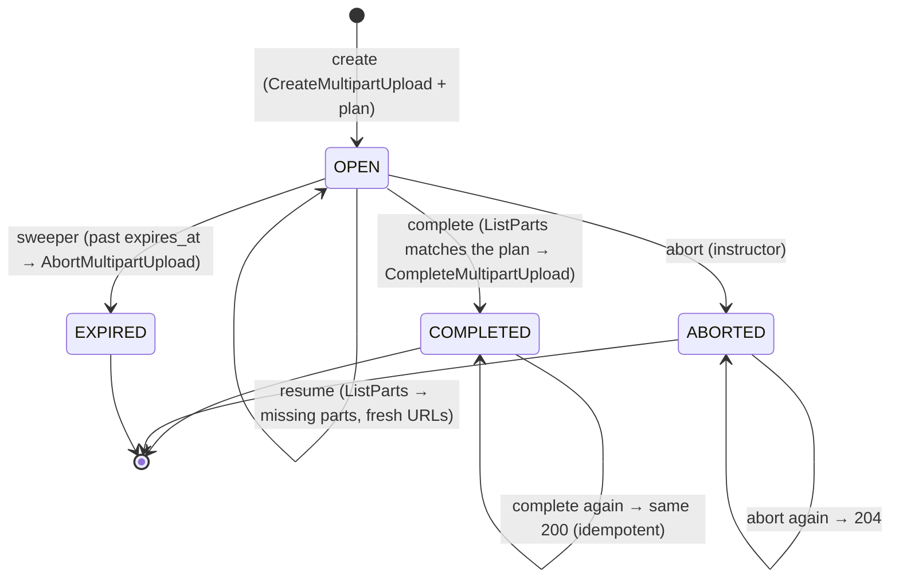
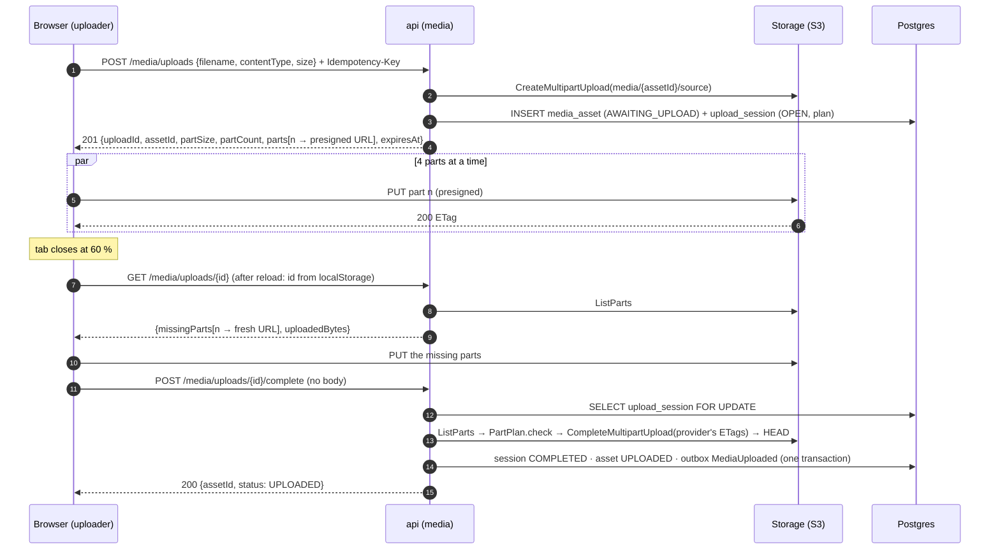
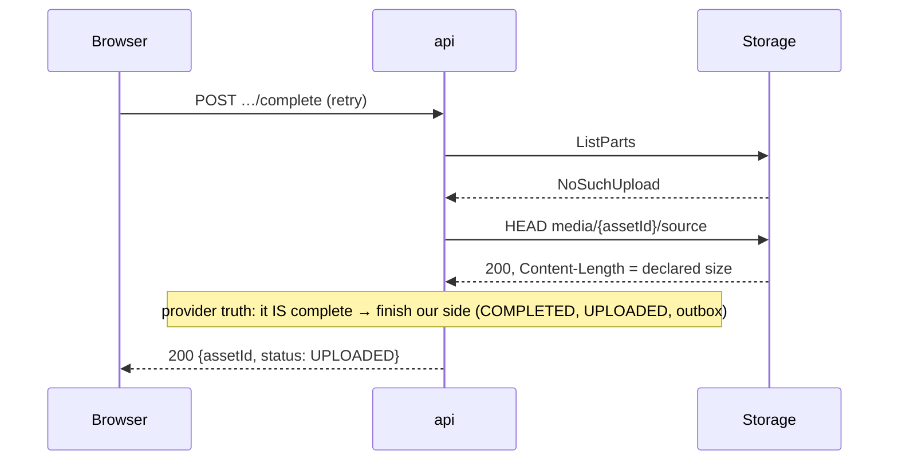

# Media — Low Level Design

> **One-liner:** get an instructor's 10 GiB video **from the browser into storage, resumably,
> without the bytes touching the api**, then hand learners short-lived URLs to the HLS output,
> with the storage provider (not our database) deciding what was uploaded.

**Module:** `backend/api/src/main/java/com/masternova/api/media` · shared storage library
`backend/storage` · **Status:** built: storage (7.2), uploads (7.3), progress (7.7), catalog link + uploader (7.8), playback (7.9) · **Last updated:** 2026-10-13
**Angular:** `frontend/src/app/features/instructor/upload` (7.8), `shared/hls-player` (7.9)
**Pairs with:** [`video-pipeline.md`](video-pipeline.md) (what happens after the upload) ·
[ADR-0012](../adr/0012-seaweedfs-as-local-s3.md) (local S3) · [ADR-0013](../adr/0013-hls-for-playback.md) (HLS) ·
[ADR-0014](../adr/0014-upload-progress-from-the-provider.md) (the provider is the source of truth)

## 1. Problem

An instructor attaches a video to a lecture. The file is 200 MB to 10 GiB, recorded on a laptop,
uploaded over home broadband. Three things go wrong with a naive `POST /upload`:

1. **The bytes go through the api.** 10 GiB ties up a request thread and the api's bandwidth
   for an hour, and a deploy mid-upload kills it.
2. **Any interruption restarts it from zero.** The laptop sleeps at 80 %, the tab reloads, the
   Wi-Fi drops, and the instructor gives up.
3. **Nobody knows what actually arrived.** The client says "done", the server believes it, and a
   part is missing, so transcoding fails an hour later with a confusing error.

On the way out, a paid lecture must not become one permanent, shareable URL.

## 2. Forces

- **Large payloads:** they go browser → storage directly (presigned multipart), never through the
  api.
- **An external system we don't control:** storage can be slow, down, or say "no such upload"
  after it has actually completed one.
- **Partial failure over hours:** a part PUT fails, a URL expires, the tab reloads.
- **Retries:** "complete" gets double-clicked, retried by the browser after a timeout, and raced
  by the orphan sweeper.
- **Two deployables, one bucket:** the api presigns and completes; the worker reads the source
  and writes renditions. Both must agree on the **key layout**: it's how a crashed job's rerun
  overwrites instead of duplicating (7.10).
- **Untrusted client:** the server checks what storage holds, not what the browser claims.
- **Access control on playback** arrives in Phase 8. Phase 7 needs the point where it will plug
  in.

## 3. Domain model

| Type | Kind | Invariant |
|---|---|---|
| `MediaAsset` (`media_asset`) | `@Entity`, aggregate root | owned by one user (`owner_id`); status only moves forward: `AWAITING_UPLOAD → UPLOADED → PROCESSING → READY \| FAILED` (and `FAILED → PROCESSING` only through an admin replay). `duration_seconds`, `width`, `height` are known only from `PROCESSING` on (the worker's probe). |
| `UploadSession` (`upload_session`) | `@Entity`, one per asset | a sealed `UploadState` (State pattern, 7.3). It stores the **plan**, never the uploaded parts (ADR-0014). `expires_at` is fixed at creation. |
| `PartPlan` | value object (record) | `1 ≤ partCount ≤ 100`; `partSize ≥ 5 MiB` (S3's minimum for all but the last part), a whole number of MiB; `partSize × (partCount − 1) < size ≤ partSize × partCount`. The **≤ 100** keeps the create response to one batch of URLs and `ListParts` to one page. |
| `StoredPart` | value object (record) | what the provider says it holds: `(number, size, etag)` |
| `MediaKeys` | static key layout, in `backend/storage` | `media/{assetId}/source` · `media/{assetId}/hls/master.m3u8` · `…/hls/{rung}/index.m3u8 · init.mp4 · seg_NNNNN.m4s` · `…/poster.jpg` · `…/sprite.jpg` + `sprite.vtt`. **Deterministic**: computed from ids, never stored, and never random. |

**Upload session states** (each event's answer depends on the state; replays are answered, not
re-done):



| Event \ state | `OPEN` | `COMPLETED` | `ABORTED` | `EXPIRED` |
|---|---|---|---|---|
| resume | missing parts + URLs | 409 `UPLOAD_ALREADY_COMPLETED` | 409 `UPLOAD_ABORTED` | 409 `UPLOAD_EXPIRED` |
| complete | check plan → `COMPLETED` (or 422 `UPLOAD_INCOMPLETE`) | **200, same body** | 409 `UPLOAD_ABORTED` | 409 `UPLOAD_EXPIRED` |
| abort | `ABORTED` | 409 `UPLOAD_ALREADY_COMPLETED` | **204** | **204** |
| expire (sweeper) | `EXPIRED` | no-op | no-op | no-op |

**Part plan:** `partSize = max(5 MiB, roundUpToMiB(ceil(size / 100)))`. So 200 MB → 39 × 5 MiB,
500 MiB → 100 × 5 MiB, 500 MiB + 1 B → 84 × 6 MiB, and 10 GiB → 100 × 103 MiB (`PartPlanTest`).
Limits: `size ≤ 10 GiB` (else 422 `UPLOAD_TOO_LARGE`); the content type must be in an allowlist
(`video/mp4`, `video/quicktime`, `video/webm`, `video/x-matroska`; else 422
`UNSUPPORTED_MEDIA_TYPE`).

> **Built differently from the 7.1 draft:** expired is **409**, not 410, and a disallowed type is
> **422**, not 415. The platform's error kinds are a sealed set (`DomainException`): an expired
> session is a state conflict, and the declared type lives in the JSON body, so it's a rule
> violation. HTTP 415 is about the *request's* `Content-Type`. Storage being down is the one new
> status: 503 `STORAGE_UNAVAILABLE` with `Retry-After`, from `StorageExceptionHandler`. The **real** container is checked by the worker's probe; the
declared type is only a first filter.

## 4. Class design

```mermaid
classDiagram
  direction LR
  class MediaApi {
    <<interface, public module API>>
    +readiness(Collection~UUID~ assetIds) Map~UUID, AssetReadiness~
    +isOwnedBy(UUID assetId, UUID userId) boolean
  }
  class AssetReadiness { <<record>> status; durationSeconds }
  class UploadController { <<web>> POST /media/uploads · GET /{id} · POST /{id}/complete · DELETE /{id} }
  class PlaybackController { <<web>> POST /media/assets/{id}/playback · GET …/hls/** }
  class UploadService { <<application>> create · resume · complete · abort }
  class PlaybackService { <<application>> ticket · rewrite playlist }
  class UploadSession { <<entity>> -UploadState state; -PartPlan plan }
  class UploadState { <<sealed interface, State>> resume() complete() abort() expire() }
  class PartPlan { <<record>> +forSize(long) +check(List~StoredPart~) List~PartProblem~ }
  class MediaAsset { <<entity>> markUploaded() }
  class ObjectStorage { <<backend/storage, Adapter>> createMultipart · presignPart · listParts · complete · abort · head · presignGet · put · listMultipartUploads }
  class MediaKeys { <<backend/storage>> source(id) · master(id) · rung(id, rung) }
  class S3Client { <<AWS SDK v2>> }
  class OutboxWriter { <<messaging>> }

  UploadController --> UploadService
  PlaybackController --> PlaybackService
  UploadService --> UploadSession
  UploadService --> MediaAsset
  UploadService --> ObjectStorage
  UploadService --> OutboxWriter : MediaUploaded
  UploadSession --> UploadState
  UploadSession --> PartPlan
  PlaybackService --> ObjectStorage
  ObjectStorage --> S3Client
  ObjectStorage ..> MediaKeys
  class MediaQueries { <<application>> }
  MediaApi <|.. MediaQueries
```

**Module API** (what catalog may use): `MediaApi` + `AssetReadiness`. Built in 7.8:

- `CurriculumService` calls `isOwnedBy(asset, course's instructor)` before an `ATTACH_MEDIA`
  command; someone else's asset → 400 `UNKNOWN_ASSET`, even when an admin does the attaching.
- `CourseLifecycleService` calls `readiness(course.videoAssetIds())` on the gated edges (submit,
  publish) and for the checklist. It passes the READY set into the **still pure**
  `PublishGate.evaluate(course, readyAssets)` (`MEDIA_NOT_READY`: every `VIDEO` lecture has a
  READY asset), and `Course.adoptMediaDurations` replaces the instructor's estimates with the
  probed lengths. **No events go from media to catalog:** catalog asks when it decides, so there's
no copy of the status to keep in sync.

**Event** `MediaUploaded(assetId, sourceKey, sizeBytes)` goes into the **outbox**, in the
complete transaction. The worker's relay delivers it to the pipeline (video-pipeline.md §5).
The api has no relay (ADR-0008), so media→worker is an outbox event and worker→media is a
conditional `UPDATE` of `media_asset.status` (§9).

**`backend/storage`**: a Spring-aware library module like `messaging`
([ADR-0008](../adr/0008-shared-messaging-module.md)'s reasoning: two deployables, one contract).
It holds:

- `ObjectStorage`, a concrete class: one implementation, so no interface;
- `MediaKeys`;
- `StorageProperties` (`masternova.storage.endpoint|region|bucket|path-style|access-key|secret-key`);
- auto-configuration for the `S3Client` and `S3Presigner`.

The **Adapter** force (7.2): the rest of the code never sees an SDK type. `ObjectStorage` returns
`StoredPart`/`StoredObject` and translates `S3Exception`s into our own:

| Exception | Meaning | Becomes |
|---|---|---|
| `StorageUnavailableException` | temporary | 503 / job retry |
| `NoSuchUploadException` | the provider forgot the upload id | §8 |
| `StorageException` | permanent | — |

That is the same contract shape as `MailProvider`'s permanent/temporary split.

**Playback** (ADR-0013):

1. `POST /media/assets/{id}/playback` (authenticated; owner or admin in Phase 7, the
   **entitlement check plugs in here** in Phase 8) returns `{ masterUrl, expiresAt }`. `masterUrl`
   is `/api/v1/media/assets/{id}/hls/master.m3u8?t=<ticket>`.
2. The ticket is an HMAC over `(assetId, userId, exp)`, valid 6 h. It's a URL token because
   **native Safari HLS can't send an `Authorization` header**.
3. The playlist endpoints accept the ticket instead of a bearer. They rewrite every segment and
   `EXT-X-MAP` URI to a presigned GET, and rung URIs to ticketed api URLs.
4. Segments themselves come straight from storage.

## 5. Main flows

**Upload, interrupted and resumed:**



**Complete, when the provider already finished it** (we crashed after S3's complete, before our
commit, and the browser retries):



If the `HEAD` is 404, the upload is really gone (aborted or swept). The client gets 409
`UPLOAD_EXPIRED` and starts a new upload; the row itself is marked `EXPIRED` by the sweeper (7.6).
A throw rolls the transaction back, so the complete request can't record it. **Resume** in the
same situation (`NoSuchUpload`) returns *no missing parts* and writes nothing: a `GET` changes no
state. The uploader then calls complete, which decides.

## 6. Patterns used

| Pattern | Class (`@DesignPattern` role) | The force that justified it | Catalog note |
|---|---|---|---|
| **State** | `UploadState` (State), `Open`/`Completed`/`Aborted`/`Expired` (ConcreteState), `UploadSession` (Context) | Four events × four states, where **replays must be answered, not re-done** (complete twice → same 200; the sweeper racing the user). An enum + `switch` per method would scatter the table above across four methods. | row 2 (7.3) |
| **Adapter** | `ObjectStorage` (Adapter) over `S3Client`/`S3Presigner` (Adaptee) | The SDK's types and exceptions stay out of media and the pipeline; the two exception kinds drive 503 vs retry. **No interface:** there's one implementation. Testcontainers runs the real S3 API (SeaweedFS), so there's no fake to swap in. | row 12 (7.2) |
| **Value Object** | `PartPlan`, `StoredPart` | The plan arithmetic (5 MiB minimum, ≤ 100 parts, last-part remainder) and the plan-vs-provider check are pure functions, unit-tested at the boundaries. | row 18 |

Not used, on purpose: no `StorageProvider` interface (one implementation, see CLAUDE.md §0); no
Strategy for "upload kinds" (there is one kind, VIDEO; images for course covers go through the
same session when they arrive).

## 7. Alternatives rejected

| Option | Why not |
|---|---|
| Track parts in an `upload_part` table | ADR-0014: a second copy of what S3 knows, and it can be lost between the PUT and the report |
| Client sends the ETag list on complete | ADR-0014: the server would trust the client, and it couldn't catch a wrong-sized part |
| Upload through the api (stream to S3) | 10 GiB through request threads; a deploy kills every upload |
| Single presigned `PUT` (no multipart) | 5 GiB is the S3 limit for a single PUT, there's no resume, and one failure costs the whole file |
| Unlimited parts (fixed 5 MiB) | 10 GiB = 2,048 parts: a 2,048-URL response, paged `ListParts`, and per-part overhead. ≤ 100 parts of ≥ 5 MiB keeps every response one page |
| Media publishes `MediaReady` and catalog keeps a copy | A copy that can be stale at the one moment it matters (publishing). Catalog asks `MediaApi.readiness` at the gate |
| Public-read bucket prefix for HLS (MinIO's old `anonymous set download`) | Every segment of every paid course would be a permanent public URL |
| A `StorageProvider` interface + `S3StorageProvider` | One implementation is not a seam. If a GCS or Azure backend ever becomes real, extracting the interface from `ObjectStorage` is a mechanical refactor |
| Separate tables per deployable (worker keeps its own asset status) | Two statuses for one asset. Instead, the worker moves `media_asset.status` with a conditional `UPDATE … WHERE status = ?` (§9) |

## 8. Failure modes

| Failure | How it is detected | Behaviour | Recovery |
|---|---|---|---|
| A part PUT fails (network) | browser: error / non-2xx | retry that part, backoff, 4 parts in flight | automatic; after 5 failures → paused, "Resume" button |
| A presigned part URL expired (1 h) | storage 403 on PUT | uploader calls `GET /media/uploads/{id}` | fresh URLs for the missing parts |
| Tab closed / reloaded | `uploadId` + file fingerprint in `localStorage` | on re-select of the same file: resume | `ListParts` decides what's missing |
| Complete with a part missing / wrong size | `PartPlan.check` | 422 `UPLOAD_INCOMPLETE` + `{missing: [n], wrongSize: [n]}` | uploader re-sends those parts |
| Complete double-clicked / retried / 10 concurrent | row lock on `upload_session` | first one completes; the rest see `COMPLETED` → same 200 | — (one `MediaUploaded`, proven by IT) |
| S3 completed, our commit failed | next complete: `NoSuchUpload` | `HEAD` the source → finish our side | the retry heals it (§5) |
| Storage down during create/complete | `StorageUnavailableException` | 503 `STORAGE_UNAVAILABLE`, `Retry-After: 5`; session unchanged | client retries |
| Abandoned upload (never completed) | sweeper: `OPEN` and `expires_at < now` | `AbortMultipartUpload` → `EXPIRED` | automatic (7.6); S3 stops billing for the parts |
| S3 upload with no session row (crash between create and insert) | sweeper: `ListMultipartUploads` older than 24 h with no session | abort | automatic (7.6) |
| Ticket leaked | — | valid ≤ 6 h for one asset; segment URLs expire too | Phase 8 adds revocation via entitlement |

## 9. Data & indexes

`V13__media.sql` (api migrations folder; Flyway is global):

- `media_asset (id PK, owner_id FK app_user, kind, status, original_filename, content_type,
  size_bytes, duration_seconds NULL, width NULL, height NULL, failure_code NULL, created_at,
  ready_at NULL, version)`. CHECK on status and kind.
- `upload_session (id PK, asset_id UNIQUE FK, provider_upload_id, object_key, size_bytes,
  part_size_bytes, part_count, status, expires_at, created_at, completed_at NULL, version)`.
  CHECK `part_count BETWEEN 1 AND 100`, `part_size_bytes >= 5242880`.
  **Index:** `(expires_at) WHERE status = 'OPEN'`, for the sweeper's only query.
- `media_rendition (asset_id FK, rung, width, height, bandwidth, playlist_key, segment_count,
  PRIMARY KEY (asset_id, rung))`. The worker **upserts** it: the primary key is why a rerun can't
  duplicate (7.10).
- `lecture.asset_id` (V6) gets **no FK** to `media_asset`. Catalog and media are separate modules
  whose tables may split later, and an asset is shared by duplicated courses (Prototype, 5.6).
  The reference is checked through `MediaApi.isOwnedBy` when an asset is attached.

**Who writes what:**

| Writer | Writes |
|---|---|
| api | `media_asset` insert + `→ UPLOADED`; all of `upload_session` |
| worker | `media_asset` `UPLOADED → PROCESSING → READY \| FAILED` + probe columns, each a conditional `UPDATE … WHERE id = ? AND status = ?` (a stale or duplicate job changes 0 rows); all of `media_rendition`; the sweeper's `upload_session OPEN → EXPIRED` + `media_asset AWAITING_UPLOAD → FAILED (UPLOAD_EXPIRED)` (7.6) |
| api (admin replay, 7.6) | `pipeline_job DEAD → PENDING` + `media_asset FAILED → UPLOADED \| PROCESSING`, both conditional |

**Transactions:**

- `UploadService.create`: the S3 `CreateMultipartUpload` comes before the insert, so a failed
  insert leaves an orphan that the sweeper aborts.
- `UploadService.complete`: row lock → S3 calls → three writes + outbox, one transaction. The
  lock is held across S3 calls (~100 ms). That's acceptable: the only contention is the same
  user's duplicate clicks.

## 10. Tests that prove it

- Unit (no Spring, no DB):
  - `PartPlanTest`: boundaries 1 B, 5 MiB, 5 MiB + 1, 200 MB, 500 MiB, 500 MiB + 1, 10 GiB
    (parts always add up to the size), 10 GiB + 1 → `UPLOAD_TOO_LARGE`; `check` finds missing,
    wrong-sized and unexpected parts.
  - `UploadStateTest`: all 16 event × state cells of §3, plus the effective `Expired`.
  - `ObjectStorageTest`: exception translation over a stubbed `S3Client`.
  - `MediaKeysTest`, `StorageAutoConfigurationTest` (browser urls use `public-endpoint`).
- `ObjectStorageIT` (SeaweedFS Testcontainer, shared as the storage test-jar): resume from
  `ListParts`, a tampered url → 403, idempotent abort, overwrite, ranged GET → 206.
- `UploadIT` (MockMvc + plain-HTTP part PUTs + SeaweedFS + Postgres):
  - an upload interrupted after parts 1 and 3 resumes with exactly part 2, then completes; a
    retried complete replays;
  - a missing part → 422 listing it;
  - **10 concurrent completes → all 200, 1 `MediaUploaded` outbox row**;
  - S3 completed but our commit didn't → the retry heals;
  - abort ×2 → 204, 204, then complete → 409;
  - another instructor → 404 everywhere; a wrong type or size → 422 with nothing created; a
    learner → 403.
- Playback (7.9): `PlaybackTicketsTest` (bound to one asset, expiry, forged / mangled / null,
  short secret refused), `PlaylistsTest` (master → `?t=`, rung → `EXT-X-MAP` + segments mapped,
  tags kept), `PlaybackIT` (owner's ticket → master → rung → **a presigned segment fetched from
  SeaweedFS**, all without a bearer; tampered / other asset → 403; no `t` → 400; someone else's →
  404; still processing → 409).
- `LectureMediaIT` (7.8): `MEDIA_NOT_READY` until media says READY, then submit works and the
  lecture takes the probed 512 s; someone else's asset → 400; attaching is undoable.
- Angular (7.8, [note 06](../../patterns/angular/06-chunked-upload-and-sse.md)): `media-api.spec`
  (SSE split mid-event), `chunked-uploader.spec` (parallel parts, no bearer to S3, retry with
  backoff, resume, dead upload → start over), `lecture-video.spec`, `curriculum-editor.spec`
  (`ATTACH_MEDIA`).

## 11. Interview notes — 60-second recall

*Written last, with the code.*
