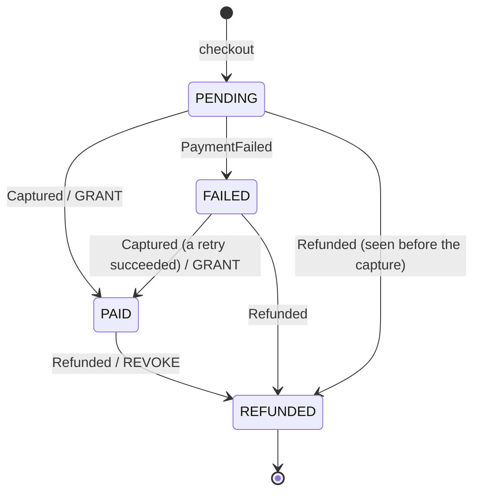
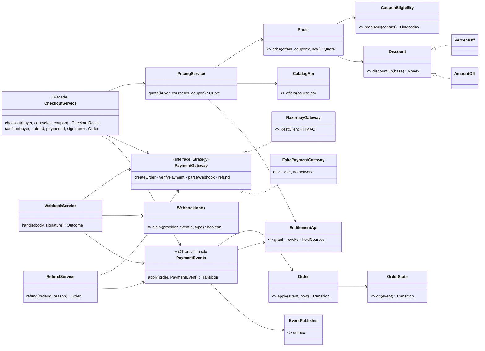
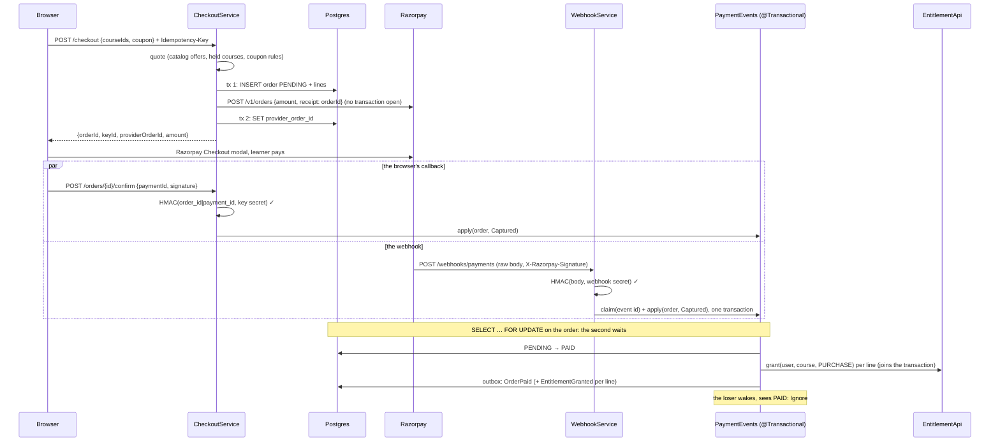
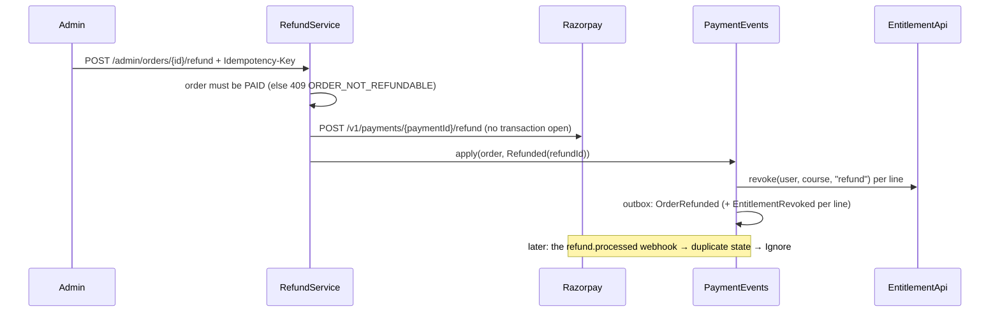

# Commerce: cart, orders and payments — Low Level Design

> **One-liner:** price a cart (coupons included), take the money through a payment provider
> **exactly once in effect**, even when the provider retries, reorders or races the browser's
> redirect, and turn a paid order into course access in the **same transaction**.

**Module:** `backend/api/src/main/java/com/masternova/api/commerce` · **Status:** draft (Phase 9: 9.1)
**Last updated:** 2026-10-14 · **Angular:** `frontend/src/app/features/commerce` (cart, checkout, result, order history)
**Pairs with:** [ADR-0018](../adr/0018-claim-webhook-events-before-processing.md) (webhook dedupe) ·
[ADR-0019](../adr/0019-grant-access-in-the-order-transaction.md) (grant in the order transaction) ·
[`entitlement-engine.md`](entitlement-engine.md) (what a grant and a revoke do) ·
[API conventions §4](../api/conventions.md#4-idempotency) (Idempotency-Key)

## 1. Problem

A learner puts courses in a cart, maybe types a coupon, and pays with Razorpay. When the money
arrives they must get the courses. When an admin refunds the order they must lose them.

The money moves on someone else's system. We learn what happened from two messengers we don't
control:

- **the browser**, which Razorpay Checkout calls back with a signed `payment_id` once the learner
  pays. It may never arrive: the tab closes, the network drops;
- **webhooks**, which Razorpay sends at least once, in no guaranteed order, sometimes many
  copies at once, sometimes minutes late.

Either messenger can arrive first, both can arrive together, and a late one can describe a world
that has already moved on (a `payment.failed` for an earlier attempt, after the retry succeeded).
Each message must move the order at most once, and only forward.

## 2. Forces

- **Money:** amounts in minor units (`long`, API conventions §5). A rounding error is a bug
  report from an accountant. Coupons compute discounts, so they are where rounding happens.
- **External system you don't control:** Razorpay retries webhooks for 24 h, reorders them, and
  sends the same event id again. Its HTTP API can be slow or down at checkout.
- **Concurrency:** the redirect's `confirm` and the `payment.captured` webhook race for the same
  order. 50 copies of one webhook may arrive at once (9.8).
- **Partial failure:** we cannot hold a database transaction open across a call to Razorpay, and
  the call can succeed after we gave up waiting.
- **Security:** the webhook endpoint is public. Only a valid HMAC over the **raw** body proves it
  came from Razorpay. The browser's callback is signed too, with a different key.
- **Multiple actors:** the learner (cart, checkout, history), admins (refunds, coupons), the
  provider (webhooks), the entitlement module (access), the worker (receipts).
- **Rules that grow:** today two coupon kinds and six eligibility rules; next quarter someone
  adds "first purchase only" or "instructor's own coupon".

## 3. Domain model

| Type | Kind | Invariant |
|---|---|---|
| `Order` (`purchase_order`) | entity, aggregate root | belongs to one user; its lines and totals never change after creation; `total = subtotal − discount`, all in one currency; `status` only moves along the table below. `paidAt` is set iff it has ever been `PAID`. |
| `OrderLine` (`order_line`) | entity inside `Order`, `(order_id, course_id)` | the course's title and price **as sold**, a snapshot: a later price change never rewrites an order |
| `OrderStatus` | enum + `EnumSet` successors | `PENDING`, `FAILED`, `PAID`, `REFUNDED` |
| `OrderState` | sealed: `Pending` · `Failed` · `Paid` · `Refunded` | what a `PaymentEvent` does in each state: a `Move(to, effect)` or an `Ignore(why)` |
| `PaymentEvent` | sealed: `Captured(paymentId, amount?)` · `PaymentFailed(paymentId, reason)` · `Refunded(refundId)` | what a messenger says happened, provider-neutral |
| `Coupon` (`coupon`) | entity, keyed by its upper-cased `code` | `PERCENT` (1–100, optional cap) or `AMOUNT` (minor units, catalog currency); optional window, redemption limit, minimum subtotal, single-course scope |
| `Discount` | sealed: `PercentOff` · `AmountOff` (Strategy) | `discountOn(base)` is never negative and never more than `base` |
| `CouponEligibility` | the six rules, each a code + a predicate (Specification) | a coupon applies iff every rule holds; the first failing rule's code is the 422 |
| `Quote` | value object | the priced cart: lines, subtotal, discount, total, the applied coupon |
| `WebhookEvent` | value object from the gateway | `(eventId, type, providerOrderId?, PaymentEvent?)`, built only from a body whose signature verified |

### The order's state machine

**Forward-only:** every state has a rank (`PENDING 0 < FAILED 1 < PAID 2 < REFUNDED 3`) and every
move goes up. An event that would move an order down, or sideways, is **ignored**, not refused:

| state ＼ event | `Captured` | `PaymentFailed` | `Refunded` |
|---|---|---|---|
| `PENDING` | → `PAID`, **grant** | → `FAILED` | → `REFUNDED` (nothing was granted) |
| `FAILED` | → `PAID`, **grant** | ignore (another failed attempt) | → `REFUNDED` |
| `PAID` | ignore (duplicate) | ignore (an older attempt, reported late) | → `REFUNDED`, **revoke** |
| `REFUNDED` | ignore (late) | ignore (late) | ignore (duplicate) |

- **Why ignore and not 409:** the senders are machines retrying history. A 409 to a webhook makes
  Razorpay retry it for a day; a 409 to `confirm` shows an error to a learner who did pay. The
  order's current state already answers them (the result page reads it).
- **Out-of-order safe:** `Refunded` before `Captured` lands in `REFUNDED`, which outranks `PAID`,
  so the late capture is ignored and **no access is ever granted** for money that was returned.
- **`FAILED` is not terminal:** with Razorpay a failed attempt leaves the provider's order open;
  the learner may retry in the same modal and succeed. So `FAILED → PAID` is legal.
- **The effect depends on where the order comes from**, which is why each state is a class
  (State pattern) and not only a row in a table: `Refunded` revokes from `PAID` and from nowhere
  else. The `EnumSet` successors table is the whiteboard diagram, and `Order.apply` asserts every
  move against it: a state class that drifts from the table fails loudly.
- **Amount check:** a `Captured` whose amount (webhooks carry one; the browser callback doesn't)
  differs from the order's total is ignored and logged at ERROR. The order stays unpaid, and the
  payment needs a human.

### Pricing

1. The cart is a list of course ids (1 to `masternova.checkout.cart-max-items`, distinct).
2. Each course must be **for sale**: published, priced and not free (a free course is enrolled
   in, Phase 10), and not already held by the buyer (an active entitlement, or their own course).
   Otherwise 422 `COURSE_NOT_FOR_SALE` / `COURSE_IS_FREE` / `COURSE_ALREADY_OWNED`.
3. `subtotal = Σ line prices`. All prices are in the catalog currency (INR, `V9`).
4. A coupon, if given, must exist (`COUPON_NOT_FOUND`, 404-free: a 422 so guessing codes is no
   easier than typing one) and pass every eligibility rule:

   | Code | Rule |
   |---|---|
   | `COUPON_INACTIVE` | an admin switched it off |
   | `COUPON_NOT_STARTED` | `now < startsAt` |
   | `COUPON_EXPIRED` | `now ≥ endsAt` |
   | `COUPON_EXHAUSTED` | `redemptions ≥ maxRedemptions` |
   | `COUPON_NOT_APPLICABLE` | it is scoped to a course that isn't in the cart |
   | `COUPON_MIN_SUBTOTAL` | `subtotal < minSubtotal` |

5. The discount applies to the **base**: the scoped course's price, or the whole subtotal.
   `PercentOff` rounds the discount half-up to the minor unit (`Money.percentOff`), then caps it;
   `AmountOff` is at most the base. `total = subtotal − discount ≥ 0`.
6. **The server always re-prices.** The browser's numbers are for display; checkout sends course
   ids and a code, never an amount.

A redemption is counted when an order becomes `PAID`, not at checkout: abandoned checkouts don't
burn a limited coupon. The price of that is a **soft limit**: two learners checking out the last
redemption at once both get it (§8).

## 4. Class design

**Module API** (`com.masternova.api.commerce`): the events `OrderPaid` and `OrderRefunded`
(through the outbox: the worker sends the receipt and the refund notice; Phase 10's enrollment
listens to `OrderPaid`). Nobody calls commerce, so there is no `CommerceApi`.

**What it needs from other modules:**

- **catalog:** `CatalogApi.offers(courseIds)`, new in 9.2: title, slug, instructor, availability,
  price, `priceSet` for a set of courses, in one statement.
- **entitlement:** `grant` / `revoke` (Phase 8), plus `heldCourses(user, courseIds)` (9.2): which
  of these the buyer already holds. Entitlement in turn publishes `EntitlementGranted` /
  `EntitlementRevoked` when a row changes (9.7).
- **identity:** the buyer's email and name for the receipt (`IdentityApi.contact`, 9.5).
- **platform:** `EventPublisher` (outbox), `@IdempotencyKeyRequired`, the problem types.

**Layering:** the state machine, the pricer, the discounts and the eligibility rules are in
`domain/`, plain Java, unit-tested without Spring. `PaymentGateway` is a domain port (no HTTP
types in it); `RazorpayGateway` and `FakePaymentGateway` are in `infrastructure/`. The order
repository is Spring Data in `domain/`, like catalog's; the webhook inbox is JDBC behind a domain
interface, like entitlement's.

## 5. Main flow

**Checkout, then the redirect and the webhook racing:**

**Refund (admin):**

**The interesting failure paths:**

- **Razorpay down at checkout:** the order stays `PENDING` with no provider id, marked `FAILED`;
  503 `PAYMENT_PROVIDER_UNAVAILABLE`. The Idempotency-Key filter doesn't store 5xx answers, so a
  retry with the same key starts afresh.
- **The tab closes after paying:** no `confirm`. The webhook pays the order; the result page,
  opened from the order history, shows `PAID`.
- **50 copies of one webhook:** one transaction wins the claim on `(provider, event_id)`; the 49
  others block on the unique index, then find the row and answer 200 without doing anything.
- **Processing fails after the claim:** the claim rolls back with everything else, the webhook
  gets a 500, Razorpay redelivers, and the next copy claims it.

## 6. Patterns used

| Pattern | Class (`@DesignPattern` role) | The force that justified it | Catalog note |
|---|---|---|---|
| State | `OrderState` (sealed State), `Order` (Context) | messengers arrive late, twice and out of order; what an event does depends on the state (a refund revokes only from `PAID`). Forward-only by construction, asserted against an `EnumSet` table | [02](../../patterns/docs/02-state.md) |
| Strategy | `Discount` (`PercentOff`, `AmountOff`) | two coupon kinds today, each a different algorithm over the same base; the pricer must not `switch` on a kind column | [01](../../patterns/docs/01-strategy.md) |
| Strategy | `PaymentGateway` (`RazorpayGateway`, `FakePaymentGateway`) | the provider is chosen by configuration: Razorpay in test mode, or a network-free fake for local runs and e2e that have no Razorpay keys | [01](../../patterns/docs/01-strategy.md) |
| Specification | `CouponEligibility` | six independent rules, each with its own error code, growing; one list produces the 422 and is tested rule by rule | [08](../../patterns/docs/08-specification.md) |
| Adapter | `RazorpayGateway` | Razorpay's HTTP API, JSON shapes, signature schemes and errors translated to our port and our exceptions | [12](../../patterns/docs/12-adapter.md) |
| Facade | `CheckoutService` | checkout is quote → order → provider → order again, with two short transactions around an external call; the controller sees one method | [14](../../patterns/docs/14-facade.md) |
| Observer | the worker's receipt and refund handlers; `EntitlementRevoked` | a refund has consequences outside commerce (an email now, enrollment in Phase 10) that commerce must not know about | [07](../../patterns/docs/07-observer.md) |

**Not a pattern, on purpose:** the cart is a list of ids in the browser (localStorage), not a
server-side aggregate. The server prices it on demand; nothing about it needs to survive a
device change yet.
