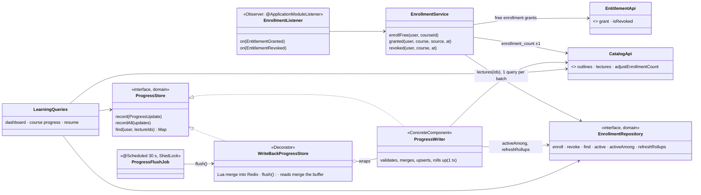
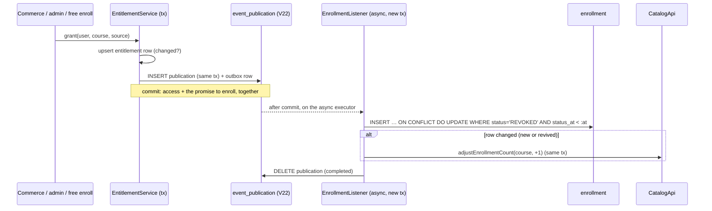
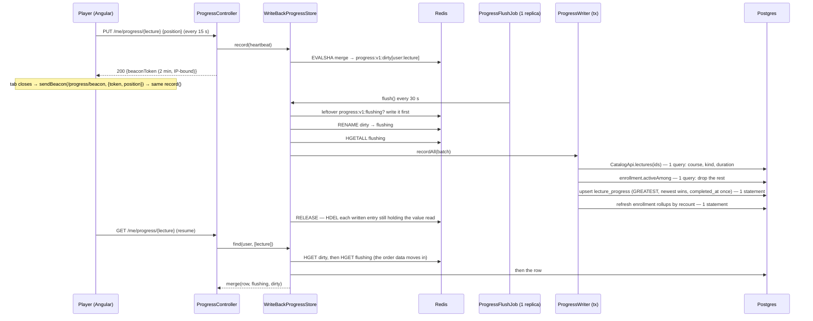

# Enrollment & progress — Low Level Design

> **One-liner:** keep a learner's courses ("My Learning") in step with what they hold, and remember
> where they stopped in every lecture, to the second, without a database write per heartbeat.

**Module:** `backend/api/src/main/java/com/masternova/api/enrollment` · **Status:** built (Phase 10: 10.1–10.6)
**Last updated:** 2026-10-17 · **Angular:** `frontend/src/app/features/learn` (dashboard, player
heartbeats + beacon), `features/catalog` (enroll / continue CTA, ticks in the curriculum)
**Pairs with:** [ADR-0021](../adr/0021-modulith-registry-for-in-process-module-listeners.md)
(durable in-process listeners) · [ADR-0022](../adr/0022-progress-write-back-buffer.md)
(write-back buffer) · [`entitlement-engine.md`](entitlement-engine.md) (who may watch) ·
[API conventions §15](../api/conventions.md#15-progress-heartbeats-and-beacons)

## 1. Problem

A learner who bought, enrolled for free or was given a course wants it on a "My Learning" page
with how far they are, and a **Continue** button that drops them into the right lecture at the
right second. A refund takes the course off the page; buying it again brings the progress back.

The player knows the position. The server has to hear about it often enough that a closed tab,
a crashed browser or a phone switching networks costs seconds, not the whole session, and it has
to do that for thousands of simultaneous viewers without turning Postgres into a heartbeat log.

## 2. Forces

- **Write volume:** a heartbeat every 15 s per viewer: ~67 writes/s per 1,000 viewers, each on a
  hot row. The data is cheap to lose in small amounts (ADR-0022: ≤ 30 s accepted).
- **Read-your-writes where it shows:** reopening a lecture a second after leaving it must resume
  at that second, even though the database is up to 30 s behind.
- **Multiple writers, any order, at least once:** heartbeats from two tabs, a beacon racing the
  last heartbeat, a flush replayed after a crash, grant and revoke events delivered twice or
  reversed (ADR-0021). Every write must be **idempotent and order-independent**.
- **Partial failure:** the api can die mid-flush; Redis can be down; a listener can throw.
- **Another module's facts:** which lectures exist, their course, kind and duration are catalog's;
  who holds a course is entitlement's. The module keeps its own rows and asks for the rest.
- **A client that can't send headers:** `navigator.sendBeacon` (the only request that reliably
  leaves a closing page) can't set `Authorization`, so its credential travels in the body.
- **Untrusted input:** a heartbeat names any lecture id it likes. Nothing it says may cost a SQL
  statement before it is validated.

## 3. Domain model

| Type | Kind | Invariant |
|---|---|---|
| `Enrollment` (`enrollment`) | row, one per `(user, course)` | `status` is `ACTIVE` or `REVOKED`, applied only from an event **newer** than `status_at`. A revoke that arrives first leaves a `REVOKED` **tombstone** so the late grant can't resurrect it. Rollups: `completed_lectures`, `last_lecture_id`, `last_activity_at`, refreshed at each flush by **recount** (idempotent), never by `+1`. |
| `ProgressUpdate` | value object (record) | `(user, lecture, lastPosition, maxPosition, at)`. A heartbeat is one with `last = max = position`. `merge` is **commutative, associative, idempotent**: `max` = the larger, `last` = the one with the later `at` (ties: the larger position). `max ≥ last` always. |
| `LectureProgress` (`lecture_progress`) | row, one per `(user, lecture)` | the merged update, plus the lecture's `course_id` (copied from catalog at the flush) and `completed_at`, set once when `max ≥ 90 %` of the duration and **never unset** |
| `Completion` | domain rule | a lecture is *trackable* if it is a video with a known duration (> 0); complete at `max × 10 ≥ duration × 9`. A course's percentage = completed trackable / trackable lectures **now** (catalog's current curriculum), clamped to 100. |
| `Resume` | domain rule | where **Continue** goes: the last lecture watched, unless it is complete, then the next trackable one in curriculum order; nothing watched → the first trackable lecture. Within a lecture: `last`, or 0 if it is within the last 10 s. |
| `BeaconToken` | value object, signed | `user · lecture · expiresAt` (2 min), HMAC over the payload **and the client IP** (kernel `SignedTokens`, as ADR-0017). Each heartbeat answers with a fresh one, so the page always holds a valid token for its last beacon. |

**Why enrollment is not the entitlement row:** access (entitlement) and learning (enrollment) have
different lifetimes. A refund revokes access **now** (ADR-0019, same transaction); the
enrollment follows by event, keeps its progress, and comes back with a re-purchase.

## 4. Class design

**Module API:** none. Enrollment is a leaf: it listens to entitlement's events and calls catalog and
entitlement; nobody calls it. (`CatalogApi` gains `outlines`, `lectures` and one command,
`adjustEnrollmentCount`; `EntitlementApi` gains `isRevoked`; `EntitlementGranted` gains `grantedAt`.)

**Layering:** `ProgressUpdate`, `Completion`, `Resume` are plain Java in `domain/`. The Decorator,
its Lua script and the JDBC repositories are in `infrastructure/`; `ProgressWriter` (the
ConcreteComponent) is in `application/` because it orchestrates two other modules' APIs in one
transaction.

## 5. Main flows

**Enrollment** (any grant, any source):

- **The listener throws / the api dies:** the publication stays. Staleness marks it `FAILED`
  (2 min `PUBLISHED`, 5 min `PROCESSING`), `FailedPublicationResubmitter` retries it each minute
  on one replica, up to 10 attempts (ADR-0021).
- **Revoke first, grant later** (reordered or retried): the revoke inserts a `REVOKED` tombstone
  with its time; the grant's `at` is older, so its `WHERE status_at < :at` matches nothing.
- **Free enrollment** (`PUT /me/enrollments/{courseId}`): the course must be published and free;
  a learner whose entitlement was **revoked** is refused (403 `ENTITLEMENT_REVOKED`, or re-enrolling
  would undo an admin's revoke). It grants `FREE_ENROLLMENT` **and** enrolls in the same
  transaction, so the answer is already true; the listener's copy is then a no-op.

**A heartbeat, the flush and a resume:**

**The interesting failure paths:**

- **The api dies after `RENAME`, before the release:** `flushing` survives in Redis. The next flush (any
  replica) writes it before renaming anything. Writing it twice is harmless: the upsert is the
  same merge.
- **Postgres is down at a flush:** the transaction fails, `flushing` stays, `dirty` keeps
  absorbing heartbeats; the next tick retries. Nothing is lost while Redis holds.
- **Redis is down at a heartbeat:** `record` falls back to `ProgressWriter.record` (write-through:
  validated, one transaction). Reads fall back to the rows.
- **A forged or stale heartbeat** (unknown lecture, not enrolled, preview of an unbought course):
  dropped at the flush, counted by reason.

## 6. Patterns used

| Pattern | Class (`@DesignPattern` role) | The force that justified it | Catalog note |
|---|---|---|---|
| Decorator (write-back) | `WriteBackProgressStore` (Decorator) over `ProgressWriter` (ConcreteComponent) | write volume: same interface, the buffering is invisible to callers; Redis down → the decorator degrades to its component | [13](../../patterns/docs/13-decorator.md) |
| Observer | `EnrollmentListener` (Observer of entitlement's events) | entitlement must not know enrollment exists; enrollment must not be able to fail a payment; the work must survive a crash | [07](../../patterns/docs/07-observer.md) |

**Not patterns, on purpose:** `Completion` and `Resume` are static rules on records (one caller
each, no variation). The beacon token reuses the kernel's `SignedTokens`; it is not a second
token framework.

## 7. Alternatives rejected

| Option | Why not |
|---|---|
| Postgres upsert per heartbeat | ADR-0022: 67–670 writes/s of churn for data whose loss is cheap |
| Enrollment from `OrderPaid` / enrollment in the order transaction | ADR-0021: misses free and admin grants; a dashboard bug would fail payments |
| `+1` to `completed_lectures` per completion | not idempotent: a replayed flush double-counts. The rollup is a recount of the pair's rows |
| `enrollment_count` recomputed by catalog | catalog would read enrollment's table (a cycle). Enrollment sends `±1` only when its upsert **changed** a row, in the same transaction: exactly once |
| Completion from the client ("I finished") | the server knows the duration; the client sends positions only |
| `fetch(…, {keepalive: true})` with the bearer instead of a beacon | the 15-min access token may have expired by the time the tab closes, and a page that is unloading can't run the refresh. A beacon token is fresh by construction (every heartbeat renews it) |
| Validating each heartbeat (lecture exists, enrolled) | a SQL statement per heartbeat is what the buffer removes; validation moves to the flush, one query per batch |
| Rollups through the buffer (fresh dashboard) | the dashboard would have to scan every lecture of every course in Redis; 30 s staleness on a percentage is fine |

## 8. Failure modes

| Failure | How it is detected | Behaviour | Recovery |
|---|---|---|---|
| api dies mid-flush | `progress:v1:flushing` exists at the next flush | written again (idempotent merge) | automatic, next tick |
| Postgres down at a flush | the transaction throws; `enrollment.progress.flush{outcome=error}` | `flushing` kept, `dirty` grows | automatic when Postgres returns |
| Redis down | command timeout (500 ms) | heartbeats written through to Postgres (`enrollment.progress.heartbeats{path=direct}`); reads from rows | none needed |
| Redis loses its data | not detected | ≤ 30 s of positions lost per learner | accepted (ADR-0022) |
| Buffer evicted under memory pressure | — | can't happen: `volatile-lru`, the buffer has no TTL | — |
| Listener throws / api dies before it runs | `event_publication` row not completed | `FAILED` after staleness; resubmitted each minute, 10 attempts | fix + automatic resubmission |
| Grant and revoke reordered or concurrent | `status_at` comparison | only the newer event applies; a revoke first leaves a tombstone | none needed |
| A lecture is deleted from the curriculum | FK `ON DELETE CASCADE` | its progress rows go; `completed_lectures` stale until the pair's next flush; percent clamped | accepted |
| Instructor saves the course while enrollments arrive | — | `enrollment_count` is `updatable = false` in JPA: a course save never writes a stale count back | — |
| Seek to the end without watching | — | counts as complete | accepted: progress is a bookmark, not a certificate |
| Forged heartbeats | dropped at the flush, `enrollment.progress.dropped{reason}` | Redis memory only, until the next flush | — |
| A flush outlives its lock and overlaps the next | — | the release deletes only the entries it read **and** that still hold the value it read: the other flush's batch stays | none needed |
| A read races a flush | — | `find` reads `dirty`, then `flushing`, then the rows — the direction data moves — so an entry that moves between two reads is caught by the next | none needed |
| A lecture watched before its duration was known | — | `completed_at` is computed from the **merged** max (the row's and the batch's) at every flush, so it completes at the next heartbeat once the duration exists | automatic |
| An entitlement expires | — | the enrollment stays ACTIVE: the card stays on "My Learning" and the player offers renewal (entitlement decides playback, not enrollment) | by design |
| Grants/revokes on a pre-Phase-10 pod during the rollout (no listener, no event), or a lost publication | `EnrollmentReconcileJob` logs a non-zero repair | ~2 min after each start, then daily, one replica: the same upserts over the whole entitlement table, the counter moved per changed row | automatic; a repair after the rollout means a lost event: investigate |

## 9. Data & indexes

`V22__modulith_event_publication.sql` and `V23__enrollment.sql`:

- `enrollment(user_id, course_id, source, status, enrolled_at, status_at, completed_lectures,
  last_lecture_id?, last_activity_at?)`, **PK `(user_id, course_id)`**: the upserts' conflict
  target. CHECKs on `status` and `source`.
  - `enrollment_dashboard_idx (user_id, last_activity_at DESC NULLS LAST) WHERE status = 'ACTIVE'`:
    "My Learning" is one index range scan.
  - `enrollment_course_idx (course_id)`: the FK.
- `lecture_progress(user_id, lecture_id → lecture ON DELETE CASCADE, course_id,
  last_position_seconds, max_position_seconds, updated_at, completed_at?)`, **PK
  `(user_id, lecture_id)`**; CHECK `max ≥ last ≥ 0` (the merge's invariant, enforced by the
  database too).
  - `lecture_progress_course_idx (user_id, course_id)`: the rollup recount and the course page.
- `event_publication`: Modulith's v2 schema (ADR-0021).
- `course.enrollment_count`: written only by `CatalogApi.adjustEnrollmentCount`
  (`UPDATE … SET enrollment_count = enrollment_count + :delta`).

Transactions: `EnrollmentService` (grant/revoke/free enroll), `ProgressWriter.recordAll` (one per
flush batch of ≤ 1,000), the listener's own `REQUIRES_NEW`. The heartbeat and resume paths open
none.

## 10. Tests that prove it

- **Unit (no Spring, no DB):**
  - `ProgressUpdateTest` ⭐ (property test): random heartbeat sequences merged in every
    order, with duplicates and partial merges, give one answer; `max` never decreases; `max ≥ last`.
  - `CompletionTest`, `ResumeTest`, `BeaconTokensTest`.
  - `WriteBackProgressStoreTest`: Redis down → write-through; parse/format of the buffer.
- **Testcontainers `*IT`:**
  - `WriteBackProgressStoreIT` ⭐ (flush on crash): a flush that dies after the `RENAME` loses
    nothing and double-counts nothing; heartbeats during a flush land in the next one; the Lua,
    SQL and Java merges agree on the same sequences; resume reads through the buffer; a lecture
    whose duration arrives later completes from the merged max; the release leaves a newer batch.
  - `EnrollmentIT`: purchase → enrolled (async, via the registry); refund → off the dashboard,
    progress kept; re-purchase → back with its progress; revoke-before-grant tombstone; a listener
    that fails is resubmitted; free enrollment (paid → 422, revoked → 403-ish refusal, twice → one
    row, already bought → the enrollment, `enrollment_count` exact); a revived tombstone is
    enrolled at its grant; the reconcile repairs a grant and a revoke no listener saw, then
    changes nothing.
  - `ProgressIT`: heartbeat → resume at once (buffer) → flush → rollups and percent on the
    dashboard; beacon with a token from another IP or for another lecture → 403; forged lecture
    dropped; a draft's progress → 404 for anyone not enrolled.
- **Angular:** `LearningApi`, `MyLearning` (cards, percent, continue/start, empty state),
  `ProgressTracker` (15 s cadence while playing, flush on pause, beacon on `pagehide` /
  hidden, a late answer for the previous lecture ignored), `LecturePlayer` (resumes at the returned second), `AccessCta` (enroll for free / continue).

## 11. Interview notes — 60-second recall

**Problem:** remember where thousands of learners stopped, to the second, with a heartbeat every
15 s, and keep "My Learning" in step with purchases, free enrollments and refunds.

**Decisions that mattered:**

1. **Write-back Decorator in Redis, flushed every 30 s** by one replica. Heartbeats never touch
   Postgres; one batched transaction per 30 s for everyone. Accepted loss: ≤ 30 s, only if Redis
   itself loses data (ADR-0022).
2. **One merge, three places** (Java, Lua, SQL): max only goes up, last is the newest. It is a
   semilattice (commutative, associative, idempotent), so a crashed flush is simply flushed again:
   crash safety by algebra, not by locks. `RENAME` swaps the batch atomically.
3. **Enrollment is an Observer of entitlement**, durable through Modulith's event registry
   (ADR-0021): it can be late, can't be lost, can't fail a payment. Events carry their time; a
   revoke that wins the race leaves a tombstone.
4. **Validation at the flush, not the heartbeat;** the beacon's credential in its body (sendBeacon
   can't send headers), renewed by every heartbeat.

**The numbers:** see §10's ITs: a heartbeat is 1 Redis call and no SQL; a flush of N heartbeats is
4 statements; a crashed flush replays to the same rows.
