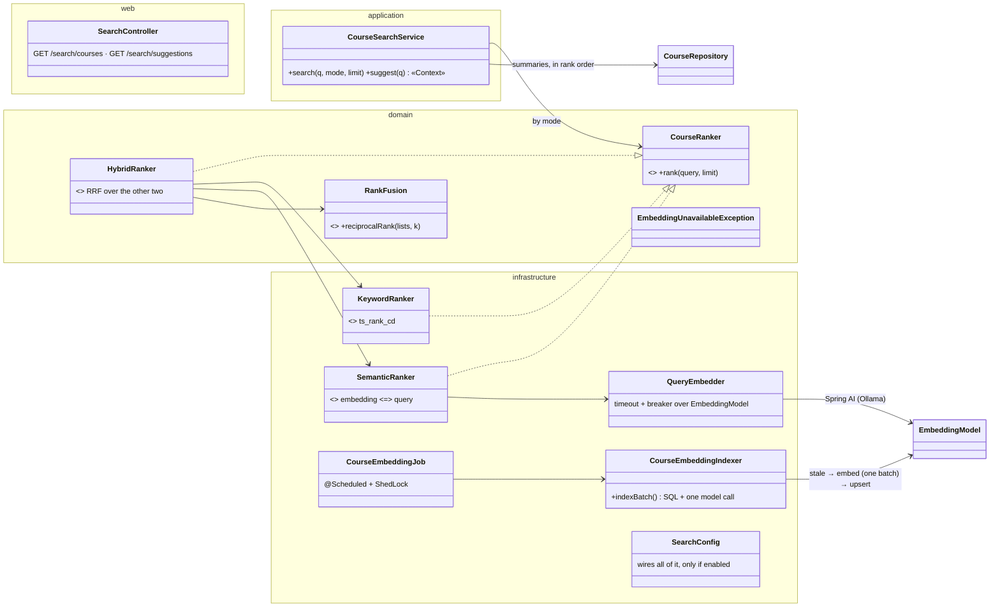
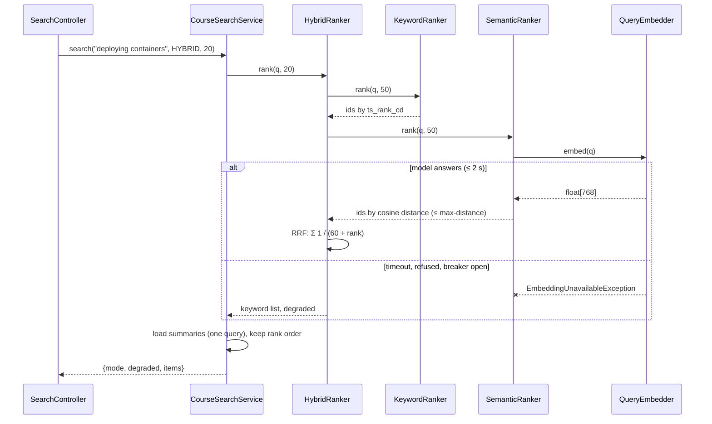

# Course search — Low Level Design

> **One-liner:** find courses by what they're *about*: keyword relevance from Postgres full-text
> search, meaning from pgvector embeddings, and a hybrid of both. When the embedding model is
> down, search still answers, from keywords only.

**Module:** `backend/api/src/main/java/com/masternova/api/catalog` (search is a read of catalog's
own rows) · **Status:** built (Phase 11: 11.3, 11.4, 11.5)
**Last updated:** 2026-10-21 · **Angular:** `frontend/src/app/features/search`, the header's
search box (`app.html`)
**Pairs with:** [ADR-0024](../adr/0024-search-in-postgres-fts-pgvector-rrf.md) · [`catalog.md`](catalog.md)
(browse, the `text` filter) · [pattern 01](../../patterns/docs/01-strategy.md) (the rankers) ·
[API conventions §17](../api/conventions.md#17-search)

## 1. Problem

The catalog's filter box (Phase 5) matches a **substring of the title**: "kubernetes" finds
"Kubernetes in Practice" but not "Container orchestration for beginners", whose description says
Kubernetes three times, and "deploying containers" finds nothing called "Deploy". Learners type
what they want to learn, not titles. They also expect a typeahead under the box while they type.

## 2. Forces

- **Relevance, not a filter.** Results are *ranked*: a title hit outranks a description hit,
  and two words both present outrank one.
- **Language.** English text must be stemmed ("deploying" = "deploy"); the catalog also has Hindi
  courses (`language = 'hi'`), which the English stemmer would mangle.
- **Meaning.** "container orchestration" and "Kubernetes" share no word. Only an embedding
  model knows they're close, and that model is an **external system we don't control**: slow
  (tens of ms), occasionally down, absent in CI and in the cluster.
- **Freshness.** An edited or newly published course should be findable within about a minute.
  Re-embedding on every keystroke of an instructor's draft is waste.
- **Keystrokes.** The typeahead fires as the user types; stale answers must not overwrite newer
  ones, and the endpoint must be cheap (no model call).
- **One database.** Postgres already holds the rows, the visibility rule and the backups.
  Adding Elasticsearch or a vector database is a second source of truth to keep in sync.

## 3. Domain model

| Type | Kind | Invariant |
|---|---|---|
| `course.search_vector` | `tsvector`, **generated** column (V26) | title weight A, subtitle B, description C, built with `english` for `language = 'en'` and `simple` otherwise. Generated `STORED`: it can never disagree with the row |
| `course_embedding` | row, one per published course | `vector(768)` of title + subtitle + description, the `model` that made it and the `content_hash` (md5) of the text it embedded; stale when either differs from the course now |
| `SearchMode` | enum | `KEYWORD`, `SEMANTIC`, `HYBRID` (the default) |
| `RankedCourse` | record | course id + score; a ranker's list is ordered best first |
| `SearchResult` | record | the courses in rank order, the mode that **actually** ran, and `degraded` (semantic was asked for but the model was unavailable) |

## 4. Class design

**The Strategy and its force.** Three ways to rank the same query, chosen **per request** by
`mode`, plus a runtime substitution: a semantic ranker that can't reach the model is replaced by
the keyword one, with `degraded: true`. The service holds a `Map<SearchMode, CourseRanker>` and
never branches on how ranking works; `HybridRanker` composes the other two through the same
interface. A fourth ranker (a learning-to-rank model, a popularity boost) is one class.

**Seams:** `CourseRanker` (three implementations) and Spring AI's `EmbeddingModel` (Ollama in
dev; tests use a deterministic hashing model; OpenAI or Bedrock is a dependency + bean away,
ADR-0024 §3).

## 5. Main flows

**Hybrid search:**

- **Reciprocal Rank Fusion** combines two lists whose *scores* aren't comparable (a `ts_rank`
  and a cosine distance) by their *ranks* only: `score(d) = Σ 1 / (k + rank_i(d))`, `k = 60`.
  No weights to tune, and a course found by both rankers rises above one found by either.
- Each ranker fetches `3 × limit` (capped at 100) candidates so the fusion has overlap to work
  with.
- **The breaker.** After a failure, the embedder doesn't call the model for 30 s and answers
  "unavailable" at once. Without it, a black-holed model host would add the full 2 s timeout to
  every search.

**Keeping embeddings fresh** (`CourseEmbeddingJob`, every 60 s, one replica):

1. One query returns up to 32 published courses whose embedding is missing, or whose `model` or
   `content_hash` differs from the course's **generated** `embedding_text_hash` (V29: md5 of the
   SQL function `catalog_embedding_text`, which also builds the text sent to the model: one
   definition, hashed once per write of the row instead of once per sweep).
2. Embed them in **one batch call**, outside any transaction (a model call is slow; holding a
   connection across it starves the pool). If the batch fails, each text is tried alone, so one
   text the model always refuses can't block the courses after it, run after run. A text refused
   while others succeed is **remembered** (course → hash, per replica) and skipped until it
   changes; two failures before any success are an outage, and the run stops (a hanging model
   would otherwise cost 32 read timeouts).
3. Upsert each `(course_id, model, content_hash, embedding)`. If the course was edited during the
   call, its hash no longer matches and the next run re-embeds it.
4. Delete the embeddings of courses that are no longer published, so the HNSW index holds only
   what search can return.
5. A full batch means more are waiting: the job runs up to 10 batches per tick (320 courses a
   minute) inside its 5-minute lock, so a new model or a big import drains in ~30 min, not 5 h.

No event, no listener: the sweep **is** the mechanism, so a missed event, a model outage or a
new model name all heal the same way. The cost is ≤ 60 s of freshness, the force accepted in §2.

**Typeahead** (`GET /search/suggestions?q=`): up to 8 published titles, ranked by trigram
`word_similarity` with the title, using V8's `course_title_trgm_idx`. No model call (2.0 ms on 10,000 courses); it
also forgives typos ("kubernets"). Angular sends it through `debounceTime(200)` →
`distinctUntilChanged` → **`switchMap`**, which unsubscribes from (cancels) the previous request
when a new keystroke arrives.

## 6. Patterns used

| Pattern | Class (`@DesignPattern` role) | The force that justified it | Catalog note |
| ------- | ----------------------------- | --------------------------- | ------------ |
| Strategy | `CourseRanker` (Strategy), `KeywordRanker` / `SemanticRanker` / `HybridRanker` (ConcreteStrategy), `CourseSearchService` (Context) | three rankings chosen per request, and a degraded substitute picked at runtime when the model is down | [01](../../patterns/docs/01-strategy.md) |

## 7. Alternatives rejected

| Option | Why not |
| ------ | ------- |
| Elasticsearch / OpenSearch | a second datastore, fed by events, with its own outage and its own visibility rule to keep identical to catalog's. At catalog scale (10,000 courses) Postgres FTS answers in milliseconds (§9) |
| A vector database (Qdrant, Pinecone) | same objection; pgvector's HNSW in the database we back up already does k-NN joined to `status = 'PUBLISHED'` in one query |
| Spring AI's `PgVectorStore` | it creates and owns its own table (`initialize-schema`), keyed by a document id with JSON metadata: outside Flyway, outside `hibernate.ddl-auto=validate`, and the "published only" filter becomes a metadata expression instead of a join. We use Spring AI for what it is good at, the model client |
| Embedding on publish (an event listener) | a model outage loses the event's work until something replays it; the sweeper heals every case (outage, edit, model change) with one mechanism |
| `ILIKE '%…%'` on the description | no ranking, no stemming, and a sequential scan of the longest column |
| Weighted sum of normalised scores | `ts_rank_cd` and cosine distance have different, query-dependent scales; the weights would be tuned on today's catalog and wrong tomorrow. RRF needs none |
| Keyset paging of results | relevance is a float computed per query; page 2 would need the query re-run with a score bound. Search shows the best 50 at most; past that, refine the query or use the filtered catalog |

## 8. Failure modes

| Failure | How it is detected | Behaviour | Recovery |
| ------- | ------------------ | --------- | -------- |
| Ollama down / not deployed (CI, the k3d cluster) | connection refused, timeout | keyword ranking, `degraded: true`, counted in `search.requests{degraded}`; the breaker skips the model for 30 s | none needed: the next query after 30 s tries again |
| Indexer can't reach the model | exception in the batch call, and in every single-text retry | that run does nothing, logs once at WARN | the next run (60 s) retries the same courses |
| The model refuses one course's text | the batch fails, that text fails alone | the others in the batch are embedded; that course is skipped (WARN) | retried every run; fixing its text (an edit) changes its hash |
| A query times out on the model | the 2 s budget | the call is **interrupted** (a `Future` from the executor: `CompletableFuture.cancel` wouldn't), freeing its connection | the breaker opens for 30 s |
| A course edited during embedding | hash differs next run | the old vector is served for ≤ 60 s | the next run re-embeds |
| Model changed (`masternova.search.embedding.model`) | `model` column differs | courses are re-embedded 32 per minute; meanwhile semantic search compares old and new vectors (garbage-ish, never an error) | a different dimension needs a migration (`vector(768)` is the type) |
| A query of stop words only ("the") | empty `tsquery` | keyword returns nothing, semantic still may | — |

## 9. Data & indexes

`V27__catalog_search.sql` and `V28__catalog_embedding.sql`:

- `course.search_vector` generated `STORED` + **GIN** index (partial on `status = 'PUBLISHED'`).
  The `ADD COLUMN … GENERATED … STORED` rewrites `course` under an `ACCESS EXCLUSIVE` lock:
  212 ms on 10,000 seeded courses (11 MB), acceptable once; on a large production table it would be an
  expand in batches (a plain column + trigger + backfill) instead.
- V29: `catalog_embedding_text(title, subtitle, description)` (`IMMUTABLE` SQL function) and
  `course.embedding_text_hash` generated from it (the rewrite: 294 ms on 10,000 courses). The
  sweep's no-op run went from 24 ms (hashing every description) to 7 ms.
- `course_embedding` (PK `course_id` → `course ON DELETE CASCADE`) + **HNSW** index
  `vector_cosine_ops` (`m = 16, ef_construction = 64`, pgvector's defaults), autovacuumed at 2 %
  dead rows (HNSW keeps dead entries in its graph until vacuum).

**Transactions:** none around a search. The semantic ranker waits up to 2 s on the model, so each
ranker's query and the card load are short auto-commit statements of their own (the HNSW
settings are per connection); no pooled connection waits on the model. The sweep calls the model
outside any transaction and upserts in one short one.

Measured with `make seed COURSES=10000` (EXPLAIN ANALYZE, [docs/db/indexes.md §9](../db/indexes.md#9-phase-11--search-indexes-2026-10-21)):
keyword search 1.5–2.2 ms with the GIN index vs 3.5–4.3 ms by sequential scan for common words,
and 0.015 ms vs 1.8 ms for a word nobody uses; the 100 nearest of 9,039 vectors in 2.6 ms with
HNSW vs 43 ms exact. Two HNSW traps found there and fixed: `hnsw.ef_search` (default 40) caps
the rows a scan returns, so every connection sets it to 100; dead graph entries hide live rows
until `VACUUM`, so V28 vacuums the table early and every connection turns on
`hnsw.iterative_scan` (Hikari `connection-init-sql`).

## 10. Tests that prove it

- `RankFusionTest`: RRF laws (both lists → higher, order kept on ties, k matters, empty inputs).
- `HybridRankerTest`: fuses; semantic unavailable → the keyword list and `degraded`.
- `QueryEmbedderTest`: a failure opens the breaker; within 30 s no model call; after, one try.
- `KeywordSearchIT`: stemming ("deploying" finds "Deploy"), title outranks description, Hindi
  with `simple`, drafts never found, an edit searchable at once, stop words and broken syntax,
  suggestions forgive a prefix and a typo; semantic asked with no model configured → `degraded`.
- `SemanticSearchIT`: semantic and hybrid with a deterministic hashing `EmbeddingModel`; a model
  that throws → keywords, `degraded`.
- `RankingTest` (pattern lab): the same Strategy without Spring.

**Proved with the real model (2026-10-21, `make ai` + `make api`, 200 seeded courses).** The
sweep embedded all 182 published courses through Ollama (`nomic-embed-text`, CPU on an M2) in
batches of 32, ~1 s each. Queries that share no word with any title found nothing by keyword
and the right subject by meaning: "relational databases" → *PostgreSQL Bootcamp*, "container
orchestration" → *Docker in Production*, at ~50 ms end to end (the query embedding is most of
it). With Ollama stopped, hybrid answered keyword results with `degraded: true` in 6–11 ms (the
breaker skips the model); with Ollama started again, hybrid came back after the 30 s window.
- `SemanticSearchIT` (the sweep): missing, stale (edited), wrong-model → re-embedded;
  unpublished → deleted; a failed batch leaves nothing written and the next run retries; more than
  40 neighbours (the `ef_search` cap, mutation-checked).

## 11. Interview notes — 60-second recall

Search lives in Postgres: a **generated `tsvector`** (weights A/B/C, `english` or `simple` by
the course's language) with a GIN index for keywords, and **pgvector** embeddings with an HNSW
index for meaning. Three rankers behind one **Strategy** interface; hybrid fuses the other two
with **Reciprocal Rank Fusion**, which needs no score normalisation. The embedding model is an
external dependency, so the query path has a 2 s timeout and a 30 s breaker, and falls back to
keywords with `degraded: true` instead of failing. Embeddings are kept fresh by a once-a-minute
**sweeper** that compares a content hash, not by events, so outages, edits and model changes all
heal the same way.
