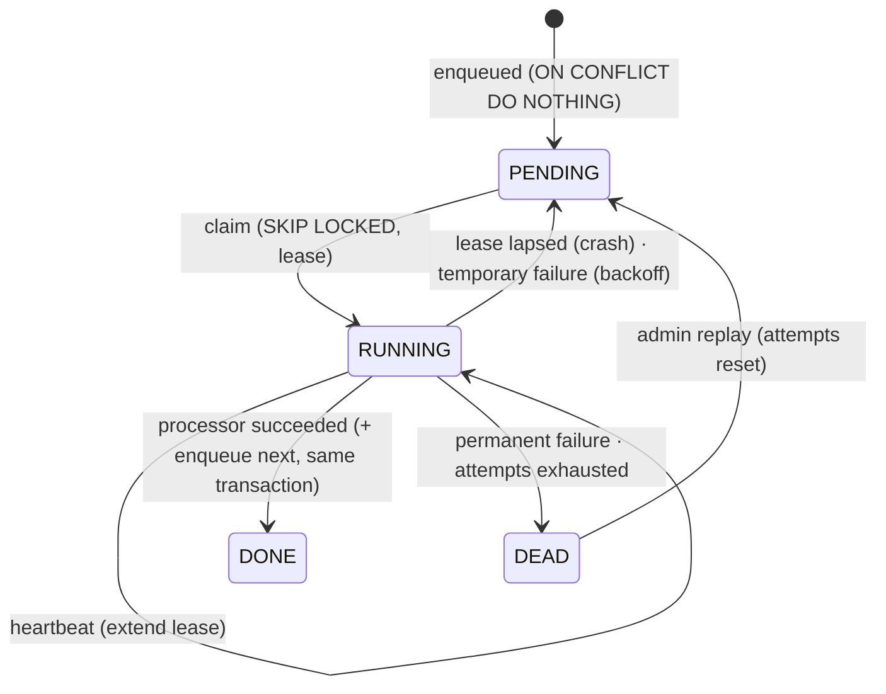
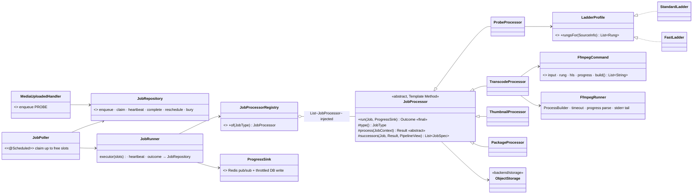
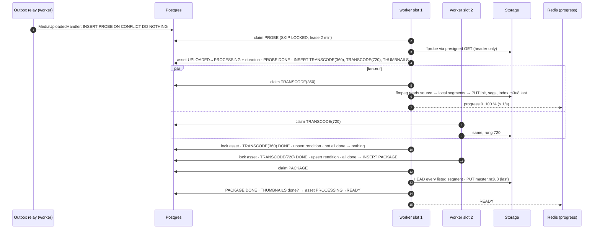
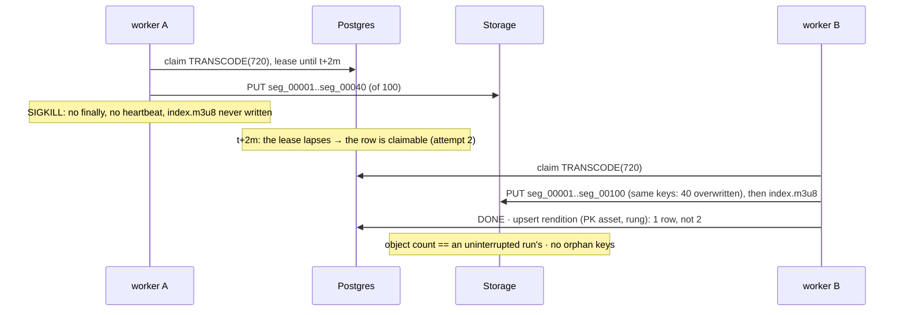

# Video pipeline — Low Level Design

> **One-liner:** turn an uploaded source video into a playable HLS ladder (renditions, master
> playlist, poster, scrub sprite) as a **small DAG of leased, retryable jobs** in the worker,
> where a crash at any moment leads to a rerun that **overwrites** instead of duplicating.

**Module:** `backend/worker/src/main/java/com/masternova/worker/pipeline` · **Status:** built: ffmpeg tooling (7.5), job DAG (7.4)
**Last updated:** 2026-10-13 · **Angular:** progress over SSE in `features/instructor/upload` (7.7, 7.8)
**Pairs with:** [`media.md`](media.md) (the upload, the asset, the key layout) ·
[ADR-0013](../adr/0013-hls-for-playback.md) (HLS, ladder, segment rules) ·
[ADR-0001](../adr/0001-spring-modulith-modular-monolith.md) (why CPU-bound work is in the worker)

## 1. Problem

`MediaUploaded` arrives: a source file of any length, codec and resolution sits at
`media/{assetId}/source`. Within ~5 minutes for a 10-minute 1080p lecture, the instructor
should see "Ready" and learners should get ABR playback.

Transcoding is the slowest and most failure-prone work in the system. It's CPU-bound for
minutes, it shells out to a native binary, and it writes hundreds of objects. Workers get
OOM-killed, rescheduled by Kubernetes, and deployed mid-job. A naive "on event, run ffmpeg"
handler leaves these behind:

- **duplicate renditions** (a redelivered event runs the whole thing twice, with two sets of
  random keys);
- **half-written output** (the master playlist points at a rung whose segments never finished
  uploading);
- **a stuck asset** (`PROCESSING` forever, because the process that owned it died).

## 2. Forces

- **Long-running work** (minutes) vs the outbox's short lease (built for millisecond handlers).
- **At-least-once delivery:** the outbox redelivers `MediaUploaded`; leases expire and jobs
  rerun.
- **Process death at any instant:** SIGKILL, OOM, a node drain. There's no `finally` to rely on.
- **Fan-out / fan-in:** rungs can run in parallel on different workers; packaging must wait for
  all of them.
- **The shape depends on the input:** you don't know the rungs until the probe has read the
  source's height.
- **External process:** ffmpeg can hang, flood stderr (a pipe that isn't drained deadlocks), or
  fail on a corrupt input. Corrupt input is permanent; retrying it forever is wrong.
- **CI must stay fast:** a real ladder takes minutes. Tests need a 2-rung `ultrafast` profile
  that runs the same code path.

## 3. Domain model

**`pipeline_job`**: one row per unit of work, unique by `(asset_id, type, rung)` (`rung = ''`
for jobs without a rung).

| Type | Inputs | Outputs (deterministic keys, `MediaKeys`) | Next |
|---|---|---|---|
| `PROBE` | `source` (ffprobe over a presigned GET: reads the header only) | `media_asset` duration, width, height, audio? → `PROCESSING` | one `TRANSCODE` per rung from the ladder + one `THUMBNAILS` |
| `TRANSCODE(rung)` | `source` (ffmpeg reads via a presigned GET, with range seeks) | `hls/{rung}/init.mp4`, `seg_NNNNN.m4s`, then **`index.m3u8` last**; `media_rendition` upsert | `PACKAGE` once **all** `TRANSCODE`s are `DONE` |
| `THUMBNAILS` | `source` | `poster.jpg`, `sprite.jpg`, `sprite.vtt` | — |
| `PACKAGE` | every rung's `index.m3u8` (each listed segment checked by `HEAD`) | **`hls/master.m3u8` last of everything** (the commit marker) | asset `READY` (once `THUMBNAILS` is also `DONE`) |

**Job states:**

Like the outbox, `next_attempt_at` is both "due at" for `PENDING` and the **lease expiry** for
`RUNNING`: a `RUNNING` row whose lease has passed is claimable again. That's how a crashed worker's
job comes back, with nothing extra to detect the crash.

**Invariants:**

1. **One row per unit of work.** A redelivered `MediaUploaded`, or two rungs finishing at the
   same instant, both enqueue with `ON CONFLICT DO NOTHING`.
2. **Output keys are a function of `(assetId, rung, segment number)`.** A rerun writes the same
   keys, so it **overwrites**.
3. **Readers only see committed output.** A rung is visible only when its `index.m3u8` exists
   (written after its segments). The asset is visible only when `master.m3u8` exists (written
   after `PACKAGE` checks every rung) and its status is `READY`.
4. **Asset transitions are conditional** (`UPDATE media_asset … WHERE status = ?`). A stale job
   finishing late changes 0 rows.
5. A job's completion and the enqueue of its successors are **one transaction**, under a row lock
   on the asset. Fan-in sees a consistent "all rungs done".

**Ladder** (a Strategy, picked by `masternova.pipeline.ladder`):

| Profile | Rungs (height / video kbps / audio kbps) | x264 preset | Used by |
|---|---|---|---|
| `standard` | 360 / 800 / 96 · 720 / 2,800 / 128 · 1080 / 5,000 / 160 | `veryfast` | prod, `make stack` |
| `fast` | 240 / 300 / 64 · 360 / 600 / 64 | `ultrafast` | dev, CI, the 7.10 crash IT |

Both drop rungs above the source's height (a 720p source gets no 1080p), and both keep at least
one rung (a 200p source gets its own height). GOP rules (ADR-0013): 6 s segments, a 2 s closed
GOP aligned across rungs.

> **Built differently from the 7.1 draft (7.4):**
> - The heartbeat ticks every **5 s** and carries the progress in the same `UPDATE`. That's one
>   statement per running job per 5 s, instead of a 30 s lease tick plus a separate progress
>   write.
> - The work directory is made **absolute** by the template. ffmpeg runs *in* it, so a relative
>   `work-dir` resolved twice (`PipelineIT` caught it).
> - `READY` is decided by a small `Readiness` helper that both `PACKAGE` and `THUMBNAILS` call:
>   whichever finishes second, under the asset lock, marks the asset ready.
> - A segment that `PACKAGE` can't find is a **temporary** failure (the rung is rerun or catches
>   up), not a permanent one.
> - `has_audio` was missing from V13; V14 adds it (V13 is never edited).
> - The startup cleanup removes only work directories untouched for longer than a lease, so a
>   second worker on the same host keeps its running job's files.

## 4. Class design

**The Template Method skeleton** (`JobProcessor.run`, `final`), steps in order:

1. **Temp directory:** create `/tmp/pipeline/{jobId}`.
2. **`process(ctx)`** (the hook): ffmpeg, ffprobe or a playlist build, writing local files.
3. **Upload outputs** in the order the hook declares, **commit markers last** (`index.m3u8`,
   `master.m3u8`).
4. **Return `Result`.** `JobRunner` then marks the job done, applies the asset effects and
   enqueues `successors(…)`, all in one transaction.
5. **Always delete the temp directory**, on success, failure or timeout. A SIGKILL skips this, so
   the poller wipes `/tmp/pipeline` on startup.

Subclasses can't skip step 3's ordering or step 5, and that's the force: invariant 3 is enforced
in one place. The classification of failures (permanent vs temporary) also lives in the base:
`FfmpegFailure.isPermanent()` matches ffmpeg's "Invalid data found", "does not contain any
stream" and a probe with no video stream.

**Registry** (Factory Method): `JobProcessorRegistry` takes `List<JobProcessor>` from Spring
and fails **at startup** if a `JobType` has no processor or has two. That's the same shape as the
outbox handler registry (catalog row 9).

**Builder:** `FfmpegCommand` produces a `List<String>` for `ProcessBuilder`, **never a shell
string** (no quoting bugs, no injection through a filename). Required parts (input, output
pattern) come in the entry point; `build()` checks cross-field rules (a GOP must divide the
segment length; an HLS output needs a segment pattern).

**Strategy:** `LadderProfile`, with two real implementations (above). It's chosen by
configuration, not an `if (ci)` inside the processor.

## 5. Main flows

**Happy path** (2 rungs shown):

**Crash mid-transcode** (the 7.10 proof):

**Progress (7.7):** the transcoder runs ffmpeg with `-progress pipe:1` and turns
`out_time_us / duration` into a percentage. `ProgressSink` publishes to Redis
`media:asset:{id}` at most once a second (lossy is fine) and writes `pipeline_job.progress` at
most every 5 s, so a fresh SSE subscriber gets the current state from the DB. The api's
`SseEmitter` endpoint subscribes to the channel. Redis pub/sub reaches every api replica, and
there's no sticky routing.

## 6. Patterns used

| Pattern | Class (`@DesignPattern` role) | The force that justified it | Catalog note |
|---|---|---|---|
| **Template Method** | `JobProcessor` (AbstractClass), the 4 processors (ConcreteClass) | Every job must upload commit markers **last**, clean its temp dir, and classify failures the same way. In a base class's `final run`, a fifth processor can't forget. | row 6 (7.4) |
| **Factory Method / Registry** | `JobProcessorRegistry` | Job type → processor, built from Spring's `List<JobProcessor>`, checked to be complete at startup. Adding a job type is one class. | row 9 (7.4) |
| **Builder** | `FfmpegCommand` | ~25 arguments with ordering and cross-field rules (GOP vs segment length; `-map` per stream). Built as a list, so nothing is shell-parsed. | row 10 (7.5) |
| **Strategy** | `LadderProfile` → `StandardLadder`, `FastLadder` | Two real ladders: prod quality vs CI speed. Picked by config, and the code path is identical. | row 1 (7.5) |

Not used, on purpose:

- **No generic workflow engine** (Temporal, Spring Batch, a DAG table with edges). The DAG has
  four node types and one shape. `successors()` per processor is about ten lines in total.
- **No Chain of Responsibility for steps.** The order isn't linear (fan-out/fan-in), so a chain
  would hide the shape.

## 7. Alternatives rejected

| Option | Why not |
|---|---|
| Run ffmpeg inside the `MediaUploaded` outbox handler | The outbox lease (seconds) would expire mid-transcode and redeliver. The relay batch would block for minutes. There's no per-rung retry or parallelism. The handler only **enqueues**. |
| One ffmpeg producing every rung (decode once, multiple outputs) | ~30 % less CPU (one decode), but one failure reruns everything and one worker does it all. Per-rung jobs spread across workers and retry one rung. Revisit with D5's numbers if CPU dominates. |
| Download the source to local disk first | 10 GiB of local disk per job, and the whole download before the first frame. ffmpeg reads a presigned URL with range seeks, so streaming input is enough. (Output still goes to local disk: segments are small and uploaded as soon as they're written.) |
| Random output keys (`{uuid}.m4s`) + a DB list of what was written | That's how a rerun duplicates. Deterministic keys make the rerun an overwrite, and leave nothing to garbage-collect. |
| Redis/RabbitMQ/SQS job queue | Another moving part. The job's state must commit with the asset's state anyway, so the queue would be a copy of a table. `SKIP LOCKED` over Postgres is proven here by the outbox. Revisit at D5 if claim contention shows up. |
| Spring Batch | Built for chunked ETL over records, not a DAG of long external processes. Its job repository would be a second schema for the same state. |
| A shell script per rung (`sh -c "ffmpeg …"`) | Quoting bugs and injection through file names; no structured timeout or progress. |
| `FAILED` asset retried automatically forever | Corrupt input never succeeds. Permanent failures go straight to `DEAD`, and only an admin replay (7.6) revives them. |

## 8. Failure modes

| Failure | How it is detected | Behaviour | Recovery |
|---|---|---|---|
| Worker SIGKILLed / OOM / drained mid-job | the lease lapses (no heartbeat for 2 min) | the job is claimable again; the rerun overwrites the same keys | automatic; proven by the 7.10 IT |
| ffmpeg hangs | timeout `max(10 min, 3 × duration)` | `destroyForcibly`, temporary failure | backoff retry |
| ffmpeg floods stderr | — | stderr goes to a file, not a pipe (no deadlock); the last 4 KB is kept as `last_error` | — |
| Corrupt / not a video | probe: no video stream; ffmpeg "Invalid data found" | **permanent** → `DEAD` at once, asset `FAILED` (`MEDIA_UNREADABLE`) | instructor re-uploads (an email follows once notification gets a `MediaFailed` template) |
| Storage down mid-job | `StorageUnavailableException` | temporary → backoff (30 s × 4ⁿ, jitter), max 5 attempts | automatic, then `DEAD` + asset `FAILED` (`TRANSCODE_FAILED`) |
| `MediaUploaded` redelivered | `ON CONFLICT DO NOTHING` | no new job | — |
| Two rungs finish at the same instant | row lock on `media_asset` + the unique key | exactly one `PACKAGE` | — |
| A stale job finishes after a replay already did | conditional asset `UPDATE` changes 0 rows; upserts are idempotent | no regression of status | — |
| Temp dir left by a SIGKILL | startup wipe of `/tmp/pipeline` | — | — |
| A rung's segments partly uploaded, `PACKAGE` runs anyway | can't happen: `PACKAGE` is enqueued only when every rung is `DONE`, and it `HEAD`s each listed segment before writing `master.m3u8` | if one is missing: temporary failure | rerun |
| Dead job | `status = DEAD` | asset `FAILED`, visible in the instructor UI | `POST /admin/media/jobs/{id}/replay` (7.6) |

## 9. Data & indexes

`V14__media_pipeline.sql`:

- `pipeline_job (id PK, asset_id FK media_asset, type, rung VARCHAR(10) NOT NULL DEFAULT '',
  status, attempts, next_attempt_at, worker_id NULL, progress SMALLINT NULL, last_error TEXT NULL,
  created_at, updated_at)`.
  - `UNIQUE (asset_id, type, rung)`: invariant 1.
  - CHECKs on `type` and `status`.
- **Index:** `(next_attempt_at) WHERE status IN ('PENDING', 'RUNNING')`: the claim query only,
  partial like the outbox's (DONE rows pile up, the index doesn't).
- `shedlock (name PK, lock_until, locked_at, locked_by)` for the scheduled sweepers (7.6): orphan
  uploads and dead-job reports. The claim loop doesn't need ShedLock: `SKIP LOCKED` already lets
  N workers share it.

**Transactions:** claim (one statement); heartbeat (one statement per 30 s); completion = lock the
asset + mark the job + asset effects + upsert the rendition + enqueue successors (one
transaction). **No transaction is open while ffmpeg runs.**

**Container image:** the worker image gains `ffmpeg` (`apk add ffmpeg` on the Alpine JRE base,
ADR-0007). That's the largest image change of the project. D1's Trivy gate applies, and the size
delta is recorded in 7.5.

## 10. Tests that prove it

*Planned; this section is finished with the code (7.4–7.10).*

- Unit (no Spring, no DB):
  - `FfmpegCommandTest` (argument lists, cross-field rules);
  - `LadderProfileTest` (no upscaling, at least one rung, GOP divides the segment);
  - `JobProcessorTest` (a fake processor proves markers go last and cleanup always runs, even
    after a throw);
  - `JobProcessorRegistryTest` (missing or duplicate type → startup failure);
  - `FfmpegProgressParserTest`.
- `JobRepositoryIT`: claim with `SKIP LOCKED` across 2 threads, lease lapse → reclaim, unique
  enqueue.
- `PipelineIT` (Testcontainers Postgres + SeaweedFS, real ffmpeg, `fast` ladder, a 10 s
  `testsrc` clip): upload → `READY`, the object count matches the playlists; `MediaUploaded` ×2
  → one pipeline.
- **`PipelineCrashIT` (7.10):** start the worker as a child JVM, SIGKILL it after the first
  segment upload, restart it, and assert the object set and `media_rendition` rows are identical
  to an uninterrupted run.

## 11. Interview notes — 60-second recall

*Written last, with the code.*
