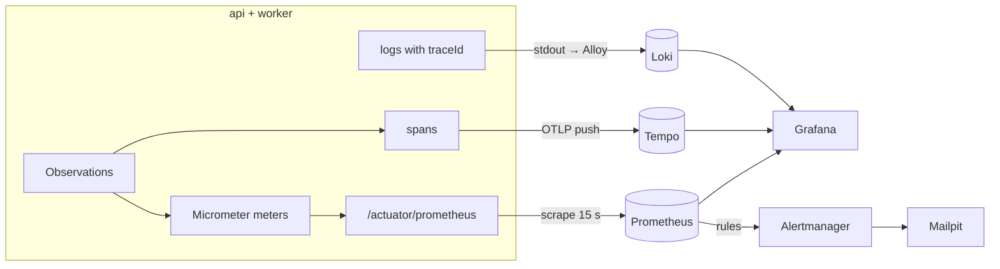
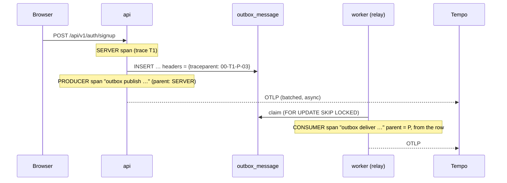
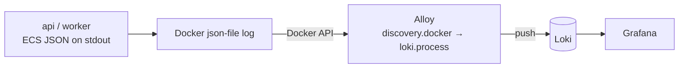

# DevOps 05: Observability — metrics, traces, logs, and alerts that mean something

> **One-liner:** monitoring tells you *that* something is wrong; observability lets you ask *why*
> without shipping new code. Three signals, one correlation key (the **trace id**), and alerts
> written against **user-visible objectives**, not against CPU graphs.

**Roadmap:** D3.1–D3.5 · **Last updated:** 2026-10-13
**Real files:** [`deploy/observability/`](../../deploy/observability/) (Prometheus + rules + their tests, Alertmanager, Grafana provisioning + dashboards, Tempo, Loki, Alloy), [`docs/runbooks/`](../../docs/runbooks/), `compose.yaml` (profile `observability`), [`backend/messaging/…/outbox/`](../../backend/messaging/src/main/java/com/masternova/messaging/outbox/) (outbox meters), [`JobRunner`](../../backend/worker/src/main/java/com/masternova/worker/pipeline/job/JobRunner.java) + [`JobPoller`](../../backend/worker/src/main/java/com/masternova/worker/pipeline/job/JobPoller.java) (pipeline meters), api + worker `application.yaml` (`management.*`)

**Priority marks:** ⭐⭐⭐ must know (interviews, incidents) · ⭐⭐ use daily · ⭐ good to know.

| # | Section | Priority | Task |
|---|---|---|---|
| 1 | [The three signals at a glance](#1-the-three-signals-at-a-glance-) | ⭐⭐⭐ | — |
| 2 | [Metrics: Micrometer → Prometheus](#2-metrics-micrometer--prometheus-) | ⭐⭐⭐ | D3.1 |
| 3 | [Dashboards as code](#3-dashboards-as-code-) | ⭐⭐ | D3.2 |
| 4 | [Distributed tracing, through the outbox](#4-distributed-tracing-through-the-outbox-) | ⭐⭐⭐ | D3.3 |
| 5 | [Centralized logs, and the jump between log and trace](#5-centralized-logs-and-the-jump-between-log-and-trace-) | ⭐⭐ | D3.4 |
| 6 | [SLOs, burn-rate alerts, runbooks](#6-slos-burn-rate-alerts-runbooks-) | ⭐⭐⭐ | D3.5 |
| 7 | [Common mistakes](#7-common-mistakes-) | ⭐⭐⭐ | — |
| 8 | [Interview Q&A](#8-interview-qa-) | ⭐⭐⭐ | — |
| 9 | [30-second recall](#9-30-second-recall) | ⭐⭐⭐ | — |

---

## 1. The three signals at a glance ⭐⭐⭐

| Signal | Answers | Cost driver | Here |
|---|---|---|---|
| **Metrics** | *Is it healthy? How much, how fast, how often?* Cheap aggregates over time | number of **series** (cardinality) | Micrometer → Prometheus |
| **Traces** | *Where did this one request spend its time, across processes?* | number of **spans** (sampling) | Micrometer Tracing → OTLP → Tempo |
| **Logs** | *What exactly happened, with which values?* | **bytes** | JSON lines → Alloy → Loki |

The rule that ties them together: **every log line carries the trace id**, every trace links to
its logs, and dashboards link to both. An alert fires on a metric; you open the trace of a slow
or failed request; the trace shows the logs of every process it crossed.



---

## 2. Metrics: Micrometer → Prometheus ⭐⭐⭐

### 2.1 Pull, not push

Each app serves its current meter values at **`/actuator/prometheus`** (Prometheus text format,
from `micrometer-registry-prometheus`); Prometheus **scrapes** every 15 s. Pull means a dead app
is *noticed* (`up == 0`) instead of silently sending nothing, and the app needs no idea where
monitoring lives.

The scrape endpoint is public on the app's port (`PlatformConfig.platformPublicEndpoints`) but
users can't reach it: nginx — and later the ingress — only forwards `/api/`. In a bigger setup the
alternative is `management.server.port` on a separate, unrouted port.

### 2.2 What to measure: RED and USE

| Method | For | Metrics | Here |
|---|---|---|---|
| **RED** — Rate, Errors, Duration | anything that *serves requests* | requests/s, failed/s, latency histogram | `http_server_requests_seconds_*` (Boot, automatic), `pipeline_job_seconds_*`, `outbox_messages_total` |
| **USE** — Utilisation, Saturation, Errors | anything that is a *resource* | busy/total, queue length, error count | `hikaricp_connections_active/pending`, `jvm_*`, `pipeline_slots_busy` / `pipeline_slots`, `pipeline_jobs_queued` |

The custom meters added in D3.1, and the question each answers:

| Meter (Prometheus name) | Type | Tags | Answers | Where |
|---|---|---|---|---|
| `outbox_events_written_total` | counter | `event_type` | how many business facts happen (registrations, uploads — orders from Phase 9 with no new code) | `JdbcOutboxWriter` |
| `outbox_messages_total` | counter | `event_type`, `outcome` = delivered / retried / dead / unhandled | is delivery failing? | `OutboxRelay` |
| `outbox_delivery_lag_seconds` | histogram | `event_type` | commit → handled: the **outbox lag** (an SLO, D3.5) | `OutboxRelay` |
| `outbox_backlog`, `outbox_overdue_seconds` | gauges, in **every** app | — | is anyone relaying? (overdue = how long the most overdue *due* row has waited) | `OutboxBacklogMetrics` |
| `pipeline_job_seconds` | histogram (an Observation) | `job_type`, `outcome` (done / lost_lease / retry / dead / released / aborted), `error` | **transcode duration** by step, and how runs end | `JobRunner` |
| `pipeline_jobs_dead_total` | counter, **pre-registered at 0** | `reason` = permanent / attempts / abandoned | buried jobs, for `DeadLetters` | `JobRunner` |
| `pipeline_slots_busy`, `pipeline_slots`, `pipeline_jobs_queued` | gauges | — | saturation: is it time to add workers? | `JobPoller` |

### 2.3 Cardinality: the one way to break Prometheus ⭐⭐⭐

Every distinct combination of tag values is a separate **time series**, stored for weeks. Tags
must come from a **small, closed set**:

- ✅ `event_type` (~10), `outcome` (4–5), `job_type` (4), `status` (a few), `uri` **template**
  (`/api/v1/courses/{slug}`, which Boot records, never the raw path).
- ❌ user id, asset id, course slug, email, the raw URL, an exception *message*. 10⁵ users ×
  20 buckets = 2 million series from one meter.

Ids still matter for debugging — they go on **spans** (and logs), not meters. The Observation API
makes the split explicit: `lowCardinalityKeyValue("job.type", …)` becomes a metric tag *and* a
span attribute; `highCardinalityKeyValue("asset.id", …)` goes to the span only (`JobRunner`).

### 2.4 Histograms, not client-side percentiles ⭐⭐⭐

A p95 computed inside each replica **cannot be averaged** across replicas (the mean of two p95s is
not a p95). A histogram exports **bucket counters** (`_bucket{le="0.3"}`); Prometheus adds them
up across replicas and computes any quantile afterwards:

```promql
histogram_quantile(0.95, sum by (le) (rate(http_server_requests_seconds_bucket{application="api"}[5m])))
```

Buckets cost series too. Micrometer's full histogram is **~54 buckets** per series between 5 ms
and 10 s (measured in `PrometheusScrapeIT` while building D3.1), times every `uri × method ×
status`. So HTTP gets **9 chosen edges** (`slo: 25ms … 5s`), including the exact **300 ms** edge
the latency SLO counts against: `le="0.3"` is a real bucket, not an interpolation. The pipeline
keeps the full histogram (`percentiles-histogram`) because it has ~20 series in total, and its
maximum is raised to 2 h (the 30 s default would put every transcode in `+Inf`).

### 2.5 Metrics that tell the truth

- **Count on commit.** `outbox_events_written_total` increments in an `afterCommit` callback:
  a rolled-back registration wrote no row, so it must not show up as a registration either
  (`TransactionalOutboxIT.onlyCommittedEventsAreCounted`).
- **Gauges for silent failure.** A stopped relay records *nothing*: its counters just flatline,
  which looks like a quiet night. `outbox_overdue_seconds` is read from the table at scrape time:
  how long the most overdue **due** row has waited. A working relay claims due rows within a poll,
  so it stays near 0; a message waiting out its retry backoff isn't due, so one failing message
  doesn't move it. It is registered in **every** app that writes the outbox, so a worker whose
  relay is *switched off* still reports the debt. One query per scrape (a 1 s snapshot feeds both
  gauges), served by the partial due-index.
- **Counters that can alert must exist at 0.** `increase()` needs an earlier sample: a counter
  created lazily at its first increment is *born at 1*, and `increase(…[1h])` of it is 0. So the
  first DEAD message would never alert. The relay registers `outbox.messages{outcome=dead}` for
  every handled type at startup, and `JobRunner` registers `pipeline.jobs.dead` for every reason.
  (Found by the phase review; the promtool test had hidden it by starting the series at 0.)
- **Observations over Timers** for anything with a duration: `Observation.start/stop` gives a
  timer today and, with a tracer on the classpath (D3.3), a span from the same code.
- **Library meters, app decisions.** The messaging library registers meters but not their buckets:
  `management.metrics.distribution.*` is set per app (the worker publishes the outbox-lag
  histogram with an exact 60 s edge). Without a `MeterRegistry` bean the library falls back to
  Micrometer's global registry, which drops everything — metrics are never needed to run.
- **One `application` tag** (`management.metrics.tags.application`) on every series tells api
  from worker; Prometheus adds `instance` for the replica.

**Try it:** `make api`, then `curl -s localhost:8080/actuator/prometheus | grep -E '^(http_server|hikaricp|outbox)'`.

---

## 3. Dashboards as code ⭐⭐

**Try it:** `make stack` (or `make api` + `make worker`), then `make obs` →
<http://localhost:3001> (Grafana, anonymous viewer) · <http://localhost:9091> (Prometheus).

### 3.1 Nothing is clicked together

| File | What Grafana does with it |
|---|---|
| `grafana/provisioning/datasources/datasources.yaml` | creates the Prometheus datasource with a **fixed `uid: prometheus`** at startup |
| `grafana/provisioning/dashboards/dashboards.yaml` | loads every JSON in `grafana/dashboards/` into the *Masternova* folder, re-reads every 30 s, `allowUiUpdates: false` |
| `grafana/dashboards/*.json` | the four dashboards below |

Grafana has **no state volume**: delete the container and nothing is lost, because everything it
shows comes from git. A change made in the UI can't be saved over a provisioned dashboard; you
export the JSON, commit it, and review it like code. The fixed datasource `uid` keeps dashboards
portable: a Grafana in Kubernetes (D4) that provisions the same uid renders the same files.

| Dashboard | Method | Panels worth knowing |
|---|---|---|
| **HTTP (RED)** | RED | 5xx ratio and *share under 300 ms* (the two SLIs of §6), p50/p95/p99 from buckets, slowest routes table |
| **JVM** | USE | heap used vs max, *live data after GC* (the leak signal), GC pause share, threads by state, CPU |
| **Connection pool (Hikari)** | USE | in use / max, **threads waiting** (with virtual threads this is the queue that matters), acquire and hold times, timeouts |
| **Pipeline & outbox** | custom | outbox overdue, backlog, dead letters, commit → delivery quantiles, job duration p95 by step, outcomes, slots and queue |

### 3.2 Details that make a dashboard honest

- **Rates use `$__rate_interval`**, never a fixed `[1m]`: Grafana makes it ≥ 4 scrape intervals
  (the datasource declares `timeInterval: 15s`), so a zoomed-in panel never computes a rate
  from a single sample.
- **The HTTP dashboard excludes `/actuator/**` and the SSE streams** (`…/stream`): Prometheus'
  own scrapes would dominate the rate, and a stream is *meant* to stay open for minutes; either one
  would wreck the latency quantiles.
- **A ratio with nothing in the numerator is 0, not "No data":** `(sum(5xx) or vector(0)) /
  sum(all)`.
- **Gauges every worker reports alike use `max`, not `sum`** (`pipeline_jobs_queued` is one
  table count seen by N workers); per-worker gauges (`pipeline_slots_busy`) use `sum`.

### 3.3 One scrape target per app — found while building it

The first config listed each app twice: `api:8080` (the container) and
`host.docker.internal:8080` (for `make api` from source), expecting one of the two to be down. In
stack mode **both answered**: the host port *is* the container's published port. Every series
existed twice and every `sum()` doubled. Now each app has one target, through the host, which
reaches either mode. The lesson: the same process scraped twice looks like two replicas, so
check `count by (job) (up)` when you add a target.

Every panel's query was run against the live stack with real traffic before commit; the only empty
ones are for events that hadn't happened (5xx, failed jobs).

---

## 4. Distributed tracing, through the outbox ⭐⭐⭐

Decision record: [ADR-0015](../../docs/adr/0015-tracing-with-micrometer-observation-and-otlp.md).

### 4.1 Vocabulary

- **Trace:** one unit of work end to end, identified by a 128-bit **trace id**.
- **Span:** one timed step in it (an HTTP request, a publish, a delivery). It has a span id, a
  parent span id, a **kind** (SERVER, CLIENT, PRODUCER, CONSUMER, INTERNAL), attributes and a
  status.
- **Context propagation:** carrying `(trace id, parent span id, sampled flag)` across a process
  boundary. The W3C format is one header,
  `traceparent: 00-<trace id>-<span id>-<flags>`.
- **Sampling:** deciding which traces to keep. **Parent-based**: the root decides, and every
  downstream hop obeys the flag, so a trace is never half-kept.

### 4.2 The path here



Verified on the running stack: one `POST /api/v1/auth/signup` gave one trace in Tempo with 8
spans from **two services**: the api's SERVER span, Spring Security's filter-chain spans, the
Modulith span `Identity > AuthController.signup`, the PRODUCER `outbox publish
identity.user-registered.v1`, and the worker's CONSUMER `outbox deliver
identity.user-registered.v1`.

### 4.3 Why the table needs headers

HTTP clients and message brokers carry `traceparent` for you. An outbox has no wire: the api
**writes a row** and a different process **polls** for it later. So the context has to be stored
with the event. The writer and relay use the Observation API's transport contexts:

| Side | Context | Carrier | What Boot's handler does |
|---|---|---|---|
| `JdbcOutboxWriter` | `SenderContext<Map>` (PRODUCER) | a `HashMap`, then saved as `headers` JSONB | **injects** the producer span's `traceparent` |
| `OutboxRelay` | `ReceiverContext<Map>` (CONSUMER) | `message.headers()` | **extracts** it and makes the delivery span a child |

The messaging library depends only on `micrometer-observation`, not on OpenTelemetry. Without a
tracer the observations are no-ops and `headers` stays empty
(`OutboxTracePropagationTest.withTracingOffTheHeadersStayEmptyAndDeliveryStillWorks`).

### 4.4 Settings, and the traps found

| Setting | Why |
|---|---|
| `MANAGEMENT_OPENTELEMETRY_TRACING_EXPORT_OTLP_ENDPOINT` as an **env var** (compose), not a YAML default | the exporter switches on when the property merely *exists*; a `${X:}` empty default would create one with no endpoint |
| `management.tracing.sampling.probability: ${TRACING_SAMPLING_PROBABILITY:1.0}` | everything locally; ~0.1 in production. Boot's own default, 0.1, would drop 9 of 10 local requests |
| `management.observations.enable.tasks.scheduled.execution: false` | Spring observes every `@Scheduled` run: a root trace per relay poll (1 s) and job poll (2 s) |
| the starter's `micrometer-registry-otlp` excluded | Prometheus already scrapes the metrics; pushing them over OTLP too would be a second, unused path |
| Tempo has no compose healthcheck | the image is distroless: no shell, no `wget`. Grafana waits for `service_started` and retries |

### 4.5 Trace id in every log line

With a tracer present, Boot puts `traceId` and `spanId` in the logging MDC. The containers log
**ECS JSON** (`LOGGING_STRUCTURED_FORMAT_CONSOLE=ecs`), and Boot's ECS writer emits them as
**top-level `traceId` / `spanId` fields**, *not* ECS's nested `trace.id` (found by
`TraceCorrelationIT`, which first looked for the nested one). That IT signs up, finds the JSON log
line written during the request, and checks that its `traceId` is the trace id in the outbox
row's `traceparent`: one id from the log line to the worker. From source, the console pattern
shows the same ids.

**Try it:** `make stack && make obs`, sign up, then open Grafana → Explore → Tempo → *Search*,
service `api`: the trace shows both services.

---

## 5. Centralized logs, and the jump between log and trace ⭐⭐

### 5.1 The pipeline



The apps only **write lines to stdout** (twelve-factor); they know nothing about Loki. Collecting
logs is the platform's job: here **Grafana Alloy** discovers this compose project's containers
through the Docker socket (`deploy/observability/alloy/config.alloy`), and on Kubernetes (D4) it
runs as a DaemonSet reading `/var/log/pods`. The apps don't change between the two.

### 5.2 Labels vs structured metadata: cardinality again ⭐⭐⭐

Loki indexes **labels only**; each distinct label set is a *stream*. So:

| Field | Stored as | Why |
|---|---|---|
| `service` (compose service) | **label** | ~10 values, and every query starts from it |
| `level` (from the JSON's `log.level`) | **label** | 5 values; "errors of the worker" is a common query |
| `traceId`, `spanId` | **structured metadata** | one value per request. As labels they would make a stream per request, which is Loki's cardinality explosion |
| everything else (message, logger, thread) | the line itself | searched with `\|=` / `\| json` at query time |

A trace's logs are then one query, even across services:

```logql
{service=~"api|worker"} | traceId="4ab014d438c35439a90683497e22a316"
```

### 5.3 Jumping between signals

| From → to | How (provisioned in `datasources.yaml`) |
|---|---|
| **log → trace** | Loki's `derivedFields`: the `traceId` metadata field (`matcherType: label`) becomes an *Open trace* link to the Tempo datasource |
| **trace → logs** | Tempo's `tracesToLogsV2` with a custom query: `{service="${__span.tags["service.name"]}"} \| traceId="${__trace.traceId}"`, ± 5 min around the span |

(`$$` in the provisioning file escapes Grafana's own `$ENV` interpolation, so the literal `${…}`
reaches the datasource.)

Verified on the running stack: a signup's trace id `4ab014d4…` opened 8 spans in Tempo (api +
worker), and the LogQL above returned the worker's `verify-email … sent` line from the same
trace. The api had no lines in it, because a successful signup logs nothing there.

### 5.4 Found while wiring it

- **The worker logged nothing when it sent an email.** An external side effect with no log line
  can only be traced through the database. `NotificationService` now logs
  `<template> for event <id> sent, provider id <…>`, with ids only (an email address in a log is
  personal data that spreads to every log store).
- **Loki's and Tempo's images are distroless and Alloy has no `wget`**, so none of them has a
  compose healthcheck. Grafana waits for `service_started` and its datasources retry.
- **Alloy reads the Docker socket**: read access to the Docker API is root-equivalent on the host.
  That's acceptable on a laptop but not on a shared machine; the Kubernetes DaemonSet reads files
  instead.
- Lines that aren't JSON (the JVM's own startup warnings) still arrive, without a `level`
  label: the `stage.match` only parses the Spring apps' streams.

**Try it:** `make stack && make obs` → <http://localhost:3001> → Explore → Loki →
`{service="worker"}`, open a line, click **Open trace**. Alloy's pipeline graph is at
<http://localhost:12345>.

---

## 6. SLOs, burn-rate alerts, runbooks ⭐⭐⭐

### 6.1 Vocabulary

- **SLI** (indicator): a ratio of good events to all events, measured where the user feels it,
  e.g. *requests answered without a 5xx*.
- **SLO** (objective): the target for that ratio over a window, e.g. *99.5 % over 30 days*.
- **Error budget:** what the SLO allows to fail, `1 − SLO` (0.5 %). While budget is left you can
  ship risky changes; when it's spent, reliability work comes first.
- **Burn rate:** how fast the budget is going. `error ratio ÷ budget`; **1** spends exactly the
  whole budget in 30 days, **14.4** spends it in about 2 days.

### 6.2 The three SLOs

| SLO | SLI (PromQL source) | Target | Budget |
|---|---|---|---|
| **api availability** | `http_server_requests` without 5xx, excluding `/actuator` and SSE streams | 99.5 % | 0.5 % |
| **api latency** | requests in the `le="0.3"` bucket ÷ all, the exact edge from §2.4 | 95 % | 5 % |
| **outbox freshness** | deliveries in the `le="60.0"` bucket of `outbox_delivery_lag_seconds` ÷ (deliveries **+ DEAD**): a given-up event records no lag, so it must be in the denominator | 99 % | 1 % |

Recording rules compute each error ratio over 5 m, 30 m, 1 h and 6 h
(`slo:<name>:error_ratio_rate<window>`), so alerts and the **SLOs & error budgets** dashboard
read cheap precomputed series.

### 6.3 Multi-window, multi-burn-rate alerts

A plain threshold ("error ratio > 0.5 % for 5 m") pages on every short blip and misses a slow leak.
Following the Google SRE workbook (ch. 5), each SLO gets two alerts, each requiring a **long window
AND a short window**:

| Alert | Burn rate | Windows | Budget spent when it fires | Goes to |
|---|---|---|---|---|
| `…FastBurn` | ≥ 14.4 | 1 h **and** 5 m | 2 % in an hour | **page** |
| `…SlowBurn` | ≥ 6 | 6 h **and** 30 m | 5 % in six hours | ticket |

- The **long** window gives significance: one bad minute doesn't page.
- The **short** window gives fast **reset**: once the problem stops, the 5 m ratio drops and the
  alert resolves within minutes, even though the 1 h ratio still remembers the errors (unit test
  *the page resolves soon after the errors stop*).
- **No traffic → NaN → no alert.** A ratio with nothing in the denominator is NaN, and `NaN > x`
  is false.

The SLOs can't express everything, so three **symptom** alerts complete them:

| Alert | Why the SLOs miss it |
|---|---|
| `ServiceDown` (`max by (job)(up) == 0`, 2 m) | an api that's down produces *no* requests, so its SLIs go NaN, not red |
| `OutboxStalled` (`max(outbox_overdue_seconds) > 300`, 5 m) | a dead or switched-off relay records no lag samples (§2.5): freshness goes NaN |
| `DeadLetters` (outbox DEAD or pipeline job buried in the last hour, ticket) | rare enough to vanish in a ratio, but each one is a user missing an email or a video |

None of them is a *cause* alert ("CPU > 80 %"): a busy machine that answers on time is fine, and a
cause alert pages people for things users don't feel.

### 6.4 Alerts are code, so they have tests

`deploy/observability/prometheus/tests/alerts.test.yml` feeds synthetic series to
`promtool test rules` and asserts what fires, including the annotations:

| Case | Asserts |
|---|---|
| 10 % errors (with heavy `/actuator` traffic) | fast burn pages by 10 m, slow burn by 7 h; actuator doesn't dilute the ratio |
| 4 % errors | ticket, **no** page |
| errors for an hour, then 10 clean minutes | the page **resolves** though the 1 h ratio is still above 7.2 % |
| no traffic | nothing fires |
| 80 % slow / 50 % late deliveries | latency and outbox fast burns |
| relay stalled (api and worker both report it) | `OutboxStalled` pending at 14 m, firing at 17 m |
| fast deliveries but 30 % DEAD | outbox freshness pages: dead events burn the budget |
| one of two api instances down, the worker down | `ServiceDown` only for the worker |
| a buried transcode | `DeadLetters{kind="pipeline"}` |

### 6.4b What the phase review found

`code-review` on the whole branch found 10 issues, all fixed, each with a regression test where a
test could catch it:

| Found | Fix |
|---|---|
| `DeadLetters` missed the first dead letter: lazily created counters are born at 1 | counters pre-registered at 0 (`deadCountersExistAtZero…` in `TransactionalOutboxIT` and `JobRunnerTest`) |
| `JobRunner` timed a run as `done` when `fail()`/`release()` threw or an `Error` escaped | outcome starts as `aborted`, set only when a path completes (2 tests) |
| backlog gauges existed only with the relay: a switched-off relay was invisible | registered in every app (`MessagingAutoConfigurationTest`, `PrometheusScrapeIT`) |
| `OutboxStalled` would page for one message in retry backoff | the gauge measures *overdue due* rows (`aMessageBackingOffIsOwedButNotOverdue`) |
| retry / DEAD log lines were written after the span closed: no `traceId` on exactly the lines that matter | the scope covers the failure handling (relay: the outcome is recorded inside the delivery span; `JobRunner`: same, tested) |
| DEAD events never counted against outbox freshness | in the SLI's denominator (promtool case *dead events count*) |
| two identical queries per scrape | one query, a 1 s snapshot for both gauges |
| 7 d retention under a 30-day budget panel | 30 d retention, 2 GB cap |
| a `null` header value made `Map.copyOf` throw and failed the whole claimed batch | null values dropped (`aNullHeaderValueIsDropped…`) |
| the runbooks README had no date | dated |

`make obs-check` (and the CI `observability` job) also runs `promtool check config`, `amtool
check-config`, and parses **every dashboard query** by turning it into a recording rule
(`scripts/dashboards_as_rules.py`). A typo in a panel fails the build instead of showing "No data"
(checked by breaking one on purpose).

The first CI run on the PR (2026-10-14) found three things the local runs could not:

- **BuildKit traces itself.** On CI's buildx, every `RUN` step gets
  `OTEL_EXPORTER_OTLP_TRACES_ENDPOINT=unix:///dev/otel-grpc.sock`. Boot's OTLP exporter reads
  `OTEL_*` variables, rejects a `unix://` endpoint, and the AOT training run failed at context
  refresh. The training `RUN` now drops every `OTEL_*` variable first (`backend/Dockerfile`).
  Lesson: the app reads the standard OTel variables too, so whatever environment it lands in
  can switch its exporter on.
- **`mktemp -d` is mode 0700.** The promtool container runs as `nobody` and couldn't read the
  generated rules file. On a Mac, Docker Desktop's file sharing hid this. The Makefile now opens up
  the directory's permissions.
- **An e2e race, once the images built.** On the new-course form, the test clicked the category
  dropdown at 5341 ms. The categories response arrived at ~5490 ms (186 ms on a cold api). A
  `mat-select` with no options doesn't open, so the click did nothing. A real user would hit
  the same thing. The field is now disabled until the categories load (`new-course.ts`, with a
  unit test), and Playwright waits for it to be enabled before clicking.

### 6.5 Routing: Alertmanager → Mailpit

- `severity: page` → `page-email`: 10 s group wait, repeated hourly while firing. `ticket` →
  `ticket-email`: repeated every 12 h. Locally both are emails in Mailpit; in production a page
  goes to a pager.
- **Inhibition:** `ServiceDown{job="api"}` mutes the `api-*` SLO alerts, and
  `ServiceDown{job="worker"}` mutes `OutboxStalled` and the freshness alerts, so you get the cause,
  not its echoes. A firing page also mutes the same SLO's ticket.
- Every alert's `runbook_url` links its runbook in [`docs/runbooks/`](../../docs/runbooks/)
  (what it means for users → confirm → mitigate → fix for good).

**Verified end to end:** stopping the worker container gave `ServiceDown{job="worker"}` pending
within a minute and `[PAGE] ServiceDown FIRING` in Mailpit **2.5 minutes** after the stop (2 m
`for:` + scrape + 10 s group wait), carrying the runbook URL. Starting the worker again gave
`[PAGE] ServiceDown RESOLVED` about 4.5 minutes later: a resolution waits for the 5 m
`group_interval`.

---

## 7. Common mistakes ⭐⭐⭐

| Mistake | Instead |
|---|---|
| User ids, emails or raw URLs as metric tags | closed sets only (type, outcome, uri *template*); ids on spans and logs |
| Averaging percentiles across replicas | export histogram buckets; `histogram_quantile` over `sum by (le)` |
| A full default histogram on every HTTP series | the bucket edges you'll query (9 here) |
| Counting an event before its transaction commits | count in `afterCommit` |
| Trusting a flat-lined counter | a gauge that keeps growing when the work stops (`outbox_overdue_seconds`) |
| Counters created at their first increment | register them at 0 at startup, or `increase()` misses the first event |
| A stall gauge that counts messages in backoff | measure *overdue due* rows: one failing message isn't a stalled relay |
| Scraping one process through two targets | one target per process; check `count by (job) (up)` |
| Dashboards edited in the UI | provision from git; `allowUiUpdates: false` |
| Trace ids as Loki labels | structured metadata (a label per trace = a stream per request) |
| A trace that stops at the queue / table | carry `traceparent` with the message (`outbox_message.headers`) |
| Alerting on causes (CPU, memory) | alert on symptoms users feel: SLO burn, service down, work not happening |
| A single-window error threshold | long AND short windows: significant *and* resets fast |
| Alerts nobody has seen fire | unit-test the rules; fire one for real (stop a container) |

---

## 8. Interview Q&A ⭐⭐⭐

**Q: Metrics, logs and traces: when do you use which?**
Metrics to know *that* something is wrong and how big it is (cheap, aggregated, alertable).
Traces to see *where* one request spent its time across services. Logs for *what exactly*
happened, with values. The trace id connects them: alert → slow trace → that trace's log lines.

**Q: What's cardinality, and how did you control it?**
Each distinct label set is a time series. Tags here come from closed sets (`event_type`,
`outcome`, `job_type`, uri templates); ids go to spans via high-cardinality key values. Bucket
count matters too: HTTP uses 9 chosen edges instead of ~54.

**Q: How do you trace across an asynchronous boundary like an outbox?**
Store the context with the message. The writer's PRODUCER observation injects `traceparent` into
a `headers` column; the relay's CONSUMER observation extracts it, so the worker's span is a child
of the api's. `OutboxTracePropagationTest` proves it with the real OpenTelemetry SDK.

**Q: Why not the OpenTelemetry Java agent?**
It's a second instrumentation system beside Micrometer, and it can't see that a table row is a
message: the outbox needs code anyway. Observations give metrics *and* spans from one call
(ADR-0015).

**Q: How would you alert on an SLO?**
Multi-window burn rates: page at 14.4× over 1 h and 5 m, ticket at 6× over 6 h and 30 m. The
long window gives significance, the short one makes it resolve quickly. Then add symptom alerts
for the cases where the SLI goes NaN: the service is down, or a queue stopped.

**Q: How do you know your alerts work?**
`promtool test rules` with synthetic series, including the negatives (4 % doesn't page; the page
resolves), in CI. And once for real: stopped the worker, got the page email in 2.5 minutes, and
the resolution after restarting it.

---

## 9. 30-second recall

- **RED** for services, **USE** for resources; tags from closed sets; histograms, not percentiles.
- Count after commit; alertable counters exist at 0; a gauge for silent failure (`outbox_overdue_seconds`).
- Dashboards and datasources provisioned from git; Grafana has no state.
- One trace from the api request to the worker: `traceparent` stored in `outbox_message.headers`.
- `traceId` on every JSON log line; in Loki as structured metadata, never a label; Grafana links
  log ↔ trace both ways.
- SLOs: availability 99.5 %, latency 95 % < 300 ms, outbox 99 % < 60 s. Burn alerts at 14.4× (page)
  and 6× (ticket), each with a long and a short window. Symptom alerts for down / stalled / dead
  letters. Every alert has a runbook and a unit test.
