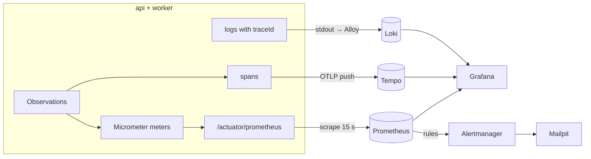

# DevOps 05: Observability — metrics, traces, logs, and alerts that mean something

> **One-liner:** monitoring tells you *that* something is wrong; observability lets you ask *why*
> without shipping new code. Three signals, one correlation key (the **trace id**), and alerts
> written against **user-visible objectives**, not against CPU graphs.

**Roadmap:** D3.1–D3.5 · **Last updated:** 2026-10-13
**Real files:** [`backend/messaging/…/outbox/`](../../backend/messaging/src/main/java/com/masternova/messaging/outbox/) (outbox meters), [`JobRunner`](../../backend/worker/src/main/java/com/masternova/worker/pipeline/job/JobRunner.java) + [`JobPoller`](../../backend/worker/src/main/java/com/masternova/worker/pipeline/job/JobPoller.java) (pipeline meters), api + worker `application.yaml` (`management.*`)

**Priority marks:** ⭐⭐⭐ must know (interviews, incidents) · ⭐⭐ use daily · ⭐ good to know.

| # | Section | Priority | Task |
|---|---|---|---|
| 1 | [The three signals at a glance](#1-the-three-signals-at-a-glance-) | ⭐⭐⭐ | — |
| 2 | [Metrics: Micrometer → Prometheus](#2-metrics-micrometer--prometheus-) | ⭐⭐⭐ | D3.1 |

---

## 1. The three signals at a glance ⭐⭐⭐

| Signal | Answers | Cost driver | Here |
|---|---|---|---|
| **Metrics** | *Is it healthy? How much, how fast, how often?* Cheap aggregates over time | number of **series** (cardinality) | Micrometer → Prometheus |
| **Traces** | *Where did this one request spend its time, across processes?* | number of **spans** (sampling) | Micrometer Tracing → OTLP → Tempo |
| **Logs** | *What exactly happened, with which values?* | **bytes** | JSON lines → Alloy → Loki |

The rule that ties them together: **every log line carries the trace id**, every trace links to
its logs, and dashboards link to both. An alert fires on a metric; you open the trace of a slow
or failed request; the trace shows the logs of every process it crossed.



---

## 2. Metrics: Micrometer → Prometheus ⭐⭐⭐

### 2.1 Pull, not push

Each app serves its current meter values at **`/actuator/prometheus`** (Prometheus text format,
from `micrometer-registry-prometheus`); Prometheus **scrapes** every 15 s. Pull means a dead app
is *noticed* (`up == 0`) instead of silently sending nothing, and the app needs no idea where
monitoring lives.

The scrape endpoint is public on the app's port (`PlatformConfig.platformPublicEndpoints`) but
users can't reach it: nginx — and later the ingress — only forwards `/api/`. In a bigger setup the
alternative is `management.server.port` on a separate, unrouted port.

### 2.2 What to measure: RED and USE

| Method | For | Metrics | Here |
|---|---|---|---|
| **RED** — Rate, Errors, Duration | anything that *serves requests* | requests/s, failed/s, latency histogram | `http_server_requests_seconds_*` (Boot, automatic), `pipeline_job_seconds_*`, `outbox_messages_total` |
| **USE** — Utilisation, Saturation, Errors | anything that is a *resource* | busy/total, queue length, error count | `hikaricp_connections_active/pending`, `jvm_*`, `pipeline_slots_busy` / `pipeline_slots`, `pipeline_jobs_queued` |

The custom meters added in D3.1, and the question each answers:

| Meter (Prometheus name) | Type | Tags | Answers | Where |
|---|---|---|---|---|
| `outbox_events_written_total` | counter | `event_type` | how many business facts happen (registrations, uploads — orders from Phase 9 with no new code) | `JdbcOutboxWriter` |
| `outbox_messages_total` | counter | `event_type`, `outcome` = delivered / retried / dead / unhandled | is delivery failing? | `OutboxRelay` |
| `outbox_delivery_lag_seconds` | histogram | `event_type` | commit → handled: the **outbox lag** (an SLO, D3.5) | `OutboxRelay` |
| `outbox_backlog`, `outbox_oldest_age_seconds` | gauges | — | is the relay keeping up — or *gone*? | `OutboxBacklogMetrics` |
| `pipeline_job_seconds` | histogram (an Observation) | `job_type`, `outcome`, `error` | **transcode duration** by step, and how runs end | `JobRunner` |
| `pipeline_slots_busy`, `pipeline_slots`, `pipeline_jobs_queued` | gauges | — | saturation: is it time to add workers? | `JobPoller` |

### 2.3 Cardinality: the one way to break Prometheus ⭐⭐⭐

Every distinct combination of tag values is a separate **time series**, stored for weeks. Tags
must come from a **small, closed set**:

- ✅ `event_type` (~10), `outcome` (4–5), `job_type` (4), `status` (a few), `uri` **template**
  (`/api/v1/courses/{slug}`, which Boot records, never the raw path).
- ❌ user id, asset id, course slug, email, the raw URL, an exception *message*. 10⁵ users ×
  20 buckets = 2 million series from one meter.

Ids still matter for debugging — they go on **spans** (and logs), not meters. The Observation API
makes the split explicit: `lowCardinalityKeyValue("job.type", …)` becomes a metric tag *and* a
span attribute; `highCardinalityKeyValue("asset.id", …)` goes to the span only (`JobRunner`).

### 2.4 Histograms, not client-side percentiles ⭐⭐⭐

A p95 computed inside each replica **cannot be averaged** across replicas (the mean of two p95s is
not a p95). A histogram exports **bucket counters** (`_bucket{le="0.3"}`); Prometheus adds them
up across replicas and computes any quantile afterwards:

```promql
histogram_quantile(0.95, sum by (le) (rate(http_server_requests_seconds_bucket{application="api"}[5m])))
```

Buckets cost series too. Micrometer's full histogram is **~54 buckets** per series between 5 ms
and 10 s (measured in `PrometheusScrapeIT` while building D3.1), times every `uri × method ×
status`. So HTTP gets **9 chosen edges** (`slo: 25ms … 5s`), including the exact **300 ms** edge
the latency SLO counts against: `le="0.3"` is a real bucket, not an interpolation. The pipeline
keeps the full histogram (`percentiles-histogram`) because it has ~20 series in total, and its
maximum is raised to 2 h (the 30 s default would put every transcode in `+Inf`).

### 2.5 Metrics that tell the truth

- **Count on commit.** `outbox_events_written_total` increments in an `afterCommit` callback:
  a rolled-back registration wrote no row, so it must not show up as a registration either
  (`TransactionalOutboxIT.onlyCommittedEventsAreCounted`).
- **Gauges for silent failure.** A stopped relay records *nothing* — its counters just flatline,
  which looks like a quiet night. `outbox_oldest_age_seconds` is read from the table at scrape
  time, so it keeps growing when nobody delivers. Its query uses the partial due-index, so it
  stays cheap at any table size (a `count(*)` over all DONE rows would not).
- **Observations over Timers** for anything with a duration: `Observation.start/stop` gives a
  timer today and, with a tracer on the classpath (D3.3), a span from the same code.
- **Library meters, app decisions.** The messaging library registers meters but not their buckets:
  `management.metrics.distribution.*` is set per app (the worker publishes the outbox-lag
  histogram with an exact 60 s edge). Without a `MeterRegistry` bean the library falls back to
  Micrometer's global registry, which drops everything — metrics are never needed to run.
- **One `application` tag** (`management.metrics.tags.application`) on every series tells api
  from worker; Prometheus adds `instance` for the replica.

**Try it:** `make api`, then `curl -s localhost:8080/actuator/prometheus | grep -E '^(http_server|hikaricp|outbox)'`.
