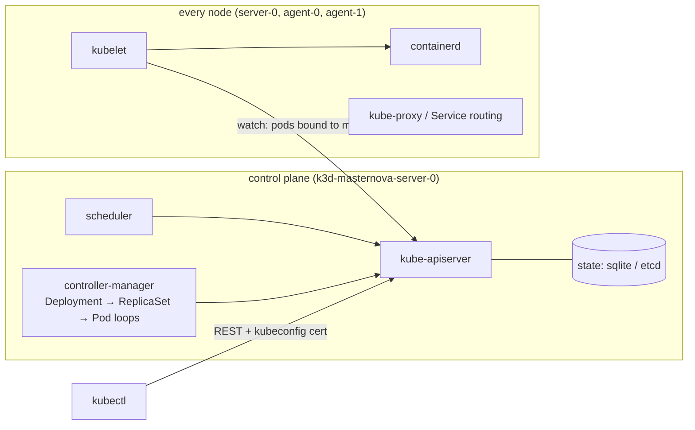
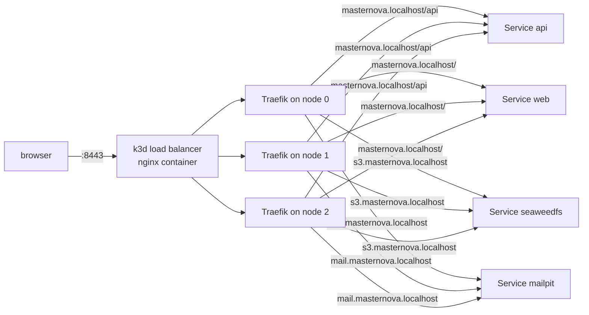
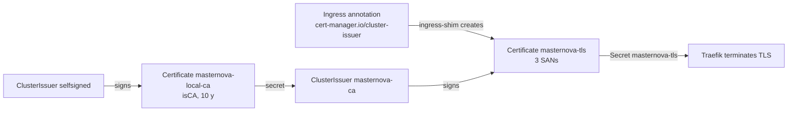
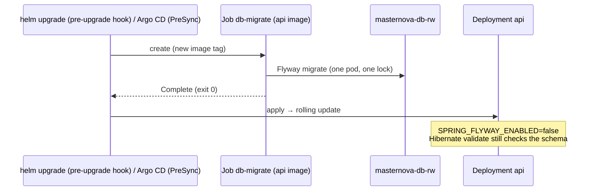
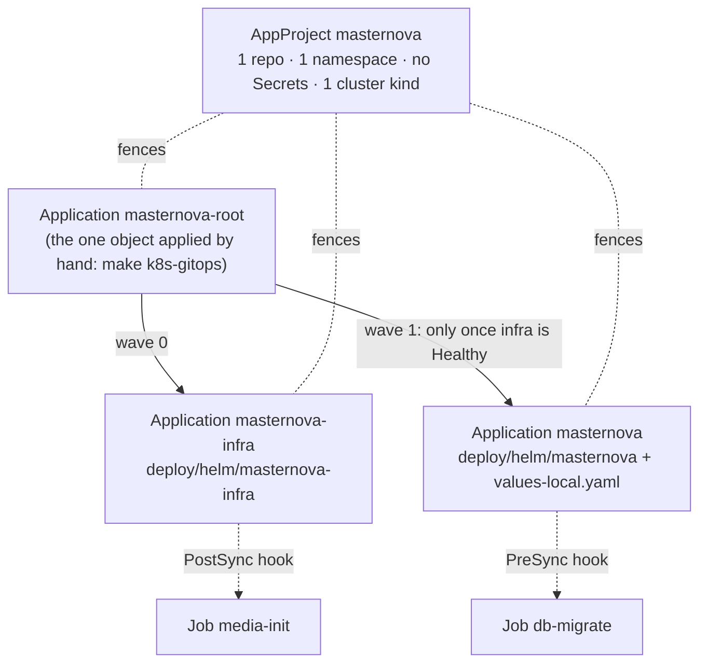

# DevOps 06: Kubernetes (local) + GitOps

> **One-liner:** Compose *starts* containers. Kubernetes *keeps a desired state true*: you
> declare objects (Deployments, Services, Secrets…), and controllers loop forever, turning the
> actual state into the declared one. GitOps puts that desired state in git, and a controller in
> the cluster pulls it.

**Roadmap:** D4.1–D4.8 · **Last updated:** 2026-10-15
**Real files:** [`deploy/k3d/`](../../deploy/k3d/) (cluster, namespace, Traefik config, local CA, KEDA + Argo CD values), [`deploy/argocd/`](../../deploy/argocd/) (project, app-of-apps, `bump.sh`), [`deploy/helm/masternova/`](../../deploy/helm/masternova/) (the apps' chart), [`deploy/helm/masternova-infra/`](../../deploy/helm/masternova-infra/) (CNPG `Cluster`, Redis, SeaweedFS, Mailpit), `Makefile` (`k8s-*`, `helm-check`), [`load/`](../../load/) (k6), [`MigrationSafetyTest`](../../backend/api/src/test/java/com/masternova/api/MigrationSafetyTest.java)
**Try it:** `make k8s-up k8s-platform k8s-images k8s-deploy`, then https://masternova.localhost:8443 (§3) or `make k8s-e2e`.

**Priority marks:** ⭐⭐⭐ must know (interviews, incidents) · ⭐⭐ use daily · ⭐ good to know.

| # | Section | Priority | Task |
|---|---|---|---|
| 1 | [Cluster anatomy, and a cluster on a laptop](#1-cluster-anatomy-and-a-cluster-on-a-laptop-) | ⭐⭐⭐ | D4.1 |
| 2 | [The core objects, written by hand](#2-the-core-objects-written-by-hand-) | ⭐⭐⭐ | D4.2 |
| 3 | [Ingress and TLS](#3-ingress-and-tls-) | ⭐⭐⭐ | D4.3 |
| 4 | [Stateful workloads: an operator, a chart, a Job](#4-stateful-workloads-an-operator-a-chart-a-job-) | ⭐⭐⭐ | D4.4 |
| 5 | [Helm: two charts, values per environment](#5-helm-two-charts-values-per-environment-) | ⭐⭐⭐ | D4.5 |
| 6 | [Autoscaling: HPA on CPU, KEDA on queues](#6-autoscaling-hpa-on-cpu-keda-on-queues-) | ⭐⭐⭐ | D4.6 |
| 7 | [GitOps with Argo CD](#7-gitops-with-argo-cd-) | ⭐⭐⭐ | D4.7 |
| 8 | [Zero downtime, measured](#8-zero-downtime-measured-) | ⭐⭐⭐ | D4.8 |
| 9 | [Common mistakes](#9-common-mistakes-) | ⭐⭐⭐ | — |
| 10 | [Interview Q&A](#10-interview-qa-) | ⭐⭐⭐ | — |
| 11 | [30-second recall](#11-30-second-recall) | ⭐⭐⭐ | — |

---

## 1. Cluster anatomy, and a cluster on a laptop ⭐⭐⭐

### 1.1 The parts



- **Everything goes through the API server.** `kubectl`, the scheduler, the controllers and every
  kubelet are *clients* of it. Nothing talks to anything else directly.
- **Controllers are reconcile loops:** read desired state, read actual state, act on the
  difference, repeat. A Deployment controller creates a ReplicaSet; the ReplicaSet controller
  creates Pods; the scheduler binds each Pod to a node; that node's kubelet starts the
  containers. Delete a pod and the ReplicaSet makes another: that's the "self-healing".
- **k3s** is a CNCF-conformant Kubernetes in one binary. It swaps etcd for sqlite on one server
  and bundles containerd, CoreDNS, Traefik (ingress), metrics-server and the local-path
  storage provisioner. **k3d** runs each k3s node as a Docker container.

### 1.2 Our cluster

[`deploy/k3d/cluster.yaml`](../../deploy/k3d/cluster.yaml) (`make k8s-up`, ~50 s):

| Choice | Why |
|---|---|
| 1 server + **2 agents** | a node drain (D4.8) needs somewhere to move pods; anti-affinity needs > 1 node |
| `rancher/k3s:v1.36.4-k3s1` pinned | the cluster is rebuilt from this file: pin it like an image |
| host **8082 → 80, 8443 → 443** on k3d's load balancer | Traefik's entry points; offset from compose's 8080/8081 so both stacks can run |
| a **registry** container, `127.0.0.1:5050` | `make k8s-images` *pushes* (as CI does) instead of side-loading tarballs (`k3d image import`) |

The registry has two names: the host pushes to `localhost:5050/…`, and the nodes pull
`registry.localhost:5050/…`. k3d writes the mirror into each node's
`/etc/rancher/k3s/registries.yaml`:

```yaml
mirrors:
  registry.localhost:5050:
    endpoint: [http://registry.localhost:5000]   # the registry's port on the Docker network
```

Images are tagged `sha-<commit>` (`-dirty` with uncommitted changes), never `latest`. A
Deployment's pod template only changes when the tag changes, and a changed template is what
triggers a rollout. Re-pushing `:latest` changes nothing the cluster can see.

**Memory.** Docker Desktop's VM has 7.7 GiB here. The compose stack (≈ 2.2 GiB with
observability) is stopped while the cluster runs (`docker compose … stop`: volumes are kept).

### 1.3 `kubectl` fundamentals: the commands actually used

```bash
kubectl config get-contexts                 # kubeconfig = clusters × users; a context picks one of each
kubectl config use-context k3d-masternova   # make k8s-up switches to it
kubectl get nodes -o wide                   # 3 nodes, their IPs, kubelet + containerd versions
kubectl -n masternova get pods -o wide      # which node each pod landed on
kubectl -n masternova describe pod <pod>    # spec + status + the EVENTS: why it isn't running
kubectl -n masternova get events --sort-by=.lastTimestamp   # the cluster's own log
kubectl -n masternova logs deploy/api       # one pod of the Deployment; -f to follow
kubectl -n masternova logs <pod> --previous # the crashed container before the restart ⭐
kubectl -n masternova exec <pod> -- sh -c 'ls /run/secrets'   # a shell in the container
kubectl -n masternova port-forward svc/web 18081:80             # a tunnel to a Service
kubectl top pods -n masternova              # live CPU/memory (k3s ships metrics-server)
kubectl explain deployment.spec.strategy    # the API's own docs, field by field
```

`--previous` and `get events` answered the first incident (§2.5). **Namespaces** are folders
for names and the unit for quotas, RBAC and Pod Security. Everything here lives in `masternova`;
the platform add-ons get their own namespaces (`kube-system`, later `cert-manager`, `cnpg-system`,
`argocd`).

---

## 2. The core objects, written by hand ⭐⭐⭐

Raw YAML in `deploy/k8s/`, before any templating, to learn what each field does (`TAG` swapped
in with `sed`: no templating yet, on purpose). D4.5 turned it into the Helm charts (§5) and
deleted it. The hand-written version stays in git: `git show f3d903f:deploy/k8s/app/api.yaml`.
The fields below are the same in the chart templates.

| Object | File | What it is |
|---|---|---|
| Namespace | `namespace.yaml` | the folder, with Pod Security labels (§2.4) |
| ConfigMap | `app/config.yaml` → `templates/configmap.yaml` | compose's `x-app-env`: non-secret settings, read via `envFrom` |
| Secret ×2 | `make k8s-secrets` (never in git) | `masternova-app` (4 signing keys), `masternova-db` (`kubernetes.io/basic-auth`) |
| Deployment + Service | `app/api.yaml`, `app/web.yaml` → `templates/api.yaml`, `web.yaml` | stateless replicas behind a stable virtual IP + DNS name |
| Deployment | `app/worker.yaml` → `templates/worker.yaml` | no Service: nothing calls the worker |
| StatefulSet + PVC template | `infra/postgres.yaml` (until D4.4), `infra/seaweedfs.yaml` → infra chart | stable pod name (`postgres-0`) and its own volume |
| Job | `media-init` → an infra chart hook | run to completion: bucket + CORS |

### 2.1 Deployment → ReplicaSet → Pod, and a Service in front

A **Service** selects pods by label (`app.kubernetes.io/name: api`) and gets a stable cluster IP
plus a DNS name (`api.masternova.svc.cluster.local`, or just `api` inside the namespace). That's
why `frontend/nginx.conf`'s `proxy_pass http://api:8080` works unchanged from compose. Only
**ready** pods are endpoints of the Service.

`strategy.rollingUpdate: { maxSurge: 1, maxUnavailable: 0 }`: a rollout starts one new pod,
waits for it to be *ready*, then stops an old one. Capacity never drops below `replicas`.

### 2.2 Probes: three questions ⭐⭐⭐

| Probe | Question | On failure | Here |
|---|---|---|---|
| `startupProbe` | has it finished booting? | (keeps the other two off until it passes) | `/actuator/health/liveness`, 2 s × 60 |
| `livenessProbe` | is it wedged beyond recovery? | the kubelet **kills and restarts** the container | `/actuator/health/liveness`, 10 s × 3 |
| `readinessProbe` | should it receive traffic now? | removed from the Service's endpoints, **not** killed | `/actuator/health/readiness`, 5 s × 2 |

- **Liveness must never check a dependency.** If Postgres goes down and liveness checks it,
  every api pod restarts at once and fixes nothing. Boot's liveness group is the app's own
  `LivenessState` only (the default, kept).
- A startup probe replaces a long `initialDelaySeconds` guess: liveness doesn't start counting
  while the JVM boots, so a slow first start (Flyway on an empty database) isn't killed.
- These are the same Actuator groups the Dockerfile's `HEALTHCHECK` already uses
  (`management.endpoint.health.probes.enabled: true`).

### 2.3 Resources and QoS ⭐⭐⭐

```yaml
resources:
  requests: { cpu: 250m, memory: 768Mi }   # what the scheduler reserves on a node
  limits:   { cpu: '2',  memory: 1Gi }     # the cgroup: memory → OOM kill, CPU → throttling
```

- **requests** are for *scheduling* (a pod lands only where the requests fit). **limits** are
  enforced by the kernel. Measured: api ≈ 500 Mi, worker ≈ 270 Mi idle (`kubectl top`).
- **QoS class:** requests = limits for every resource → `Guaranteed` (evicted last); requests <
  limits → `Burstable` (ours); none → `BestEffort` (evicted first under node pressure).
- **The JVM reads the limit:** `MaxRAMPercentage=75` of 1 Gi = 768 MB heap, exactly as in compose
  (devops/02). Memory request = most of the limit, so the scheduler reserves what the JVM will
  really take.
- **CPU limit: kept, on purpose.** The common advice is "no CPU limits" (throttling hurts tail
  latency), but the JVM sizes GC threads and `availableProcessors()` from it. Without one, a pod
  on an 8-core node sizes for 8. The alternative is `-XX:ActiveProcessorCount`.

### 2.4 Security context, Pod Security Admission, Secrets ⭐⭐⭐

Each compose hardening line has a field (devops/03 §9), now applied:

```yaml
spec:
  enableServiceLinks: false            # see §2.5
  automountServiceAccountToken: false  # no Kubernetes API token in the pod (verified: no /var/run/secrets/kubernetes.io)
  securityContext:
    runAsNonRoot: true
    runAsUser: 100                     # ⭐ numeric: the image says `USER app`, a NAME the kubelet can't verify
    runAsGroup: 101
    seccompProfile: { type: RuntimeDefault }
  containers:
    - securityContext:
        readOnlyRootFilesystem: true   # + emptyDir (medium: Memory) at /tmp = compose's tmpfs
        allowPrivilegeEscalation: false
        capabilities: { drop: [ALL] }
```

**Pod Security Admission** (in the API server, no add-on) is configured by namespace labels:
`enforce: baseline`, `warn` + `audit: restricted`. `kubectl apply` printed a warning for
postgres, redis, seaweedfs, mailpit, media-init and web (nginx's root master + `CHOWN/SETUID/SETGID`).
api and worker printed **nothing**: they already meet `restricted`.

**Secrets** stay files, as in compose. One `projected` volume merges keys from two Secrets into
`/run/secrets`, and Spring's `configtree:/run/secrets/` import reads each file as a property:

```yaml
- name: secrets
  projected:
    sources:
      - secret: { name: masternova-app, items: [{ key: JWT_ACCESS_SECRET, path: JWT_ACCESS_SECRET }, …] }
      - secret: { name: masternova-db,  items: [{ key: password, path: DATABASE_PASSWORD }, …] }
```

The worker's volume lists only `NOTIFICATION_TOKEN_SECRET` (least privilege). Verified inside
the api pod: 6 files in `/run/secrets`, **0** env vars matching `secret|password`. A Secret is
only base64 in etcd. Real protection is RBAC on `secrets` plus encryption at rest; D6 uses a cloud
secret manager.

### 2.5 What compose did that Kubernetes doesn't ⭐⭐

**No `depends_on`.** The first apply started api and worker before Postgres was ready:

```text
api-…   1/1   Running   2 (23s ago)
Caused by: … FlywaySqlUnableToConnectToDbException: Connection to postgres:5432 refused
```

The pods crashed and were restarted with backoff until Postgres answered. That's the Kubernetes
model: **every component must tolerate its dependencies being absent**, and restarts are cheap.
Ordering, where it really matters (migrations before the new code), becomes a Job (D4.4).

**Service links.** For every Service, Kubernetes injects `<NAME>_PORT=tcp://10.43.x.y:port` into
every pod, a Docker-links leftover. A Service named `api` produces `API_PORT`, and our
`server.port: ${API_PORT:8080}` would read `tcp://…`. `enableServiceLinks: false` on every pod.

**Graceful stop.** `terminationGracePeriodSeconds: 45` (compose's `stop_grace_period`), plus a
`preStop: { sleep: { seconds: 5 } }`. Endpoint removal and SIGTERM happen in parallel, so Traefik
can still route to a terminating pod for a moment. The native `sleep` action needs no `sleep`
binary in the image.

### 2.6 Verified

- `web → api → postgres → outbox → worker → Mailpit`: a signup through
  `port-forward svc/web` returns 201, and the confirmation email lands in Mailpit.
- 2 api replicas spread over 2 nodes; Flyway ran once (its advisory lock serialises the two).
- PVCs `data-postgres-0` and `data-seaweedfs-0` bound by `local-path`.

---

## 3. Ingress and TLS ⭐⭐⭐

### 3.1 One way in



An **Ingress** is a routing rule (host + path → Service); an **ingress controller** (Traefik,
bundled with k3s) watches Ingresses and configures itself. [`templates/ingress.yaml`](../../deploy/helm/masternova/templates/ingress.yaml) (the `s3.` and `mail.` hosts are in the infra chart's):

- `/api` goes **straight to the api** Service. In compose the browser's `/api` calls went
  through the web container's nginx; here that hop is gone (nginx's `/api` block is simply
  unused). The longest prefix wins, whatever the order of the paths.
- `s3.masternova.localhost` exposes SeaweedFS for the **presigned** upload and segment URLs
  (`STORAGE_PUBLIC_ENDPOINT`). The host is part of the S3 signature, and Traefik forwards it
  unchanged.
- `*.localhost` resolves to 127.0.0.1 with no `/etc/hosts` edits (RFC 6761).
- **http → https:** Traefik's usual entry-point redirect would send browsers to `:443`, but the
  host publishes TLS on `:8443`. So a `redirectScheme` **Middleware** (a Traefik CRD) names the
  port, on a second, http-only Ingress. Measured: `http://…:8082/courses` → `301
  https://…:8443/courses`.
- `SECURE_COOKIES=true`: the refresh cookie now travels over https only.

### 3.2 cert-manager: certificates as objects



- cert-manager (`make k8s-platform`, Helm chart v1.21.2 with its CRDs) adds `Issuer`,
  `ClusterIssuer` and `Certificate` kinds, plus a controller that issues and renews them.
- **One local CA, not a self-signed certificate per host:** trusting
  `secrets/masternova-local-ca.crt` once (`curl --cacert`, the OS keychain) makes every local host
  valid. It's also the shape of production: swap the `masternova-ca` ClusterIssuer for an ACME
  one (Let's Encrypt) and nothing else changes.
- The Ingress only carries an **annotation**; cert-manager's *ingress-shim* creates the
  `Certificate` from the Ingress's `tls` hosts. Verified: issuer `CN=Masternova local CA`, SANs
  `masternova.localhost, s3.…, mail.…`.

### 3.3 Found: the client IP changed with the node ⭐⭐⭐

Learner playback tokens are bound to the client IP (ADR-0017). A throwaway `traefik/whoami`
behind the same ingress, 12 requests, each with a forged `X-Forwarded-For: 6.6.6.6`:

| Traefik as | Service `externalTrafficPolicy` | `X-Forwarded-For` seen by the app |
|---|---|---|
| Deployment, 1 pod (k3s default) | `Cluster` (default) | `10.42.0.0` ×4, `10.42.1.0` ×4, `10.42.2.1` ×4 |
| **DaemonSet**, 1 per node | **`Local`** | `172.19.0.6` ×15 (the k3d load balancer) |

- The forged header never got through: Traefik replaces `X-Forwarded-For` from untrusted
  sources. Good.
- With `Cluster`, a connection may enter on any node and is **SNATed** to that node's address
  on its way to the one Traefik pod. The "client IP" was whichever node it entered on, so 2
  requests in 3 would have failed the token's IP binding, and the player gives up after one
  re-ticket.
- `Local` delivers only to a Traefik pod on the entry node, with no SNAT. A DaemonSet guarantees
  every node has one. [`deploy/k3d/traefik-config.yaml`](../../deploy/k3d/traefik-config.yaml)
  is a k3s `HelmChartConfig`, which overrides the values of the Traefik chart k3s installs itself.
- Locally every browser still shows up as the k3d load balancer: one stable IP, so the binding
  is consistent, if not meaningful. Behind a cloud load balancer, `Local` (or PROXY protocol)
  is what delivers the real client address.

### 3.4 Verified: the e2e suite against the cluster

`make k8s-e2e` runs the same 13 Playwright tests as CI against
`https://masternova.localhost:8443`, with `MAILPIT_URL` on the mail host and `E2E_LOCAL_CA=1`
(Playwright's `ignoreHTTPSErrors`, opt-in). The tests cover sign up / cookie restore / log out,
authoring with autosave and the 409 dialog, the catalog, **checkout** and **upload to S3 →
transcode on the worker → HLS preview plays**. **13 passed (40 s).** One test had
`localhost:8081` hard-coded; it now compares with `baseURL`.

---

## 4. Stateful workloads: an operator, a chart, a Job ⭐⭐⭐

### 4.1 Postgres through an operator (CloudNativePG)

D4.2's StatefulSet ran Postgres, but nothing *operated* it: no replica, no failover, no backups,
no safe minor upgrade. An **operator** is a controller plus CRDs that encodes that runbook.
You declare a `Cluster`, and it does the rest. [`masternova-infra/templates/postgres.yaml`](../../deploy/helm/masternova-infra/templates/postgres.yaml):

```yaml
apiVersion: postgresql.cnpg.io/v1
kind: Cluster
metadata: { name: masternova-db }
spec:
  instances: 2                      # primary + hot standby (streaming replication)
  imageName: ghcr.io/cloudnative-pg/postgresql:17-standard-trixie   # has pgvector
  bootstrap:
    initdb:
      owner: masternova
      secret: { name: masternova-db }               # OUR basic-auth Secret: the apps mount the same one
      postInitApplicationSQL: [CREATE EXTENSION IF NOT EXISTS vector, …]   # as superuser, once
  affinity: { enablePodAntiAffinity: true, podAntiAffinityType: required } # never both on one node
```

| It created | What for |
|---|---|
| pods `masternova-db-1` (primary), `-2` (standby), on different nodes | the instances; *no* StatefulSet: the operator manages pods and PVCs itself |
| Services `masternova-db-rw` / `-ro` / `-r` | primary / standbys / any. `DATABASE_URL` points at `-rw`; after a failover the operator moves the label and the Service follows |
| labels `cnpg.io/instanceRole=primary` | how `make k8s-seed` finds the current primary |

- **Extensions vs the owner.** pgvector isn't a *trusted* extension (its `.control` file has no
  `trusted = true`, checked in the image), so the database owner, who isn't a superuser,
  can't `CREATE` it. `postInitApplicationSQL` runs as the superuser at creation, and V1's `CREATE
  EXTENSION IF NOT EXISTS` becomes a no-op. RDS (D6) has the same split: an admin creates
  extensions, the app migrates.
- `max_connections: 100` against 2 api pods × Hikari's 10, the workers and the migrate Job, with
  room for the HPA (D4.6). Connections are the first wall horizontal scaling hits.
- The operator itself is a platform add-on (`make k8s-platform`: chart 0.29.1, namespace
  `cnpg-system`). Failover is drilled in D5.3, backups in D5.4.

### 4.2 Redis from a chart

The [CloudPirates chart](../../deploy/helm/masternova-infra/values.yaml) (`redis:` values; official `redis` image,
Apache-2.0; Bitnami's free images ended in 2025): standalone, **no persistence**, a password from
`masternova-redis`, and `allkeys-lru` within 96 MB. LRU eviction is safe only because of what's
in Redis. Checked: the entitlement cache (ADR-0016, re-read from Postgres on a miss) and the
progress pub/sub (not stored). ShedLock is JDBC. `fullnameOverride: redis` keeps the Service
name, so `REDIS_HOST` didn't change.

The password reaches Spring as a **file named after the property**: the projected volume maps the
Secret's key to `/run/secrets/spring.data.redis.password`, and `configtree` binds it. No code or
`application.yaml` change. Verified: `redis-cli` without the password → `WRONGPASS`; with it,
`dbsize` = 1 (the cached entitlement row from the e2e checkout).

### 4.3 Migrations as a Job, before the rollout ⭐⭐⭐



In compose every api start migrates. With N replicas that means:

- N pods race for Flyway's lock;
- a long migration blows the startup probe, so the kubelet kills the pod *mid-migration*;
- a failed migration looks like a half-rolled-out, crash-looping Deployment.

[`templates/db-migrate-job.yaml`](../../deploy/helm/masternova/templates/db-migrate-job.yaml) moves the schema first,
once, and the rollout starts only if it succeeded.

- **Same image as the api:** the migrations live in its jar, so they can never drift from the
  code that expects them.
- **How it exits:** `-Dspring.context.exit=onRefresh`, the Dockerfile's AOT-training trick. Flyway
  runs during the context refresh, then the JVM exits 0 before Tomcat or any scheduler starts.
  Measured: **9 s**, `1 succeeded`.
- `restartPolicy: Never` + `backoffLimit: 2`: a failed pod stays around for `kubectl logs`.
  Flyway on Postgres is transactional per migration, so a retry resumes cleanly.
- A Job's pod template is immutable. In D4.4 `make k8s-apply` deleted, recreated and `kubectl wait`ed
  for it. Since D4.5 it's a Helm `pre-install,pre-upgrade` **hook** with `hook-delete-policy:
  before-hook-creation`. `helm upgrade` runs it first and stops if it fails, and Argo CD runs the same
  hook as `PreSync`. Its env is inline, not `envFrom` the ConfigMap: a pre-install hook runs
  *before* the chart's ordinary objects exist (§5.3).
- The startup probe budget dropped from 2 min to 1 min: the api no longer migrates.

Verified after the switch: `make k8s-e2e` **13 passed** on CNPG + Redis with auth.

---

## 5. Helm: two charts, values per environment ⭐⭐⭐

### 5.1 Why two charts

| Chart | Holds | Released as |
|---|---|---|
| [`deploy/helm/masternova`](../../deploy/helm/masternova/) | api, worker, web, ConfigMap, Ingress, the `db-migrate` hook | `masternova` |
| [`deploy/helm/masternova-infra`](../../deploy/helm/masternova-infra/) | CNPG `Cluster`, Redis (a **dependency**), SeaweedFS + `media-init`, Mailpit, the `s3.`/`mail.` Ingress | `masternova-infra` |

- **Ordering:** the apps' `pre-install` migration hook runs before anything else in its release.
  In one chart, that's before the database `Cluster` exists, a deadlock. Two releases are
  installed in order: infra, wait for the `Cluster` to be `Ready`, then the apps.
- **Lifecycle:** images change on every merge, the data layer rarely. On AWS (D6) the infra chart
  disappears (RDS, ElastiCache, S3) and the app chart only gets other values.
- Redis is a chart **dependency**, vendored as `charts/redis-0.37.2.tgz` (`helm dependency
  build`) with `Chart.lock`. Rendering needs no network, and what Argo CD renders is exactly
  what's in git.
- **Secrets are not in either chart.** Both reference existing Secrets by name (`secrets.app`,
  `ownerSecret`…), created out of band (`make k8s-secrets`). Putting them in values would put
  them in git, or in Helm's release Secret in clear base64. Sealed Secrets / External Secrets are
  the next step (§9).

### 5.2 Values: defaults for a real environment, overrides per environment

`values.yaml` holds the **safe** defaults: GHCR images, `PAYMENT_PROVIDER: razorpay` (fails
closed without its keys), sampling 0.1, no ingress issuer. `values-local.yaml` holds only what
the k3d cluster changes (`fake` payments, `*.localhost` hosts, the local CA, port 8443, the fast
ladder). The `config:` map is passed through as the ConfigMap's data, keyed by the apps' own
env names (`application.yaml`), so there's no second vocabulary to translate.

`image.tag` has no default: `{{ required "image.tag is required…" }}` fails the render. The tag
is the deployment (§6), and an empty one must never quietly mean "whatever".

### 5.3 Template details that are really Kubernetes lessons

| In the chart | Because |
|---|---|
| `checksum/config: {{ toJson .Values.config \| sha256sum }}` on the pod template | env is read at start, so a ConfigMap change alone restarts nothing (measured in D4.3: the worker kept the old `WEB_URL`). The hash changes the pod template, which *is* a rollout. It hashes the data only, not the ConfigMap's labels (they carry the image tag, which would make the hash change with every deploy). Checked by rendering: new tag → same hash; changed config → new hash |
| selector = `name` + `instance` only, never `version` | a Deployment's selector is immutable; a label that changes per release can't be in it |
| `{{- if not .Values.api.autoscaling.enabled }} replicas: …` | with an HPA (D4.6) the HPA owns `replicas`; a chart that also sets it fights the HPA on every sync |
| the migrate Job's env inline, not `envFrom: masternova-config` | a `pre-install` hook runs *before* the release's ConfigMap exists: on a first install it would fail |
| `helm.sh/hook-delete-policy: before-hook-creation` | a Job's pod template is immutable: the next upgrade replaces it; the last run stays for `kubectl logs` |
| `media-init` as a `post-install,post-upgrade` hook | it re-runs when the CORS origins change; a plain Job is immutable and would never re-run |
| `_helpers.tpl`: one `secretsVolume` with an `appKeys` list per pod | least privilege stays explicit: the worker lists 1 key, the api 4, the migrate Job 1 |

### 5.4 Moving a live cluster under Helm

Helm refuses objects it didn't create ("invalid ownership metadata"). The move from D4.4's raw
manifests:

1. stateless objects (Deployments, Services, Ingresses, ConfigMap, Jobs): deleted and recreated
   by the charts. The selectors changed anyway (the `instance` label), and selectors are immutable;
2. the CNPG `Cluster`, which holds the data, was **adopted**: `meta.helm.sh/release-name` /
   `release-namespace` annotations plus `app.kubernetes.io/managed-by=Helm`, and the next
   install took it over in place (the database pods kept running);
3. SeaweedFS's StatefulSet was recreated, and its PVC `data-seaweedfs-0` was reattached by name
   (same claim template + pod name).

Result: 2 releases, **0 restarts** (the hook migrated before any app pod existed; D4.2 had 2
crash-restarts per pod), `db-migrate` 9 s, `make k8s-e2e` **13 passed**.

### 5.5 CI: catch it before Argo CD does

`make helm-check` (job `helm` in CI, path-filtered on `deploy/helm/**`):

- `helm lint --strict` on both charts, with the local values;
- `helm template | kubeconform -strict`, against the Kubernetes schemas **and** the CRDs'
  (datree's CRDs-catalog). Without the catalog, the CNPG `Cluster` and the Traefik `Middleware`
  are "skipped", which means unchecked. With it: 21 objects, 21 valid.

Under GitOps an invalid chart fails at sync time, *after* the merge. This moves the failure to
the PR.

### 5.6 Found on the way: CI never published Phase 8 and 9 ⭐⭐⭐

Pointing `values-local.yaml` at GHCR needed a `sha-` tag with all three images. The newest api
and worker image was `sha-5d7e9da` (Phase D3). The `main` runs for the Phase 8 and Phase 9
merges were **cancelled**: `concurrency: { group: ci-${{ github.ref }}, cancel-in-progress:
true }` treated the `docs/post-phase-N` merge a minute later as "a newer push", and the docs
commit builds no images (path filters). Fix in `ci.yml`:

```yaml
concurrency:
  group: ci-${{ github.ref == 'refs/heads/main' && github.sha || github.ref }}   # a group per commit on main
  cancel-in-progress: ${{ github.ref != 'refs/heads/main' }}
```

"Just don't cancel on main" isn't enough: a concurrency group keeps one *pending* run, and a
third push replaces it. On main every commit is a potential deployment, so every commit gets its
own run.

---

## 6. Autoscaling: HPA on CPU, KEDA on queues ⭐⭐⭐

### 6.1 Which signal for which workload

| Workload | Busy means | Scaled on | Why not the other |
|---|---|---|---|
| **api** | requests arriving | **CPU** (HPA, metrics-server) | it's stateless and CPU-bound under load (JSON, bcrypt, JWT); DB waits are virtual threads parked on I/O, which cost no CPU |
| **worker** | work *waiting* | **queue depth** (KEDA → an HPA) | an idle relay polling an empty outbox and a worker blocked on SMTP both look cold on CPU; a backlog doesn't lie |

### 6.2 The api's HPA

[`templates/api-hpa.yaml`](../../deploy/helm/masternova/templates/api-hpa.yaml): 2–4 replicas,
70 % CPU, where the percentage is **of the request** (250m → 175m per pod on average), not of the
limit.

```yaml
behavior:
  scaleUp:   { policies: [{ type: Pods, value: 1, periodSeconds: 60 }] }   # one pod a minute
  scaleDown: { stabilizationWindowSeconds: 300 }                           # highest of the last 5 min
```

A JVM's first minute is JIT and class loading: CPU-hot while it serves little. Adding one pod a
minute (and the HPA ignoring unready pods' CPU) avoids a cascade where new pods "prove" more
load. The ceiling isn't arbitrary either: 4 api × Hikari's 10 + 3 workers × 10 + the migrate Job
fits Postgres's `max_connections: 100`. Connections are the first wall horizontal scaling hits.

**Measured** (`k6 run -e VUS=40 -e HOLD=4m load/catalog-browse.js`, the [new `load/` folder](../../load/)):

| t | CPU (of request) | replicas |
|---|---|---|
| 0:00 | 24 % | 2 |
| 0:40 | 177 % | 2 → **3** |
| 1:40 | 170 % | 3 → **4** (a minute later: the policy) |
| 3:00 – 4:30 | 78–99 % | 4 (`maxReplicas`: still above target, capped) |
| +5 min idle | — | 4 → **2** (stabilization window) |

**59,900 requests, 0 failed, list p95 23 ms at 210 req/s.** The per-minute step is visible in
the events (`New size: 3` at 5m21s, `New size: 4` at 4m21s).

### 6.3 KEDA on the worker

KEDA turns any query into an **external metric** and drives an HPA it creates (`keda-hpa-worker`).
[`templates/worker-scaledobject.yaml`](../../deploy/helm/masternova/templates/worker-scaledobject.yaml)
has two `postgresql` triggers, and the HPA takes the **larger** answer:

| Trigger | Query (the app's own D3 gauges) | Target per worker |
|---|---|---|
| `outbox-lag` | seconds since the most overdue **due** message became due (`outbox_overdue_seconds`: backoff isn't lag) | 30 s → `ceil(lag / 30)` workers |
| `transcode-queue` | `count(*)` of `PENDING` jobs already due (`pipeline_jobs_queued`) | 2 (= `pipeline.slots`) |

`minReplicaCount: 1`, never 0: the worker also runs the scheduled upload sweeper, which has no
queue to wake it. Scale-down is one pod a minute, because a worker leaving mid-transcode releases
its job and another starts it over. N workers are safe because every claim is
`FOR UPDATE SKIP LOCKED` and the sweeper is ShedLocked (checked before writing a single manifest).

**The drill.** Real lag, held in place: insert 5 messages due in 8 s, then hold `SELECT … FOR
UPDATE` on them in another session. The relay's `SKIP LOCKED` passes over them; KEDA's plain
`SELECT` still sees them, overdue and growing:

```text
13:02:46  21899m/30  replicas 1/1     ← lag ≈ 22 s
13:03:01  36908m/30  replicas 1/2     ← > 30 s: scale to 2
13:03:31  33449m/30  replicas 2/3     ← shown PER REPLICA: 33 s × 2 = 67 s → 3
13:04:17  0/30       replicas 3/3     ← lock released, relay drained them
          … then 3 → 2 → 1, one a minute
```

(The first attempt didn't scale at all: my lock session had failed with `FOR UPDATE is not
allowed with aggregate functions`, so the relay simply delivered the rows. Output captured,
`SELECT id … FOR UPDATE`, rerun.)

### 6.4 Found: KEDA could read every Secret in the cluster ⭐⭐⭐

```text
kubectl auth can-i list secrets -A --as=system:serviceaccount:keda:keda-operator   → yes
```

By default the KEDA chart lets its operator `list/watch` every Secret, and gives it a `get *` on
every resource (so it can scale any custom kind). The operator could read the local CA's
private key and every app credential. Fixed in
[`deploy/k3d/keda-values.yaml`](../../deploy/k3d/keda-values.yaml) and the charts:

1. `permissions.operator.restrict.secret: true` (+ `namesAllowList`): Secrets in its own
   namespace only. **Not enough on its own:** `get secrets/masternova-app -n masternova` was
   still `yes` through the `*/*` rule;
2. `rbac.enabledCustomScaledRefKinds: false`: we scale a Deployment, which KEDA supports
   without that rule;
3. a **read-only Postgres role** `keda_reader` (a CNPG *managed role*, connection limit 4) instead
   of the app owner's credentials. First it was in `pg_read_all_data`. Verified: `SELECT` works,
   `DELETE` → `permission denied`. The phase review caught that "read-only" still meant *every
   table*: password hashes, refresh tokens, orders. Now the role is a bare login, and the apps'
   [`db-grants`](../../deploy/helm/masternova/templates/db-grants-job.yaml) PreSync hook (weight 1,
   after `db-migrate`) grants `SELECT (status, next_attempt_at)` on the two queue tables, as their
   owner. That's exactly what the two queries filter on;
4. a `ClusterTriggerAuthentication`, whose Secret is read from KEDA's namespace: the reader
   password is created in both namespaces by `make k8s-secrets`.

After: `list secrets -A` → no, the app's Secret → no, the CA key → no, `masternova-db-reader` in
`keda` → yes. The drill above ran on this setup.

**Side effect, worth knowing:** between steps 1 and 4 the scaler couldn't log in for 3.5 min
(`FailedGetExternalMetric … password authentication failed`). The HPA **kept its current size**:
when metrics fail, it doesn't scale to the minimum. A scaler outage freezes scaling; it doesn't
collapse capacity. The ordering lesson for GitOps: tighten the platform only after the apps
stop needing the old access.

---

## 7. GitOps with Argo CD ⭐⭐⭐

### 7.1 Push vs pull

| | Push (CI runs `helm upgrade`) | **Pull (GitOps)** |
|---|---|---|
| who touches the cluster | CI, with cluster-admin credentials stored in GitHub | a controller *inside* the cluster |
| a laptop cluster | unreachable from GitHub's runners | pulls from GitHub: works behind NAT (ADR-0004's reason) |
| "what's running?" | whatever the last successful job did | the commit Argo CD reports as synced |
| a `kubectl edit` in production | stays until the next deploy | **reverted** (`selfHeal`) |
| rollback | re-run an old pipeline | `git revert` |

### 7.2 The objects



- **App-of-apps.** The root syncs [`deploy/argocd/apps/`](../../deploy/argocd/apps/), whose
  Applications carry `sync-wave` annotations. ⭐ Argo CD stopped computing an Application's
  *health* (2.x), so the root wouldn't wait for wave 0 to be healthy. A Lua health check for
  `argoproj.io/Application` in [`argocd-values.yaml`](../../deploy/k3d/argocd-values.yaml)
  restores it.
- **Helm hooks become Argo hooks.** `pre-install,pre-upgrade` → **PreSync** (a failed migration
  stops the sync before any pod rolls), `post-install` → PostSync, `before-hook-creation` →
  `BeforeHookCreation`. The charts didn't change.
- **The AppProject is a fence.** The `default` project allows any repo, namespace and kind.
  [`project.yaml`](../../deploy/argocd/project.yaml): this repo only, namespace `masternova`,
  cluster-scoped kinds limited to `ClusterTriggerAuthentication`, and **`Secret` blacklisted**:
  a chart that started templating one fails to sync.
  - **Found in the phase's security review:** the first version also let `masternova` deploy
    into `argocd` (for the child Applications). That meant a file in `deploy/argocd/apps` could
    create *any* namespaced kind there, `argocd-rbac-cm` included (an admin UI without a login).
    ⭐ Argo CD doesn't check which `project` a child Application names, so a child saying
    `project: default` got everything.
  - Now: the root has its own project (`masternova-root`: `Application` objects in `argocd`,
    nothing else), and the built-in `default` project is **emptied** (no repos, destinations or
    kinds).
- **The database is protected from GitOps itself.** The CNPG `Cluster` carries
  `argocd.argoproj.io/sync-options: Prune=false,Delete=false` (and `helm.sh/resource-policy:
  keep`), and the infra Application has **no** `resources-finalizer`. Neither a deleted line nor
  a deleted Application removes data.
- `automated: { prune: true, selfHeal: true }` and a 60 s git poll (no GitHub webhook can
  reach a laptop).

### 7.3 Deploying = committing a tag (your decision: no bot commits)

[`values-local.yaml`](../../deploy/helm/masternova/values-local.yaml)'s `image.tag` **is** the
deployment. `make k8s-bump TAG=sha-abc1234` runs [`bump.sh`](../../deploy/argocd/bump.sh):

1. checks that **all three** images exist on GHCR, with an anonymous pull token (exactly what
   the cluster will do). Refused for real: `sha-8c04b2d` (the Phase 9 merge) → `404: did CI publish
   this commit?`, the §5.6 bug;
2. rewrites the tag and makes the commit, **as you**. No bot has write access, and the history
   stays yours;
3. you push and open a PR. The merge is the deployment.

CI's job ends at a scanned, signed image; it never touches the cluster or the repo.

### 7.4 Proving it before the merge: a git server on the cluster's network

The Applications point at GitHub `main`, which won't have the charts until this phase merges. To
test the real thing first: a bare mirror of the branch served by `git daemon` (an Alpine
container on the `k3d-masternova` Docker network, a fixed IP), and a throwaway `gitops-test`
branch whose only extra commit swaps the repo URL to `git://172.19.0.8/…` and the registry to
the local one. Everything else is the committed code.

| Check | Result |
|---|---|
| Hand-over: delete Helm's release records only (`kubectl delete secret -l owner=helm`), apply project + root | all 3 Applications `Synced/Healthy` in 30 s; the running objects **adopted**, no pod restarted (ages 34–50 min) |
| A tag-bump commit pushed to the mirror, under 10 VUs of k6 | detected at **+88 s** (60 s poll + jitter), PreSync `db-migrate`, rollout: **all 3 Deployments live at +127 s**; k6 **0 failed / 9,710** |
| `kubectl scale deploy web --replicas=5` + a ConfigMap edit turning `LOG_VERIFICATION_LINKS` on | **both reverted within 5 s** (self-heal watches live state, not the git poll). The ConfigMap edit would have logged live tokens |
| **Rebuild from nothing:** `k3d cluster delete` → `k8s-up` + `k8s-platform` + images + secrets (3.4 min) → apply the root | infra `Healthy` at +106 s; the `masternova` Application **didn't exist until then** (the waves work); all Healthy at **+138 s**, 0 restarts; `make k8s-e2e` **13 passed** |

From an empty laptop to a running system, out of git: **≈ 5.6 minutes**. That's the disaster
recovery story, and it's the reason Secrets are the only thing created by hand (`make
k8s-secrets`). The next step is Sealed Secrets or External Secrets (§9).

---

## 8. Zero downtime, measured ⭐⭐⭐

### 8.1 What has to be true

| Moment | What keeps requests alive | Where |
|---|---|---|
| a new pod starts | readiness gates traffic; `maxSurge: 1, maxUnavailable: 0` | §2 |
| an old pod stops | `preStop` sleep 5 s (endpoint removal races SIGTERM), Spring's graceful drain, 45 s grace | §2.5 |
| a node is drained | **PodDisruptionBudget** `maxUnavailable: 1` + replicas **spread** over nodes | `templates/pdb.yaml`, `topologySpreadConstraints` |
| the schema changes | the migration runs *before* the rollout, so it must suit the **old** code too: expand → switch → contract | `MigrationSafetyTest` |

The load for every drill is [`load/rollout-drill.js`](../../load/rollout-drill.js): 10 VUs
browsing the catalog (`CourseSummary` reads `course.subtitle`) and 2 VUs as the seed instructor,
creating courses and rewriting their details. Each write is **read back**, so a broken
dual-write fails a check even when every status is 200. Thresholds: 0 failed requests, 0 failed
checks.

- **PDBs:** `maxUnavailable: 1` (not `minAvailable: N`, which goes stale as the HPA moves the
  count), plus `unhealthyPodEvictionPolicy: AlwaysAllow` so a crash-looping pod can't block a
  drain. No worker PDB: with one replica, "keep 1" blocks every drain forever.
- **Spread:** `topologySpreadConstraints` on the hostname, `ScheduleAnyway`. Two api pods on one
  node means one drain takes both, or the PDB blocks it.

### 8.2 Drill 1: a rolling update (D4.7's GitOps push)

A tag bump synced by Argo CD, under 10 VUs: **0 failed / 9,710**. Each expand–contract step
below is another rolling update under the full read + write load.

### 8.3 Drill 2: draining the database primary's node

`kubectl drain k3d-masternova-agent-0` under the drill load. The node held an api pod, a web
pod, Redis and **the CNPG primary**:

1. api and web pods were evicted one at a time (the PDB) and rescheduled on the other nodes;
2. the primary's eviction was **refused** ("would violate the pod's disruption budget": CNPG's
   own `masternova-db-primary` PDB, 0 disruptions allowed);
3. CNPG noticed the cordon (`SwitchingOver: Current primary is running on unschedulable node`),
   **promoted the standby**, and the next eviction attempt went through, about 20 s in. No human
   step;
4. `masternova-db-1` stayed **Pending** while the node was cordoned: its `local-path` volume
   lives on that node. The database ran on one instance until `kubectl uncordon`, then the old
   primary **rejoined as a standby in 16 s**.

**Result: 4 failed of 12,371 (0.03 %).** Every one came from the switchover itself, from the logs:
`FATAL: terminating connection due to administrator command` (`57P01`) at 08:00:33, the old
primary's fast shutdown killing in-flight transactions (3 catalog reads, 1 course create). The
api/web evictions caused **none**. Redis moved too (one replica: about 20 s unreachable): only
`Cannot reconnect to redis` warnings, no failed request, because the entitlement cache falls
through to Postgres (ADR-0016) as designed.

So a primary switchover is a sub-second write outage that **clients must retry**. The failed POST
carried an `Idempotency-Key`, so retrying it is safe: that's the point of the keys. Retrying
`57P01` server-side, or a PgBouncer `Pooler` that pauses during switchover, is the next step.

### 8.4 Drill 3: renaming a column, safely and unsafely ⭐⭐⭐

On a throwaway branch (never merged), `course.subtitle` → `tagline`, four api builds, each
deployed by a git push to the mirror (§7.4) under the drill load:

| Release | Migration (PreSync, before the rollout) | Code | Failed requests |
|---|---|---|---|
| 1 · **expand** | `ADD COLUMN tagline`, backfill, a trigger that copies whichever column a version wrote | reads/writes `subtitle` | **0 / 5,558** |
| 2 · **switch** | — | reads/writes `tagline` (old pods still write `subtitle` during the rollout) | **0 / 5,505**; 1,269 rows, **0** with `subtitle ≠ tagline` |
| 3 · **contract** | drop the trigger, `DROP COLUMN subtitle` | (unchanged) | **0 / 5,256** |
| 4 · **unsafe**: the same kind of change in ONE release | `RENAME COLUMN tagline TO subtitle` | reads/writes `subtitle` | **4,535 / 6,487 (69.9 %)** for the 129 s rollout; 0 once it finished |

Why release 4 fails: the migration runs first, and the **old pods keep serving until the rollout
replaces them**, each failing every query on `course` (create: 91 % failed). The HPA added pods
during the error storm, so the rollout had more pods to replace and took longer: a bad
migration makes its own outage longer. A rollback wouldn't have helped either. The previous image
reads `tagline`, which no longer exists: **an image rollback doesn't roll back the schema.** That
follows from the table above; it wasn't run.

The trigger in release 1 is what makes release 2's rollout safe: during it, old pods write
`subtitle` and new pods write `tagline`, and the trigger copies each write to the other column.
The drill's read-back checks are what prove it, not the status codes.

### 8.5 The lesson as a build rule: `MigrationSafetyTest`

[`MigrationSafetyTest`](../../backend/api/src/test/java/com/masternova/api/MigrationSafetyTest.java)
(plain JUnit, no Spring or DB) reads every migration Flyway would run (the api's, the
test-only ones, and the **messaging jar's** V2/V16) and fails on `DROP TABLE|COLUMN`, `RENAME`,
`ALTER COLUMN … TYPE` and `SET NOT NULL`, unless the file's first line is `-- contract: V<n>`
naming an **older, existing** expand migration. Relaxing a constraint (`DROP NOT NULL`) is
allowed: it never breaks the old writer.

**What it catches** (after the phase review widened it; see below), per statement, with or
without the optional `COLUMN` keyword and with quoted identifiers:

- reads that break: dropping a table, view, type, function or sequence; `TRUNCATE`; renaming a
  table or column; dropping a column; changing a column's type;
- writes that break: `SET NOT NULL`; `ADD … NOT NULL` without a `DEFAULT` (the old INSERTs omit
  the column); `ADD CONSTRAINT`/`CHECK`/`UNIQUE`/FK (old writers may violate it).

It doesn't flag `ALTER INDEX … RENAME` or relaxations (`DROP NOT NULL`, `DROP CONSTRAINT`,
`DROP DEFAULT`). V1–V21 are grandfathered (`ROLLING_DEPLOYS_SINCE = 22`): they shipped when each
api pod migrated at its own start, and V9's stricter currency `CHECK` would fail the rule today.

**It failed its own mutation check at first.** With the drill's V23 and V24 copied in, it still
passed. `getResource("/db/migration")` returned the *test* classpath's directory (a test-only
`V1000`), which hid the real ones. Fixed by enumerating every `db/migration` resource, jars
included, and asserting V1, V2, V16 and V21 are seen. After the fix: the clean tree passes; with
the drill's files, V23 (`DROP FUNCTION` + `DROP COLUMN`) and V24 (`RENAME COLUMN`) fail, plus a
V25 test file with V9's `CHECK` and an `ADD … NOT NULL`. On the way, one regex for "NOT NULL with
no DEFAULT in the same clause" (nested negative-lookahead quantifiers) **backtracked
catastrophically**: a 0.1 s test ran past 10 minutes. That rule is plain code now: split on
commas, then two `contains`.

**Clean-up after the drill:** the schema was back to its original shape (V24 renamed it back;
checked in `information_schema`), and the three drill rows were deleted from
`flyway_schema_history` (otherwise Phase 10's real V22 would collide with them). The real code
redeployed through git: **0 failed / 5,187**, Flyway "up to date".

### 8.6 What's next (D5)

`CREATE INDEX` without `CONCURRENTLY` locks writes on a large table: the next rule for the test,
together with Flyway's `executeInTransaction=false` for those files. Chaos drills (D5.3) repeat
§8.3 *without* the cordon: a node killed, not drained.

---

## 9. Common mistakes ⭐⭐⭐

| Mistake | Instead |
|---|---|
| Liveness probe checks the database | liveness = the process itself; dependencies belong in readiness, if anywhere |
| `initialDelaySeconds: 120` for a slow boot | a `startupProbe` |
| `runAsNonRoot` with an image whose `USER` is a name | numeric `runAsUser` (or a numeric `USER` in the Dockerfile) |
| Leaving service links on | `enableServiceLinks: false` (`API_PORT=tcp://…` broke nothing only because of this) |
| Secrets as env vars (`secretKeyRef`) | a Secret volume; Spring's `configtree` reads files |
| `:latest` tags | an immutable tag per build: a new tag is what makes a rollout |
| Expecting start-up order | crash + restart is the model; a Job where order matters |
| Changing a ConfigMap and expecting pods to see it | env is read at start: roll the pods (Helm: a checksum annotation, §5) |
| `externalTrafficPolicy: Cluster` in front of anything that cares about the client IP | `Local` + an ingress pod on every node (or PROXY protocol) |
| A self-signed certificate per host | one CA issuer; trust it once; swap it for ACME in production |
| Every replica runs migrations at startup | one Job before the rollout; the app validates, never migrates |
| A hand-rolled database StatefulSet in production | an operator (CNPG): failover, switchover, backups as declared state |
| `allkeys-lru` on a Redis that holds real state | only on a pure cache; know what's in it first |
| A `pre-install` hook that reads the release's own ConfigMap | inline its env: hooks run before the release's objects |
| A label that changes per release (`version`) in a selector | selectors are immutable: `name` + `instance` only |
| Setting `replicas` in a chart whose Deployment has an HPA | leave it out when autoscaling is on |
| Secrets in Helm values | reference existing Secrets; a secrets operator in production |
| `cancel-in-progress: true` for every branch | never cancel `main`: each run publishes a deployable artifact |
| Scaling queue consumers on CPU | scale on the queue (KEDA): depth or the oldest item's age |
| HPA target read as a % of the limit | it's a % of the **request** |
| Installing an operator with its default RBAC | check `kubectl auth can-i … --as=system:serviceaccount:…`; KEDA read every Secret |
| An autoscaler with the app's owner DB credentials | a read-only role, in a Secret the scaler alone can read |
| App-of-apps sync waves without the Application health check | add it (argocd-cm), or wave 1 doesn't wait for wave 0 |
| Argo CD Applications in the `default` project | an AppProject: repos, namespaces, kinds (and no Secrets) |
| `resources-finalizer` / prune on the database | `Prune=false,Delete=false` on the Cluster; no finalizer on the infra Application |
| CI with cluster credentials pushing deploys | pull: the cluster syncs from git; CI only publishes images |
| A tag in git that CI never published | check the registry before committing the bump (`bump.sh`) |
| Renaming / dropping / retyping a column in one release | expand → switch → contract, three releases; `MigrationSafetyTest` enforces it |
| "We can always roll back the image" | not past a migration: an image rollback doesn't roll back the schema |
| `minAvailable: N` PDBs, or a PDB on a single replica | `maxUnavailable: 1`; no PDB for a singleton |
| All replicas on one node | `topologySpreadConstraints` on the hostname |
| Expecting a DB switchover to be invisible | in-flight transactions die (`57P01`): clients retry, writes carry idempotency keys |
| A rule test that never failed | mutation-check it: ours passed vacuously until the drill's files went in |
| A child Application's `project` trusted by the root's | Argo CD doesn't check it: empty the `default` project; the root gets a project of its own |
| "Read-only" DB role = `pg_read_all_data` | grant the exact columns the scaler reads |
| Emergency `automated: null` on a child of a self-healing root | pause the root first, or the patch is reverted in seconds |

---

## 10. Interview Q&A ⭐⭐⭐

**Q: What happens between `kubectl apply -f deployment.yaml` and a running container?**
The API server validates and stores the Deployment. The Deployment controller creates a
ReplicaSet, which creates Pods. The scheduler binds each pod to a node whose free capacity fits
its *requests*. That node's kubelet sees the binding, pulls the image through containerd, starts
the containers and runs the probes. Readiness passing adds the pod to its Services' endpoints.

**Q: Liveness vs readiness?**
Liveness failing restarts the container; readiness failing only takes it out of load balancing.
So liveness checks only the process itself (never the database: that would restart every pod
during a DB outage), and readiness says "don't send me traffic right now".

**Q: Requests vs limits, and why does it matter for Java?**
Requests are for scheduling, limits are enforced by cgroups. The JVM sizes its heap from the
memory limit (`MaxRAMPercentage`) and its thread pools from the CPU limit, so without limits it
sizes itself for the whole node.

**Q: How do you get the client's IP through a Kubernetes ingress?**
`externalTrafficPolicy: Local` on the ingress controller's Service, so traffic isn't SNATed
between nodes, with a controller pod on every node that receives traffic (a DaemonSet). Then
trust `X-Forwarded-For` only from the controller: Traefik drops a client's own header, and
Tomcat's `RemoteIpValve` trusts only internal addresses. I measured both halves with a whoami pod
before trusting it with IP-bound playback tokens.

**Q: How do you run database migrations on Kubernetes?**
As a Job that runs before the new pods roll out: a Helm `pre-upgrade` hook, an Argo CD `PreSync`
hook. Same image as the app, so migrations and code can't drift. The app itself runs with
migrations off and the ORM in `validate` mode, so a skipped migration fails loudly. The schema
changes have to be backward compatible with the running version (expand → contract, D4.8).

**Q: What does an operator give you over a StatefulSet?**
A StatefulSet gives stable names and volumes, nothing more. An operator encodes the operational
knowledge: replication, failover that moves the `-rw` Service to the new primary, rolling minor
upgrades with a switchover, and backups, all as declared state on one `Cluster` object.

**Q: How do you structure Helm charts for an app and its database?**
Separately. The app chart has a pre-upgrade migration hook that needs the database to exist, and
the two have different lifecycles (the app on every merge, the database rarely; in the cloud it
becomes a managed service). Safe defaults in `values.yaml`, one small overrides file per
environment, the image tag required, Secrets referenced and never templated.

**Q: How would you autoscale a queue consumer?**
On the queue, not CPU: KEDA with the backlog's depth or its oldest item's age, `ceil(metric /
target)` replicas, a floor of 1 if it also does scheduled work, slow scale-down if work in
flight is expensive to restart. Consumers must be safe in parallel (`SKIP LOCKED` claims). Give
the scaler a read-only credential, and check what the operator's RBAC lets it read.

**Q: What is GitOps, and why pull instead of push?**
Git holds the desired state; a controller in the cluster (Argo CD) continuously makes the
cluster match it. Nothing outside the cluster needs credentials to it, drift is reverted
(`selfHeal`), "what's running" is a commit, a rollback is a revert, and a lost cluster is rebuilt
from git. I rebuilt this one from nothing in under 6 minutes, everything except the Secrets.

**Q: How do you order dependent applications in Argo CD?**
App-of-apps with sync waves, plus the Application health check that Argo removed in 2.x, or a
later wave won't wait. Inside an app, hooks: PreSync for migrations.

**Q: How do you rename a column with zero downtime?**
Three releases. Expand: add the new column, backfill, and keep both in sync (a trigger, or
dual writes) while the code still uses the old one. Switch: the code moves to the new column;
during that rollout old pods write the old column and the sync covers them. Contract: drop the
old column once no running version reads it. I measured it: 0 failures across all three under
load, against 70 % failures for the one-step rename, because the migration runs before the
rollout and the old pods keep serving.

**Q: What happens to your database when you drain its node?**
CNPG's PDB refuses to evict the primary. CNPG sees the cordon and switches over to the standby;
then the eviction goes through. In-flight transactions on the old primary die (4 requests in
12,371), so clients retry, and writes carry idempotency keys. With node-local volumes, the old
instance waits for its node and rejoins as a standby (16 s).

---

## 11. 30-second recall

- Everything talks to the **API server**; controllers reconcile desired → actual, forever.
- Deployment → ReplicaSet → Pods; a **Service** = label selector + stable IP/DNS over *ready* pods.
- startup / liveness (restart) / readiness (traffic); liveness never checks dependencies.
- requests schedule, limits enforce; the JVM sizes itself from the limits.
- `restricted` security context on the apps; Secrets as files; `enableServiceLinks: false`.
- Ingress = rules, controller = Traefik; cert-manager issues from one local CA; `Local` keeps the client IP.
- Operators run stateful systems (CNPG: `-rw` follows the primary); migrations = one Job before the rollout.
- Two charts (infra, apps); `values.yaml` safe, `values-<env>.yaml` small; config checksum rolls pods; lint + kubeconform in CI.
- HPA on CPU (% of request) for the api; KEDA on queue lag/depth for the worker; audit the operator's RBAC.
- GitOps = pull: root app-of-apps, waves + health check, PreSync migration, selfHeal; deploy = a commit of the tag; rebuild from git ≈ 6 min.
- Zero downtime = readiness + surge + preStop + PDB + spread + **expand → switch → contract** (0 vs 70 % failed, measured).
