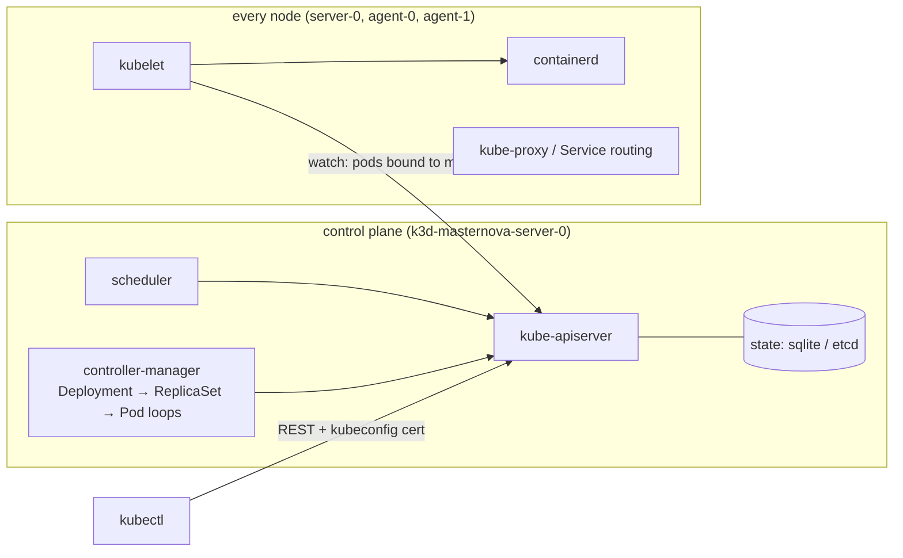
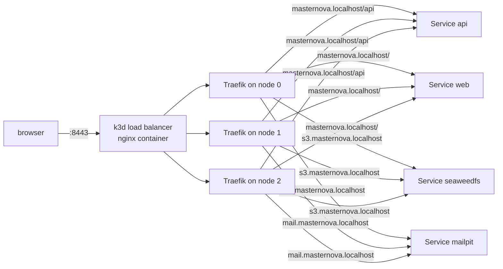
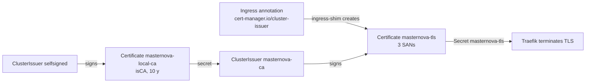

# DevOps 06: Kubernetes (local) + GitOps

> **One-liner:** Compose *starts* containers. Kubernetes *keeps a desired state true*: you
> declare objects (Deployments, Services, Secrets…), and controllers loop forever, turning the
> actual state into the declared one. GitOps puts that desired state in git, and a controller in
> the cluster pulls it.

**Roadmap:** D4.1–D4.8 · **Last updated:** 2026-10-15
**Real files:** [`deploy/k3d/`](../../deploy/k3d/) (cluster, Traefik config, local CA), [`deploy/k8s/`](../../deploy/k8s/) (raw manifests), `Makefile` (`k8s-*` targets)
**Try it:** `make k8s-up k8s-platform k8s-images k8s-apply`, then https://masternova.localhost:8443 (§3.3) or `make k8s-e2e`.

**Priority marks:** ⭐⭐⭐ must know (interviews, incidents) · ⭐⭐ use daily · ⭐ good to know.

| # | Section | Priority | Task |
|---|---|---|---|
| 1 | [Cluster anatomy, and a cluster on a laptop](#1-cluster-anatomy-and-a-cluster-on-a-laptop-) | ⭐⭐⭐ | D4.1 |
| 2 | [The core objects, written by hand](#2-the-core-objects-written-by-hand-) | ⭐⭐⭐ | D4.2 |
| 3 | [Ingress and TLS](#3-ingress-and-tls-) | ⭐⭐⭐ | D4.3 |
| 8 | [Common mistakes](#8-common-mistakes-) | ⭐⭐⭐ | — |
| 9 | [Interview Q&A](#9-interview-qa-) | ⭐⭐⭐ | — |
| 10 | [30-second recall](#10-30-second-recall) | ⭐⭐⭐ | — |

---

## 1. Cluster anatomy, and a cluster on a laptop ⭐⭐⭐

### 1.1 The parts



- **Everything goes through the API server.** `kubectl`, the scheduler, the controllers and every
  kubelet are *clients* of it. Nothing talks to anything else directly.
- **Controllers are reconcile loops:** read desired state, read actual state, act on the
  difference, repeat. A Deployment controller creates a ReplicaSet; the ReplicaSet controller
  creates Pods; the scheduler binds each Pod to a node; that node's kubelet starts the
  containers. Delete a pod and the ReplicaSet makes another: that's the "self-healing".
- **k3s** is a CNCF-conformant Kubernetes in one binary. It swaps etcd for sqlite on one server
  and bundles containerd, CoreDNS, Traefik (ingress), metrics-server and the local-path
  storage provisioner. **k3d** runs each k3s node as a Docker container.

### 1.2 Our cluster

[`deploy/k3d/cluster.yaml`](../../deploy/k3d/cluster.yaml) (`make k8s-up`, ~50 s):

| Choice | Why |
|---|---|
| 1 server + **2 agents** | a node drain (D4.8) needs somewhere to move pods; anti-affinity needs > 1 node |
| `rancher/k3s:v1.36.4-k3s1` pinned | the cluster is rebuilt from this file: pin it like an image |
| host **8082 → 80, 8443 → 443** on k3d's load balancer | Traefik's entry points; offset from compose's 8080/8081 so both stacks can run |
| a **registry** container, `127.0.0.1:5050` | `make k8s-images` *pushes* (as CI does) instead of side-loading tarballs (`k3d image import`) |

The registry has two names: the host pushes to `localhost:5050/…`, and the nodes pull
`registry.localhost:5050/…`. k3d writes the mirror into each node's
`/etc/rancher/k3s/registries.yaml`:

```yaml
mirrors:
  registry.localhost:5050:
    endpoint: [http://registry.localhost:5000]   # the registry's port on the Docker network
```

Images are tagged `sha-<commit>` (`-dirty` with uncommitted changes), never `latest`. A
Deployment's pod template only changes when the tag changes, and a changed template is what
triggers a rollout. Re-pushing `:latest` changes nothing the cluster can see.

**Memory.** Docker Desktop's VM has 7.7 GiB here. The compose stack (≈ 2.2 GiB with
observability) is stopped while the cluster runs (`docker compose … stop`: volumes are kept).

### 1.3 `kubectl` fundamentals: the commands actually used

```bash
kubectl config get-contexts                 # kubeconfig = clusters × users; a context picks one of each
kubectl config use-context k3d-masternova   # make k8s-up switches to it
kubectl get nodes -o wide                   # 3 nodes, their IPs, kubelet + containerd versions
kubectl -n masternova get pods -o wide      # which node each pod landed on
kubectl -n masternova describe pod <pod>    # spec + status + the EVENTS: why it isn't running
kubectl -n masternova get events --sort-by=.lastTimestamp   # the cluster's own log
kubectl -n masternova logs deploy/api       # one pod of the Deployment; -f to follow
kubectl -n masternova logs <pod> --previous # the crashed container before the restart ⭐
kubectl -n masternova exec <pod> -- sh -c 'ls /run/secrets'   # a shell in the container
kubectl -n masternova port-forward svc/web 18081:80             # a tunnel to a Service
kubectl top pods -n masternova              # live CPU/memory (k3s ships metrics-server)
kubectl explain deployment.spec.strategy    # the API's own docs, field by field
```

`--previous` and `get events` answered the first incident (§2.5). **Namespaces** are folders
for names and the unit for quotas, RBAC and Pod Security. Everything here lives in `masternova`;
the platform add-ons get their own namespaces (`kube-system`, later `cert-manager`, `cnpg-system`,
`argocd`).

---

## 2. The core objects, written by hand ⭐⭐⭐

Raw YAML in [`deploy/k8s/`](../../deploy/k8s/), before any templating, to learn what each field
does. `make k8s-apply` applies it (`TAG` substituted with `sed`: no templating yet, on purpose).

| Object | File | What it is |
|---|---|---|
| Namespace | `namespace.yaml` | the folder, with Pod Security labels (§2.4) |
| ConfigMap | `app/config.yaml` | compose's `x-app-env`: non-secret settings, read via `envFrom` |
| Secret ×2 | `make k8s-secrets` (never in git) | `masternova-app` (4 signing keys), `masternova-db` (`kubernetes.io/basic-auth`) |
| Deployment + Service | `app/api.yaml`, `app/web.yaml` | stateless replicas behind a stable virtual IP + DNS name |
| Deployment | `app/worker.yaml` | no Service: nothing calls the worker |
| StatefulSet + PVC template | `infra/postgres.yaml`, `infra/seaweedfs.yaml` | stable pod name (`postgres-0`) and its own volume |
| Job | `infra/seaweedfs.yaml` (`media-init`) | run to completion: bucket + CORS |

### 2.1 Deployment → ReplicaSet → Pod, and a Service in front

A **Service** selects pods by label (`app.kubernetes.io/name: api`) and gets a stable cluster IP
plus a DNS name (`api.masternova.svc.cluster.local`, or just `api` inside the namespace). That's
why `frontend/nginx.conf`'s `proxy_pass http://api:8080` works unchanged from compose. Only
**ready** pods are endpoints of the Service.

`strategy.rollingUpdate: { maxSurge: 1, maxUnavailable: 0 }`: a rollout starts one new pod,
waits for it to be *ready*, then stops an old one. Capacity never drops below `replicas`.

### 2.2 Probes: three questions ⭐⭐⭐

| Probe | Question | On failure | Here |
|---|---|---|---|
| `startupProbe` | has it finished booting? | (keeps the other two off until it passes) | `/actuator/health/liveness`, 2 s × 60 |
| `livenessProbe` | is it wedged beyond recovery? | the kubelet **kills and restarts** the container | `/actuator/health/liveness`, 10 s × 3 |
| `readinessProbe` | should it receive traffic now? | removed from the Service's endpoints, **not** killed | `/actuator/health/readiness`, 5 s × 2 |

- **Liveness must never check a dependency.** If Postgres goes down and liveness checks it,
  every api pod restarts at once and fixes nothing. Boot's liveness group is the app's own
  `LivenessState` only (the default, kept).
- A startup probe replaces a long `initialDelaySeconds` guess: liveness doesn't start counting
  while the JVM boots, so a slow first start (Flyway on an empty database) isn't killed.
- These are the same Actuator groups the Dockerfile's `HEALTHCHECK` already uses
  (`management.endpoint.health.probes.enabled: true`).

### 2.3 Resources and QoS ⭐⭐⭐

```yaml
resources:
  requests: { cpu: 250m, memory: 768Mi }   # what the scheduler reserves on a node
  limits:   { cpu: '2',  memory: 1Gi }     # the cgroup: memory → OOM kill, CPU → throttling
```

- **requests** are for *scheduling* (a pod lands only where the requests fit). **limits** are
  enforced by the kernel. Measured: api ≈ 500 Mi, worker ≈ 270 Mi idle (`kubectl top`).
- **QoS class:** requests = limits for every resource → `Guaranteed` (evicted last); requests <
  limits → `Burstable` (ours); none → `BestEffort` (evicted first under node pressure).
- **The JVM reads the limit:** `MaxRAMPercentage=75` of 1 Gi = 768 MB heap, exactly as in compose
  (devops/02). Memory request = most of the limit, so the scheduler reserves what the JVM will
  really take.
- **CPU limit: kept, on purpose.** The common advice is "no CPU limits" (throttling hurts tail
  latency), but the JVM sizes GC threads and `availableProcessors()` from it. Without one, a pod
  on an 8-core node sizes for 8. The alternative is `-XX:ActiveProcessorCount`.

### 2.4 Security context, Pod Security Admission, Secrets ⭐⭐⭐

Each compose hardening line has a field (devops/03 §9), now applied:

```yaml
spec:
  enableServiceLinks: false            # see §2.5
  automountServiceAccountToken: false  # no Kubernetes API token in the pod (verified: no /var/run/secrets/kubernetes.io)
  securityContext:
    runAsNonRoot: true
    runAsUser: 100                     # ⭐ numeric: the image says `USER app`, a NAME the kubelet can't verify
    runAsGroup: 101
    seccompProfile: { type: RuntimeDefault }
  containers:
    - securityContext:
        readOnlyRootFilesystem: true   # + emptyDir (medium: Memory) at /tmp = compose's tmpfs
        allowPrivilegeEscalation: false
        capabilities: { drop: [ALL] }
```

**Pod Security Admission** (in the API server, no add-on) is configured by namespace labels:
`enforce: baseline`, `warn` + `audit: restricted`. `kubectl apply` printed a warning for
postgres, redis, seaweedfs, mailpit, media-init and web (nginx's root master + `CHOWN/SETUID/SETGID`).
api and worker printed **nothing**: they already meet `restricted`.

**Secrets** stay files, as in compose. One `projected` volume merges keys from two Secrets into
`/run/secrets`, and Spring's `configtree:/run/secrets/` import reads each file as a property:

```yaml
- name: secrets
  projected:
    sources:
      - secret: { name: masternova-app, items: [{ key: JWT_ACCESS_SECRET, path: JWT_ACCESS_SECRET }, …] }
      - secret: { name: masternova-db,  items: [{ key: password, path: DATABASE_PASSWORD }, …] }
```

The worker's volume lists only `NOTIFICATION_TOKEN_SECRET` (least privilege). Verified inside
the api pod: 6 files in `/run/secrets`, **0** env vars matching `secret|password`. A Secret is
only base64 in etcd. Real protection is RBAC on `secrets` plus encryption at rest; D6 uses a cloud
secret manager.

### 2.5 What compose did that Kubernetes doesn't ⭐⭐

**No `depends_on`.** The first apply started api and worker before Postgres was ready:

```text
api-…   1/1   Running   2 (23s ago)
Caused by: … FlywaySqlUnableToConnectToDbException: Connection to postgres:5432 refused
```

The pods crashed and were restarted with backoff until Postgres answered. That's the Kubernetes
model: **every component must tolerate its dependencies being absent**, and restarts are cheap.
Ordering, where it really matters (migrations before the new code), becomes a Job (D4.4).

**Service links.** For every Service, Kubernetes injects `<NAME>_PORT=tcp://10.43.x.y:port` into
every pod, a Docker-links leftover. A Service named `api` produces `API_PORT`, and our
`server.port: ${API_PORT:8080}` would read `tcp://…`. `enableServiceLinks: false` on every pod.

**Graceful stop.** `terminationGracePeriodSeconds: 45` (compose's `stop_grace_period`), plus a
`preStop: { sleep: { seconds: 5 } }`. Endpoint removal and SIGTERM happen in parallel, so Traefik
can still route to a terminating pod for a moment. The native `sleep` action needs no `sleep`
binary in the image.

### 2.6 Verified

- `web → api → postgres → outbox → worker → Mailpit`: a signup through
  `port-forward svc/web` returns 201, and the confirmation email lands in Mailpit.
- 2 api replicas spread over 2 nodes; Flyway ran once (its advisory lock serialises the two).
- PVCs `data-postgres-0` and `data-seaweedfs-0` bound by `local-path`.

---

## 3. Ingress and TLS ⭐⭐⭐

### 3.1 One way in



An **Ingress** is a routing rule (host + path → Service); an **ingress controller** (Traefik,
bundled with k3s) watches Ingresses and configures itself. [`app/ingress.yaml`](../../deploy/k8s/app/ingress.yaml):

- `/api` goes **straight to the api** Service. In compose the browser's `/api` calls went
  through the web container's nginx; here that hop is gone (nginx's `/api` block is simply
  unused). The longest prefix wins, whatever the order of the paths.
- `s3.masternova.localhost` exposes SeaweedFS for the **presigned** upload and segment URLs
  (`STORAGE_PUBLIC_ENDPOINT`). The host is part of the S3 signature, and Traefik forwards it
  unchanged.
- `*.localhost` resolves to 127.0.0.1 with no `/etc/hosts` edits (RFC 6761).
- **http → https:** Traefik's usual entry-point redirect would send browsers to `:443`, but the
  host publishes TLS on `:8443`. So a `redirectScheme` **Middleware** (a Traefik CRD) names the
  port, on a second, http-only Ingress. Measured: `http://…:8082/courses` → `301
  https://…:8443/courses`.
- `SECURE_COOKIES=true`: the refresh cookie now travels over https only.

### 3.2 cert-manager: certificates as objects



- cert-manager (`make k8s-platform`, Helm chart v1.21.2 with its CRDs) adds `Issuer`,
  `ClusterIssuer` and `Certificate` kinds, plus a controller that issues and renews them.
- **One local CA, not a self-signed certificate per host:** trusting
  `secrets/masternova-local-ca.crt` once (`curl --cacert`, the OS keychain) makes every local host
  valid. It's also the shape of production: swap the `masternova-ca` ClusterIssuer for an ACME
  one (Let's Encrypt) and nothing else changes.
- The Ingress only carries an **annotation**; cert-manager's *ingress-shim* creates the
  `Certificate` from the Ingress's `tls` hosts. Verified: issuer `CN=Masternova local CA`, SANs
  `masternova.localhost, s3.…, mail.…`.

### 3.3 Found: the client IP changed with the node ⭐⭐⭐

Learner playback tokens are bound to the client IP (ADR-0017). A throwaway `traefik/whoami`
behind the same ingress, 12 requests, each with a forged `X-Forwarded-For: 6.6.6.6`:

| Traefik as | Service `externalTrafficPolicy` | `X-Forwarded-For` seen by the app |
|---|---|---|
| Deployment, 1 pod (k3s default) | `Cluster` (default) | `10.42.0.0` ×4, `10.42.1.0` ×4, `10.42.2.1` ×4 |
| **DaemonSet**, 1 per node | **`Local`** | `172.19.0.6` ×15 (the k3d load balancer) |

- The forged header never got through: Traefik replaces `X-Forwarded-For` from untrusted
  sources. Good.
- With `Cluster`, a connection may enter on any node and is **SNATed** to that node's address
  on its way to the one Traefik pod. The "client IP" was whichever node it entered on, so 2
  requests in 3 would have failed the token's IP binding, and the player gives up after one
  re-ticket.
- `Local` delivers only to a Traefik pod on the entry node, with no SNAT. A DaemonSet guarantees
  every node has one. [`deploy/k3d/traefik-config.yaml`](../../deploy/k3d/traefik-config.yaml)
  is a k3s `HelmChartConfig`, which overrides the values of the Traefik chart k3s installs itself.
- Locally every browser still shows up as the k3d load balancer: one stable IP, so the binding
  is consistent, if not meaningful. Behind a cloud load balancer, `Local` (or PROXY protocol)
  is what delivers the real client address.

### 3.4 Verified: the e2e suite against the cluster

`make k8s-e2e` runs the same 13 Playwright tests as CI against
`https://masternova.localhost:8443`, with `MAILPIT_URL` on the mail host and `E2E_LOCAL_CA=1`
(Playwright's `ignoreHTTPSErrors`, opt-in). The tests cover sign up / cookie restore / log out,
authoring with autosave and the 409 dialog, the catalog, **checkout** and **upload to S3 →
transcode on the worker → HLS preview plays**. **13 passed (40 s).** One test had
`localhost:8081` hard-coded; it now compares with `baseURL`.

---

## 8. Common mistakes ⭐⭐⭐

| Mistake | Instead |
|---|---|
| Liveness probe checks the database | liveness = the process itself; dependencies belong in readiness, if anywhere |
| `initialDelaySeconds: 120` for a slow boot | a `startupProbe` |
| `runAsNonRoot` with an image whose `USER` is a name | numeric `runAsUser` (or a numeric `USER` in the Dockerfile) |
| Leaving service links on | `enableServiceLinks: false` (`API_PORT=tcp://…` broke nothing only because of this) |
| Secrets as env vars (`secretKeyRef`) | a Secret volume; Spring's `configtree` reads files |
| `:latest` tags | an immutable tag per build: a new tag is what makes a rollout |
| Expecting start-up order | crash + restart is the model; a Job where order matters |
| Changing a ConfigMap and expecting pods to see it | env is read at start: roll the pods (Helm: a checksum annotation, §5) |
| `externalTrafficPolicy: Cluster` in front of anything that cares about the client IP | `Local` + an ingress pod on every node (or PROXY protocol) |
| A self-signed certificate per host | one CA issuer; trust it once; swap it for ACME in production |

---

## 9. Interview Q&A ⭐⭐⭐

**Q: What happens between `kubectl apply -f deployment.yaml` and a running container?**
The API server validates and stores the Deployment. The Deployment controller creates a
ReplicaSet, which creates Pods. The scheduler binds each pod to a node whose free capacity fits
its *requests*. That node's kubelet sees the binding, pulls the image through containerd, starts
the containers and runs the probes. Readiness passing adds the pod to its Services' endpoints.

**Q: Liveness vs readiness?**
Liveness failing restarts the container; readiness failing only takes it out of load balancing.
So liveness checks only the process itself (never the database: that would restart every pod
during a DB outage), and readiness says "don't send me traffic right now".

**Q: Requests vs limits, and why does it matter for Java?**
Requests are for scheduling, limits are enforced by cgroups. The JVM sizes its heap from the
memory limit (`MaxRAMPercentage`) and its thread pools from the CPU limit, so without limits it
sizes itself for the whole node.

**Q: How do you get the client's IP through a Kubernetes ingress?**
`externalTrafficPolicy: Local` on the ingress controller's Service, so traffic isn't SNATed
between nodes, with a controller pod on every node that receives traffic (a DaemonSet). Then
trust `X-Forwarded-For` only from the controller: Traefik drops a client's own header, and
Tomcat's `RemoteIpValve` trusts only internal addresses. I measured both halves with a whoami pod
before trusting it with IP-bound playback tokens.

---

## 10. 30-second recall

- Everything talks to the **API server**; controllers reconcile desired → actual, forever.
- Deployment → ReplicaSet → Pods; a **Service** = label selector + stable IP/DNS over *ready* pods.
- startup / liveness (restart) / readiness (traffic); liveness never checks dependencies.
- requests schedule, limits enforce; the JVM sizes itself from the limits.
- `restricted` security context on the apps; Secrets as files; `enableServiceLinks: false`.
- Ingress = rules, controller = Traefik; cert-manager issues from one local CA; `Local` keeps the client IP.
