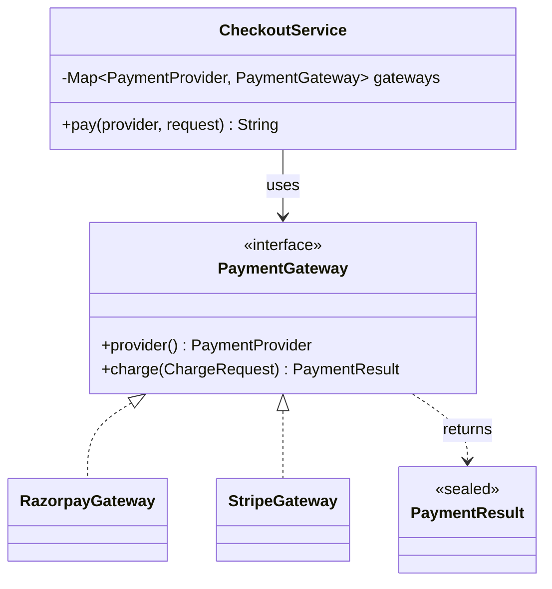

# Strategy — pick one interchangeable algorithm at runtime

> **One-liner:** define a family of algorithms behind one interface, so the caller chooses one at
> runtime and new ones are added without editing the caller.

**Type:** Behavioral · **Status:** ✅ in real code (Phases 7.5, 8.2, 9.2, 9.4, 11.4) · **Last updated:** 2026-10-21
**Real code:** `com.masternova.worker.pipeline.ffmpeg.LadderProfile` (Strategy) → `StandardLadder`, `FastLadder` (ConcreteStrategy), chosen by `masternova.pipeline.ladder` · `com.masternova.api.commerce.domain.Discount` (sealed: `PercentOff`, `AmountOff`) · `com.masternova.api.commerce.domain.PaymentGateway` → `RazorpayGateway`, `FakePaymentGateway`, chosen by `masternova.commerce.provider` · **Lab:** [`lab/.../strategy/`](../lab/src/main/java/com/masternova/patterns/strategy/) (payments) and [`strategy/ladder/`](../lab/src/main/java/com/masternova/patterns/strategy/ladder/Ladder.java) (the transcode ladder)

**Trigger phrase:** "*support several providers/methods/algorithms, and more later*", or
"*the behaviour depends on a type/config value*".

## 1. The problem in Masternova

Checkout must charge through **Razorpay** today and maybe **Stripe** tomorrow. Without Strategy,
the checkout service grows a branch for each provider:

```java
if (provider == RAZORPAY) { /* razorpay SDK calls, INR rules */ }
else if (provider == STRIPE) { /* stripe SDK calls, limits */ }
// every new provider = edit + retest this class
```

That one class then knows every provider's rules, changes for every provider, and is hard to
unit-test. Strategy moves each branch into its own class behind `PaymentGateway`.

The same shape shows up again later:

- **Phase 3:** auth methods (password, Google OAuth).
- **Phase 7:** transcode profiles (240p … 1080p ladder).
- **Phase 9:** coupon types (percent, fixed).

## 2. Structure



| GoF role | Masternova class | Responsibility |
|---|---|---|
| Strategy | `PaymentGateway` | The contract every provider honours |
| ConcreteStrategy | `RazorpayGateway`, `StripeGateway` | One provider's rules and API calls |
| Context | `CheckoutService` | Picks a strategy by key and uses it, without knowing the concrete class |

## 3. Code walkthrough

```java
public CheckoutService(Collection<? extends PaymentGateway> strategies) {
  for (PaymentGateway gateway : strategies) {             // Spring will inject List<PaymentGateway>
    PaymentGateway previous = gateways.putIfAbsent(gateway.provider(), gateway);
    if (previous != null) throw new IllegalArgumentException("two gateways for " + gateway.provider());
  }
}

public String pay(PaymentProvider provider, ChargeRequest request) {
  PaymentGateway gateway = gateways.get(provider);      // registry lookup, not if/else
  return switch (gateway.charge(request)) {              // exhaustive over the sealed result
    case PaymentResult.Approved(String ref)    -> "Paid — reference " + ref;
    case PaymentResult.Declined(String reason) -> "Payment declined: " + reason;
  };
}
```

- **Registry (`EnumMap`):** strategies are indexed once at construction, so selecting one is
  O(1) and there is no `switch` on the provider anywhere.
- **Fail fast:** a duplicate registration is a wiring bug, so it throws at startup, not at the
  first payment.
- In Spring, `CheckoutService` becomes a `@Service` and its constructor receives
  `List<PaymentGateway>`, which is every bean implementing the interface. Adding a provider is
  then *just a new `@Component`*.

## 4. Java features that make it nicer

- **`record ChargeRequest`:** an immutable input. The compact constructor validates it (no
  negative money).
- **`sealed interface PaymentResult`:** the compiler knows the only outcomes, so the `switch` is
  exhaustive with no `default`.
- **Record deconstruction patterns:** `case Approved(String ref)` pulls fields out in the
  `case` label (Java 21+).
- **Lambdas:** if the strategy interface had one method, each strategy could be a lambda, e.g.
  `Map<CouponType, Function<Money, Money>>`.

## 5. When NOT to use it

- **Only one implementation, and no second one is on the roadmap.** One implementation is not a
  seam, so call the class directly (YAGNI).
- **The variants differ only by data, not behaviour.** For example, the ladder rungs differ only
  in resolution and bitrate. A record/enum of settings is enough there. Use Strategy when the
  *code* differs.
- **The choice never changes at runtime.** Then a single injected bean (plain DI) is enough; you
  don't need a registry.

## 6. Where Spring itself uses it

- **DI of an interface:** the container picks the implementation.
- **`PasswordEncoder`:** bcrypt, argon2 and others are strategies.
- **`ResourceLoader`**, Jackson serializers.
- **Spring Security:** `AuthenticationProvider` (one per auth method).

## 7. Alternatives considered

| Alternative | Why not here |
|---|---|
| `if/else` / `switch` on provider | Violates Open/Closed; one class changes for every provider |
| Enum with abstract method per constant | Fine for tiny pure logic, but providers need injected SDK clients and config, which enums can't take |
| Inheritance (`abstract class Checkout`, subclass per provider) | Fixes the behaviour at construction; can't pick per request; that's Template Method's job |

## 7b. First real use: the transcode ladder (Phase 7.5)

Which HLS renditions to make, and how hard x264 should work, has **two real answers**:

- **`StandardLadder`** (prod): 360p / 720p / 1080p at `veryfast`, where quality matters;
- **`FastLadder`** (dev, CI, the crash IT): 240p / 360p at `ultrafast`, so a test clip takes about
  a second through the **same** pipeline code.

That's the force: two implementations that exist from day one, not "maybe a second one later".
Spring picks one with `@ConditionalOnProperty(name = "masternova.pipeline.ladder")`, so the
processor never contains `if (ci)`.

One rule is shared by every strategy: never upscale, and always keep one rung. It lives in the
interface as a **default method** (`rungsFor`), and each strategy only lists its `rungs()` and
`preset()`. That's a Strategy with a little Template Method inside it. It's fine while the shared
part is one rule; if it grew, the shared part would move into the processor and the strategies
would shrink to data. `LadderProfileTest` pins the rule for both.

## 7c. Second use: the entitlement policies (Phase 8.2)

`com.masternova.api.entitlement.domain.EntitlementPolicy` is a Strategy with **seven**
ConcreteStrategies (`AdminPolicy`, `OwnerPolicy`, `FreeCoursePolicy`, …), each one rule over the
same `AccessContext`. The difference from the ladder: the caller doesn't *pick one*. The
`PolicyChain` runs *all* of them and reduces their votes ([Chain of Responsibility](03-chain-of-responsibility.md)).
That's the usual pairing: Strategy is the shape of each rule, the chain is how they're composed.

The force is the same as for the ladder: the rules vary independently and new ones are added
without opening the old ones (a coupon policy next quarter is a new `@Component @Order`).

## 7d. Third use: coupon kinds as sealed records (Phase 9.2)

`com.masternova.api.commerce.domain.Discount` is a `sealed interface` with two records,
`PercentOff(percent, cap?)` and `AmountOff(amount)`. Each one computes `discountOn(base)`
differently: a percentage rounds half-up to the paisa and then caps, a fixed amount clamps to the
base. The pricer calls `coupon.discount().discountOn(base)` and never looks at the kind.

What's different from the ladder and the policies: **these strategies are data, not beans**. A
coupon *row* picks its strategy, so there's no Spring selection. The one place a row becomes a
strategy, `Coupon.discount()`, is an exhaustive `switch` over the kind. A third kind is a new
record plus one `case`, and the compiler finds the switch.

The contract every strategy must keep (`0 ≤ discount ≤ base`, same currency) is what lets the
pricer write `subtotal.minus(discount)` without a check. `DiscountTest.theContractHoldsForEveryKind`
runs every strategy over the edge bases (0, 1, 99, …). Lab: [`strategy/coupon/`](../lab/src/main/java/com/masternova/patterns/strategy/coupon/CouponDiscount.java).

## 7e. Fourth use: the payment provider (Phase 9.4)

The lab's `PaymentGateway` (written in Phase 1, before any provider existed) picks a gateway **per
request** from a registry. The real one is simpler, and the difference is worth saying: Masternova
takes payments through **one** provider per deployment, so the strategy is picked **once, by
configuration**, in `CommerceConfig`: two `@Bean` methods guarded by
`@ConditionalOnProperty(masternova.commerce.provider)`, `razorpay` (test or live keys) or `fake`,
so exactly one gateway exists and everything else injects `PaymentGateway`.

The second implementation is real, not speculative: local runs, e2e and CI have no Razorpay keys,
so `FakePaymentGateway` simulates the two outbound calls (create an order, refund) and shares the
rest with Razorpay's adapter (signatures, webhook parsing). Checkout, confirm, webhooks and refunds
never contain `if (fake)`. A per-request registry would come back only if learners could choose a
provider (Razorpay for INR, Stripe for USD), which the single-currency catalog doesn't need yet.

Guard rails: the fake logs a WARN at startup, and choosing `RAZORPAY` without its three secrets
fails startup (`FakePaymentGatewayTest.razorpayWithoutKeysRefusesToStart`).

## 7f. Fifth use: search rankers, picked per request (Phase 11.4)

`com.masternova.api.catalog.domain.search.CourseRanker` has three implementations:
`KeywordRanker` (Postgres full-text, `ts_rank_cd`), `SemanticRanker` (pgvector cosine distance
over embeddings) and `HybridRanker`, which **is built from the other two through the same
interface** and fuses their lists with Reciprocal Rank Fusion. `CourseSearchService`, the Context,
holds an `EnumMap<SearchMode, CourseRanker>` filled from every ranker bean (each says its
`mode()`), so the request's `mode` picks the strategy and the service never branches on how
ranking works.

Two things this use adds to the earlier ones:

- **Selection per request *and* a runtime substitute.** The payment provider is picked once per
  deployment; the ladder once per profile. A ranker is picked by each request, and when the
  semantic strategy's dependency (the embedding model) is down, it throws
  `EmbeddingUnavailableException` and the Context substitutes the keyword strategy, answering
  `degraded: true`. A mode with no ranker configured (semantic search off) degrades the same way.
- **A strategy composed of strategies.** `HybridRanker` knows no SQL and no model, only two
  `CourseRanker`s and a pure function (`RankFusion`). `HybridRankerTest` tests it with lambdas.

Lab: [`strategy/ranking/`](../lab/src/main/java/com/masternova/patterns/strategy/ranking/Ranking.java).

## 8. Interview Q&A

- **Q: Strategy vs State?**
  **A:** Same class diagram, different intent. In Strategy, the *client* chooses the algorithm
  and strategies don't know each other. In State, the *object itself* switches state, and
  states decide the next state.
- **Q: Strategy vs Template Method?**
  **A:** Strategy is composition: swap the whole algorithm at runtime. Template Method is
  inheritance: a fixed skeleton where subclasses fill in steps, chosen at compile time.
- **Q: How do you select a strategy without a `switch`?**
  **A:** A registry (`Map<Key, Strategy>`) built from the injected `List<Strategy>`, with each
  strategy reporting its own key.
- **Q: Which SOLID principles does it serve?**
  **A:** OCP (add, don't edit), SRP (one provider per class), DIP (the context depends on the
  abstraction).

## 9. 30-second recall

- **Intent:** a family of interchangeable algorithms behind one interface, chosen at runtime.
- **Roles:** Strategy (interface) · ConcreteStrategy · Context (holds and uses one).
- **In Masternova:** the transcode ladder (`StandardLadder` / `FastLadder`, by property; a shared never-upscale default method) · entitlement policies · coupon kinds (sealed records, picked by the row) · payment gateways (9.4).
- **Pitfall:** one implementation is not a seam. And select via a registry, not a `switch` that
  just moved somewhere else.

*Related:* State (planned, `02-state.md`) · Template Method (planned, `06-template-method.md`) · LLD notes: `../../../LLD/`
