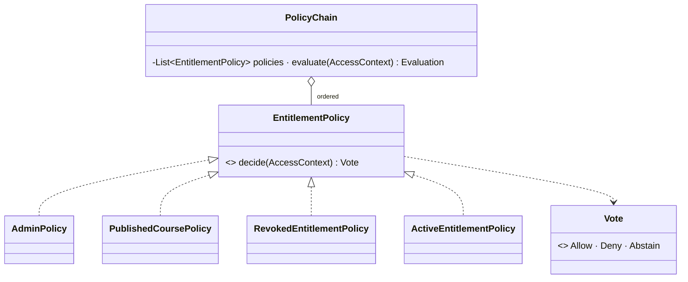

# Chain of Responsibility — the entitlement policies, where an explicit denial always wins

> **One-liner:** pass a request along an **ordered set of independent handlers**, each of which
> may decide or pass. Adding a rule is a new class, never an edit to a `switch`.

**Type:** Behavioral · **Status:** built (Phase 8.2) · **Last updated:** 2026-10-14
**Real code:** `com.masternova.api.entitlement.domain.PolicyChain` (the chain) ·
`EntitlementPolicy` (the handler) · seven `@Component @Order` policies in `entitlement.domain.policy`
**Lab:** [`lab/.../patterns/chain/`](../lab/src/main/java/com/masternova/patterns/chain/): the
textbook first-match chain and the deny-wins chain side by side, and a test where the same two
rules in a different order flip the first one's answer.

**Trigger phrase:** "there are N reasons to allow or refuse this", "and next quarter we'll add…",
"any of these may decide", "a filter / interceptor / middleware".

## 1. The problem in Masternova

Whether a viewer may play a lecture has seven reasons today: admin, owner, free course, preview
lecture, active purchase, unpublished course, refunded purchase. Commerce, coupons and
subscriptions will add more, written by someone who hasn't read the other seven.

Without the pattern:

```java
// ❌ one method that every new rule reopens, where the order of the ifs IS the policy
if (user.isAdmin()) return true;
if (course.instructorId().equals(user.id())) return true;
if (lecture.isPreview()) return true;             // ← added later, above the refund check…
if (entitlement != null && entitlement.isRevoked()) return false;   // …so refunds stop working
if (course.isFree()) return true;
return entitlement != null && entitlement.isActive();
```

A boolean also can't say *why*, and the UI needs "buy" vs "renew" vs "contact support".

## 2. Structure



| GoF role | Masternova | Responsibility |
|---|---|---|
| Handler | `EntitlementPolicy` | one rule over the `AccessContext`: `Allow(grant)`, `Deny(reason)` or `Abstain` |
| Concrete handlers | `AdminPolicy` … `ActiveEntitlementPolicy` (7) | one reason each, ignorant of the others |
| Chain / client | `PolicyChain` | runs every handler in `@Order`, reduces the votes, fails shut |

## 3. Code walkthrough

```java
public Evaluation evaluate(AccessContext context) {
  List<PolicyVote> votes = new ArrayList<>(policies.size());
  for (EntitlementPolicy policy : policies) {          // ⭐ EVERY policy runs: no short-circuit
    votes.add(new PolicyVote(policy.name(), voteSafely(policy, context)));
  }
  return new Evaluation(reduce(votes, context), votes); // the votes are the explanation
}

private static AccessDecision reduce(List<PolicyVote> votes, AccessContext context) {
  for (PolicyVote v : votes)
    if (v.vote() instanceof Deny(DenialReason reason)) return new Denied(reason); // ⭐ deny wins
  for (PolicyVote v : votes)
    if (v.vote() instanceof Allow(var grant)) return new Allowed(grant);
  return new Denied(fallback(context));                // ⭐ closed by default
}
```

And a handler that denies **scopes itself**, because a deny always wins:

```java
class RevokedEntitlementPolicy implements EntitlementPolicy {
  public Vote decide(AccessContext context) {
    boolean revoked = !context.isStaff()                // ⭐ never lock out admin / instructor
        && context.entitlementStatus().orElse(null) == Entitlement.Status.REVOKED;
    return revoked ? Vote.deny(DenialReason.ENTITLEMENT_REVOKED) : Vote.ABSTAIN;
  }
}
```

**Two departures from the book, on purpose:**

1. **No short-circuit.** The textbook chain stops at the first handler that answers. For
   authorization that makes the answer depend on list order: put "preview → allow" above
   "refunded → deny" and refunds silently stop working (the lab's `FirstMatchChain` test shows the
   flip). Evaluating everything and letting deny win means order only picks *which reason* is
   reported.
2. **No `next` pointer.** The linked list exists so a handler can choose to stop the chain. None
   of ours may, so the chain is just `List<EntitlementPolicy>`, injected by Spring in `@Order`.

## 4. Java features that make it nicer

- **Sealed `Vote` with record patterns:** `v instanceof Deny(DenialReason reason)` binds the
  reason in the test itself; a fourth vote kind would be a compile error in every `switch`.
- **`List<EntitlementPolicy>` injection sorted by `@Order`:** Spring collects every bean of the
  type and sorts them (`AnnotationAwareOrderComparator`). Adding a policy is a new `@Component`.
- **A `default` method** for `name()`, so the explanation and the error log name the policy
  without each one repeating itself.
- **Records for the context:** immutable and fetched once, so a rule can't query (the N+1 that
  grows with the number of rules).

## 5. When NOT to use it

- **Two branches that will never be five:** that's an `if`. No force, no pattern.
- **When exactly one handler must handle it and order is the point** (routing, parsing): then the
  textbook first-match chain is right, and deny-wins is wrong.
- **When handlers need each other's results:** that's a pipeline or a Decorator, not a chain of
  independent votes.

## 6. Where Spring itself uses it

- **`SecurityFilterChain`:** servlet filters, each calls `chain.doFilter` or stops. That one *is*
  first-match-ish: a filter that rejects ends the request.
- **`HandlerInterceptor`s** in Spring MVC, and Angular's `HttpInterceptorFn` chain in our frontend.
- **Spring Security's `AuthorizationManager`s** composed with `AuthorizationManagers.allOf/anyOf`.

## 7. Alternatives considered

| Alternative | Why not here |
|---|---|
| First-match chain | Order-dependent answers; a later allow defeats an earlier deny. |
| `boolean` handlers | No abstain (so "not a preview" must lie), and no reason for the UI. |
| A rules engine (Drools, Easy Rules) | Seven rules in plain Java are readable and unit-tested in milliseconds; an engine adds a DSL and a runtime for nothing. |
| Spring Security voters (`AccessDecisionVoter` + `UnanimousBased`) | The same idea, deprecated since Spring Security 5.8 in favour of `AuthorizationManager`. Our chain plugs into `@PreAuthorize` through an `AuthorizationResult` instead (Phase 8.4). |

## 8. Interview Q&A

- **Q:** What's Chain of Responsibility?
  **A:** A request goes through an ordered set of handlers; each handles it or passes. The sender
  doesn't know which handler answers, and adding one doesn't touch the others.
- **Q:** Why would you *not* short-circuit?
  **A:** In authorization the rule that must win (a refund) has to beat rules added after it. If
  the first answer wins, someone inserting a rule above yours silently disables it. Run everything,
  let any deny win, and order stops mattering for *whether*.
- **Q:** Then how do you keep a deny from locking out the wrong people?
  **A:** A denying rule must scope itself. Ours share one predicate, `isStaff()`, so the instructor
  still sees their own draft.
- **Q:** What happens if a rule throws, or the list is empty?
  **A:** Fail shut: a throwing rule counts as a deny (`ACCESS_CHECK_FAILED`, logged), and nobody
  allowing means denied. The opposite default turns a bad refactor into free access to every paid
  course.
- **Q:** Why three outcomes?
  **A:** "This lecture isn't a preview" isn't a reason to deny. `Abstain` lets each rule speak only
  about what it knows.
- **Q:** CoR vs Strategy vs Decorator?
  **A:** Each policy *is* a Strategy (an interchangeable rule); the chain composes them. A
  Decorator also chains objects, but adds behaviour around one subject instead of collecting votes.

## 9. 30-second recall

- **Intent:** independent handlers, in order; any may decide; adding one is a new class.
- **Roles:** handler (`EntitlementPolicy`) · concrete handlers (7 `@Order` beans) · chain (`PolicyChain`).
- **In Masternova:** every policy votes Allow / Deny / Abstain; **deny wins**, **closed by default**,
  a throwing policy is a deny; votes kept for an admin's explanation; denials carry a reason code.
- **Pitfalls:** first-match in an auth chain · a deny that forgot `isStaff()` · handlers that query ·
  defaulting to allow.

*Related:* [Strategy](01-strategy.md) (each policy) · [Decorator](13-decorator.md) (the cached row
the context reads) · [Specification](08-specification.md) · LLD:
[`docs/lld/entitlement-engine.md`](../../docs/lld/entitlement-engine.md) §3
