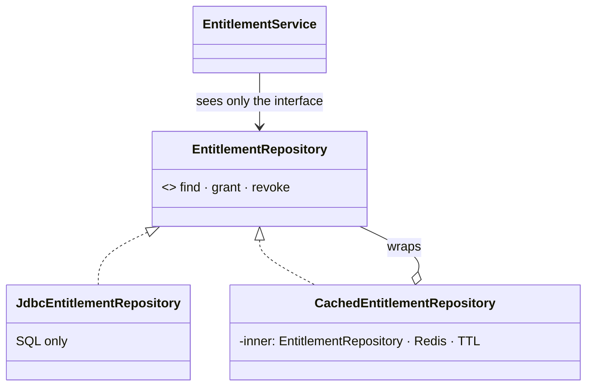

# Decorator — the entitlement cache the repository doesn't know about

> **One-liner:** wrap an object in another that has the **same interface**, holds the original,
> and **adds behaviour** around its calls. Callers can't tell, and the wrapped object doesn't know.

**Type:** Structural · **Status:** built (Phases 8.3, 10.3) · **Last updated:** 2026-10-17
**Real code:** `com.masternova.api.entitlement.infrastructure.CachedEntitlementRepository`
(Decorator) wrapping `JdbcEntitlementRepository` (ConcreteComponent), both implementing
`entitlement.domain.EntitlementRepository` (Component), wired in `EntitlementConfig`
**Lab:** [`lab/.../patterns/decorator/`](../lab/src/main/java/com/masternova/patterns/decorator/)
(an in-memory cache over an in-memory "database") · the Java-OOP version:
[`java/06`](../java/06-oop-composition-over-inheritance.md) (notification channels)
**Second use (10.3):** `com.masternova.api.enrollment.infrastructure.WriteBackProgressStore`
(Decorator, write-back) wrapping `enrollment.application.ProgressWriter` (ConcreteComponent), both
`enrollment.domain.ProgressStore`, wired in `EnrollmentConfig` (§3b); lab: `WriteBackPositionStore`

**Trigger phrase:** "add caching / logging / metrics / retries **to** X without changing X",
"sometimes with, sometimes without", "stackable".

## 1. The problem in Masternova

Every entitlement decision reads one row: does this user hold this course? It runs once per
lecture on every course page, on every lecture open and every playback token. The row changes
about twice in its life. That's what a cache is for (ADR-0016).

Without the pattern, the cache goes *into* the repository:

```java
// ❌ the SQL class now also knows Redis, keys, TTLs, eviction timing and Redis outages
public Optional<Entitlement> find(UUID user, UUID course) {
  String cached = redis.get("ent:" + user + ":" + course);
  if (cached != null) return parse(cached);
  var row = jdbc.sql("SELECT …").query(…).optional();
  redis.set(…);
  return row;
}
```

Its integration test now needs Redis to test SQL, and a unit test of the eviction rules needs
Postgres. Removing the cache means editing the SQL class.

## 2. Structure



| GoF role | Masternova | Responsibility |
|---|---|---|
| Component | `EntitlementRepository` | what the service depends on; every writer of the row is a method here |
| ConcreteComponent | `JdbcEntitlementRepository` | the truth: SQL, the idempotent upsert |
| Decorator | `CachedEntitlementRepository` | cache-aside: delegate, then cache / evict |
| Client | `EntitlementService` | injects `EntitlementRepository`, never knows which |

## 3. Code walkthrough

The wiring is where the decoration is **visible**, in one place:

```java
@Bean
EntitlementRepository entitlementRepository(JdbcClient jdbc, StringRedisTemplate redis, …) {
  return new CachedEntitlementRepository(new JdbcEntitlementRepository(jdbc), redis, json, ttl, meters);
}   // ⭐ only the wrapper is a bean: nothing can inject the uncached one by accident
```

Reads: try the cache, else delegate and remember the answer, **including "no row"**:

```java
public Optional<Entitlement> find(UUID userId, UUID courseId) {
  Hit cached = read(key);                 // null on a miss, a Redis error or an unreadable value
  if (cached != null) return cached.row();
  Optional<Entitlement> row = inner.find(userId, courseId);   // ⭐ delegate
  write(key, row);                        // "-" for no row: negatives are cached too
  return row;
}
```

Writes: delegate, then **delete the key after the commit**:

```java
public boolean revoke(UUID userId, UUID courseId, Revocation revocation) {
  boolean changed = inner.revoke(userId, courseId, revocation);   // ⭐ always delegate first
  evictAfterCommit(key(userId, courseId));  // TransactionSynchronization.afterCommit → DEL
  return changed;
}
```

**Four decisions worth defending** (ADR-0016):

1. **Cache the row, not the decision.** The decision also depends on price, publish status and
   preview flags, all catalog's. The row's only writers are methods on the interface being
   decorated, so the cache can't miss a write.
2. **Delete after commit, never write through.** Before the commit, a concurrent reader reloads
   the old row and re-caches it; write-through installs what *this* process believes.
3. **Cache negatives.** A stranger opening paid courses is the traffic to absorb.
4. **Fail open.** Every Redis call is wrapped: counted (`entitlement.cache{result=error}`),
   logged, and the database answers. A failed eviction never fails a refund that committed.

⭐ **The bug the NestJS version shipped:** `JSON.parse` has no `Date`, so the cached `expiresAt`
came back as a string, `expiresAt <= now` was quietly false, and **expired access kept
working, on the cached path only**. Here Jackson maps `Instant` both ways, and
`CachedEntitlementRepositoryTest.theCachedCopyKeepsItsInstantsSoExpiryStillWorks` reads twice so
the second answer really comes from the cache.

## 3b. Second use: the progress write-back buffer (Phase 10.3)

The player sends a heartbeat every 15 s: about 67 a second per thousand viewers, for data whose
loss costs a learner a few seconds of bookmark. The same shape, a different behaviour added:
**write-back** instead of cache-aside (ADR-0022).

| GoF role | Masternova | Responsibility |
|---|---|---|
| Component | `ProgressStore` | `record` · `recordAll` · `find` |
| ConcreteComponent | `ProgressWriter` | validated write-through: one catalog query, one enrollment query, one upsert, one rollup recount per batch, one transaction |
| Decorator | `WriteBackProgressStore` | `record` = one Lua merge into a Redis hash, no SQL; `flush()` every 30 s = `RENAME dirty → flushing`, `recordAll` the batch, release what was written (`HDEL` if unchanged); `find` merges the buffer into the rows |
| Client | `ProgressService`, `LearningQueries` | inject `ProgressStore`, never know |

```java
@Bean
WriteBackProgressStore progressStore(…) {
  return new WriteBackProgressStore(new ProgressWriter(catalog, enrollments, progress, tx, meters), redis, meters);
}   // ⭐ as in §3: only the wrapper is a bean
```

**What makes a write-back buffer safe here** is the merge, not a lock: `ProgressUpdate.merge`
(max only goes up, last is the newest) is commutative, associative and idempotent. A flush that
crashed after the `RENAME` leaves `flushing` behind, and the next flush writes it again: same
rows. The merge exists three times (Java, Lua, SQL), and `WriteBackProgressStoreIT` runs the same
random sequences through all three.

**Failing open, again:** Redis down → `record` delegates straight to `ProgressWriter` (counted as
`path=direct`), and `find` reads the rows. The decorator degrades to its component.

**Cache-aside vs write-back:** §3 makes *reads* cheap and keeps the database the only truth;
this one makes *writes* cheap and accepts that Redis holds up to 30 s of truth. That trade only
works because the data is a bookmark: no money, no access, and an accepted ≤ 30 s loss.

## 4. Java features that make it nicer

- **An interface + constructor injection:** the decorator takes `EntitlementRepository`, not
  `JdbcEntitlementRepository`, so decorators stack (a metrics decorator could wrap this one).
- **Records as cache values:** `Entitlement` is immutable, so sharing a cached instance is safe,
  and Jackson 3 serialises records (with `Optional` and `Instant`) without annotations.
- **A private `record Hit(Optional<Entitlement> row)`** instead of `Optional<Optional<…>>` to tell
  "cached: no row" from "not cached".

## 5. When NOT to use it

- **One fixed behaviour that's always on:** put it in the class. A decorator pays off when the
  behaviour is optional, stackable, or must be tested separately.
- **When the wrapped object calls itself:** `this.find(…)` inside the JDBC class bypasses the
  decorator (the same self-invocation trap as Spring's proxies).
- **When writers bypass the interface:** a cache over a table that another module updates with
  SQL can't evict. That's why the entitlement *decision* isn't cached.

## 6. Where Spring itself uses it

- **`TransactionAwareCacheDecorator`:** wraps a `Cache` so `put`/`evict` wait for the commit,
  the same idea as our `evictAfterCommit`.
- **`ContentCachingRequestWrapper`, `HttpServletRequestWrapper`:** Servlet decorators. Our
  idempotency filter's `CachedBodyRequest` is one.
- **`BufferedInputStream(new FileInputStream(…))`:** the textbook case from `java.io`.

## 7. Alternatives considered

| Alternative | Why not here |
|---|---|
| Cache inside the JDBC repository | Mixes two concerns; each test needs both Postgres and Redis. |
| Spring `@Cacheable` / `@CacheEvict` | Can do it (with `TransactionAwareCacheDecorator`, `cache-null-values`, a `CacheErrorHandler`), but puts annotations and SpEL keys on the class that shouldn't know it's cached. ADR-0016. |
| Proxy | Same shape. A Proxy *controls access* (lazy loading, permissions); a Decorator *adds behaviour*. Caching sits between, and the GoF call it a Decorator when the wrapper is explicit and stackable. |
| Inheritance (`CachedJdbcEntitlementRepository extends Jdbc…`) | Fixed at compile time, can't stack, and couples the cache to one implementation. |

## 8. Interview Q&A

- **Q:** What's a Decorator?
  **A:** An object with the same interface as the one it wraps, holding it, adding behaviour before
  or after delegating. It's composition instead of inheritance, and decorators stack.
- **Q:** Decorator vs Proxy vs Adapter?
  **A:** Adapter *changes* the interface; Decorator keeps it and *adds* behaviour; Proxy keeps it
  and *controls access*. Same shape for the last two: the difference is intent.
- **Q:** How do you invalidate the cache?
  **A:** Every writer of the cached row is a method on the decorated interface, so the decorator
  sees every write and deletes the key after the transaction commits. The TTL is the backstop.
- **Q:** Why delete instead of updating the cache with the new value?
  **A:** Two writers racing each install their own value and neither knows it lost. Deleting sends
  the next reader to the database, the only thing that knows.
- **Q:** What if Redis is down?
  **A:** The decorator catches, counts and logs, and the database answers. A cache must never fail
  the request it was added to speed up.
- **Q:** What race is left?
  **A:** A reader that loaded the old row *before* the commit can write it back *after* the
  delete. It lives one TTL (5 min). Accepted; a compare-and-set would need a Lua script.

## 9. 30-second recall

- **Intent:** same interface, wraps the original, adds behaviour; stackable; the wrapped object
  doesn't know.
- **Roles:** Component (`EntitlementRepository`) · ConcreteComponent (`Jdbc…`) · Decorator (`Cached…`).
- **In Masternova:** cache the **row** (not the decision), negatives too, **delete after commit**,
  **fail open**, TTL as backstop; wiring visible in one `@Bean`; two tests, one per concern.
  Second use: a **write-back** progress buffer, crash-safe because its merge is idempotent.
- **Pitfalls:** forgetting to delegate · writers that bypass the interface · self-invocation ·
  evicting before the commit · a cache that can fail the request.

*Related:* [Chain of Responsibility](03-chain-of-responsibility.md) (the decision that reads the
row) · [Proxy](15-proxy.md) · [Repository](16-repository-unit-of-work.md) · LLD:
[`docs/lld/entitlement-engine.md`](../../docs/lld/entitlement-engine.md) §4 · ADR-0016
