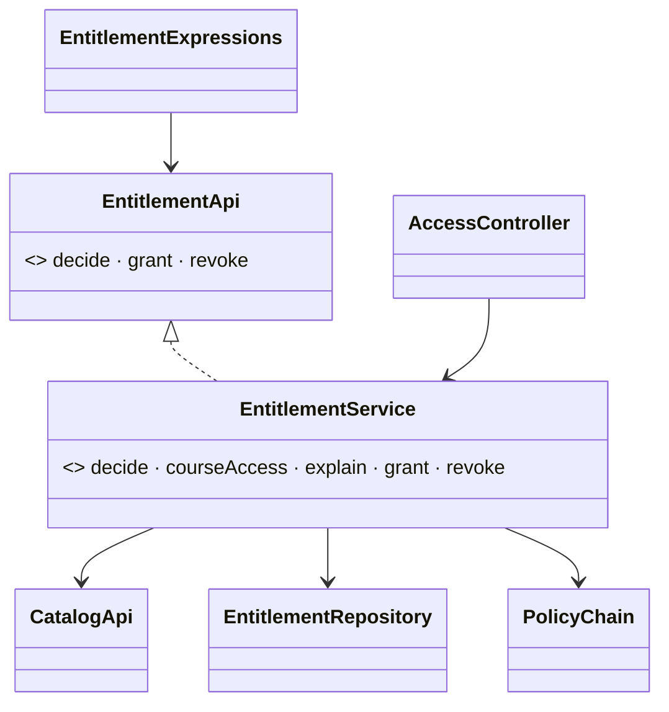

# Facade — one entry point to the entitlement engine

> **One-liner:** give a subsystem **one simple entry point** that runs the usual sequence over its
> parts, so callers don't learn the parts or the order.

**Type:** Structural · **Status:** built (Phase 8.4) · **Last updated:** 2026-10-14
**Real code:** `com.masternova.api.entitlement.application.EntitlementService` (implements the
module API `EntitlementApi`) · **Lab:**
[`lab/.../patterns/facade/`](../lab/src/main/java/com/masternova/patterns/facade/)
**Planned second use:** `CheckoutService` (Phase 9): pricing, order, payment, grant in one transaction

**Trigger phrase:** "every caller does the same five steps", "callers shouldn't know about X",
"one place for the transaction".

## 1. The problem in Masternova

Answering "may this viewer play this lecture?" takes four parts in a fixed order:

1. ask **catalog** for the course's facts (instructor, status, price, preview flags);
2. read the viewer's **entitlement row**, through the Redis cache, and only for a signed-in viewer;
3. build the `AccessContext` with the **clock**;
4. run the **policy chain**.

Four callers need it: the course page (once per lecture), the player's guard, the `@entitlements`
SpEL bean behind playback, and support's "explain". Commerce (Phase 9) will grant and revoke,
which needs a transaction and the cache's eviction. Without a facade, each caller learns the
cache, the chain and catalog's API, and one of them forgets that anonymous viewers have no row,
or reads the row once per lecture instead of once per page.

## 2. Structure



| GoF role | Masternova | Responsibility |
|---|---|---|
| Facade | `EntitlementService` | the sequence, the transaction boundary, "not found" |
| Subsystem classes | `CatalogApi`, `EntitlementRepository` (cached), `PolicyChain`, `Clock` | each does one thing; none knows the facade |
| Clients | `AccessController`, `AdminEntitlementController`, `EntitlementExpressions` (SpEL), commerce (Phase 9) | ask one question |

## 3. Code walkthrough

```java
public CourseAccess courseAccess(Optional<CurrentUser> viewer, UUID courseId) {
  CourseFacts course = catalog.courseFacts(courseId).orElseThrow(() -> new NotFoundException(…));
  Viewer who = viewerOf(viewer);
  Optional<Entitlement> row = rowOf(who, course);       // ⭐ ONCE for the whole page
  Instant now = clock.instant();
  return new CourseAccess(courseId,
      chain.evaluate(new AccessContext(who, course, Optional.empty(), row, now)).decision(),
      course.lectures().stream()
          .map(l -> new LectureAccess(l.lectureId(),
              chain.evaluate(new AccessContext(who, course, Optional.of(l), row, now)).decision()))
          .toList());
}

@Override
@Transactional                                           // ⭐ the facade owns the boundary
public boolean revoke(UUID userId, UUID courseId, String reason) {
  requireUserAndCourse(userId, courseId);
  return entitlements.revoke(userId, courseId, new Entitlement.Revocation(clock.instant(), reason));
}                                                        // the cache evicts after this commits
```

**Where the god-object line is drawn:** the facade holds the **sequence** and **no rules**. "Is a
refund stronger than a preview?" lives in a policy, never here. That keeps it at five public
methods and ~140 lines (CLAUDE.md's limit is 5 and ~200). If a sixth use case arrives, it's a
second service, not a sixth method.

**Decisions run without a transaction:** catalog's read has its own, the row lookup is one
statement, and holding a connection across a Redis call would only cost pool capacity.

## 4. Java features that make it nicer

- **The module API as an interface the facade implements** (`EntitlementApi`): other modules
  see three methods; the controllers in the same module also get `courseAccess` and `explain`.
- **`Optional<CurrentUser>`** in, a domain `Viewer` inside: identity's type stops at the facade.
- **Records for the answers** (`CourseAccess`, `LectureAccess`): immutable, and the web layer maps
  them with `static from(…)`.

## 5. When NOT to use it

- **A single call to a single class:** wrapping it is indirection, not simplification.
- **When the facade starts deciding things:** rules in a facade make it a god object. Move them
  into the subsystem (here, a policy).
- **To hide a bad API you own:** fix the API instead.

## 6. Where Spring itself uses it

- **`JdbcTemplate` / `JdbcClient`:** connection, statement, result set, exception translation
  behind one call.
- **`RestClient`**, **`KafkaTemplate`**, **`RedisTemplate`:** the same idea for HTTP, Kafka, Redis.
- **Spring Boot's auto-configuration** is a facade over hundreds of beans.

## 7. Alternatives considered

| Alternative | Why not here |
|---|---|
| Controllers call catalog, the repository and the chain directly | Three controllers and a SpEL bean repeating the sequence; one forgets the anonymous case. |
| Put the rules in the facade | A god object; the rules must be independently addable (the chain). |
| A facade per caller | Duplicated sequence; the course page and the guard must agree exactly. |

## 8. Interview Q&A

- **Q:** What's a Facade?
  **A:** One simple interface over a set of classes, running the common sequence so clients don't
  need to know the parts.
- **Q:** Facade vs Adapter?
  **A:** Adapter converts *one* interface into another the client expects. Facade *simplifies*
  several into one new entry point.
- **Q:** How do you stop a facade becoming a god object?
  **A:** It owns the sequence and the transaction boundary, never business rules, and it stays
  small. Here: five public methods, the rules are seven separate policies.
- **Q:** Why is the transaction on the facade?
  **A:** It's the unit of work's boundary: commerce's grant and the cache eviction after commit
  must see the same transaction. Decisions skip it: no connection held across the Redis lookup.

## 9. 30-second recall

- **Intent:** one entry point over a subsystem; callers learn one question, not five steps.
- **Roles:** Facade (`EntitlementService`) · subsystems (catalog facts, cached row, chain, clock) ·
  clients (controllers, SpEL bean, commerce).
- **In Masternova:** facts and the row fetched **once**; sequence + transaction, **no rules**;
  implements the module API `EntitlementApi`.
- **Pitfalls:** rules creeping in · a facade for one call · leaking subsystem types to clients.

*Related:* [Chain of Responsibility](03-chain-of-responsibility.md) · [Decorator](13-decorator.md) ·
[Proxy](15-proxy.md) (`@PreAuthorize` in front of playback) · LLD:
[`docs/lld/entitlement-engine.md`](../../docs/lld/entitlement-engine.md) §4
