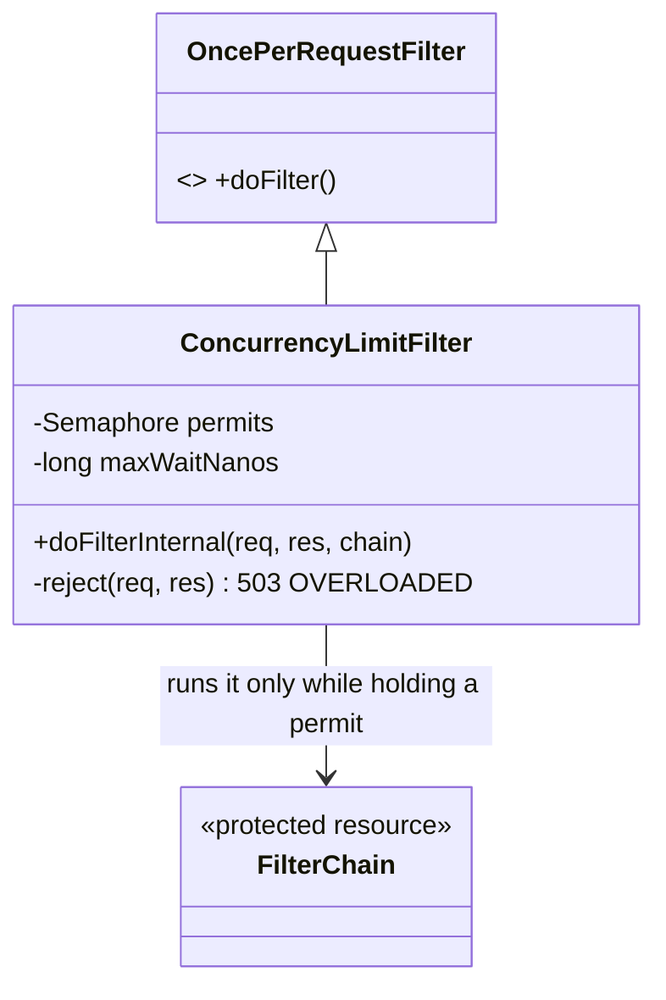

# Bulkhead — a cap on in-flight requests, so overload is a fast 503 instead of a stall

> **One-liner:** give a resource a fixed number of slots; when they're all taken, refuse the
> next caller now rather than let it queue without bound and sink everyone else.

**Type:** Resilience · **Status:** built · **Last updated:** 2026-10-23
**Real code:** `com.masternova.api.platform.overload.ConcurrencyLimitFilter` · **Lab:** [`lab/.../bulkhead/`](../lab/src/main/java/com/masternova/patterns/bulkhead/)

**Trigger phrase:** "under load it doesn't get slow, it falls over" · "one slow dependency
takes the whole service down" · "the queue grows without limit".

## 1. The problem in Masternova

The D5.1 load test ([`docs/hld/03-capacity.md`](../../docs/hld/03-capacity.md)) met the SLO up to
150 rps, then collapsed. It didn't just slow down: p95 went from 30 ms to 25 s, and pods restarted.
The logs showed why:

```
HikariPool-1 - Connection is not available, request timed out after 153262ms
  (total=10, active=10, idle=0, waiting=1513)
```

**Virtual threads mean Tomcat never says no.** Each request gets a cheap thread, so a pod took
every request it was sent, and ~1,500 of them waited for 10 database connections. That has three
effects:

1. every request waits, so all of them are slow, not just the excess;
2. the waiting requests' memory fills the heap, GC thrashes, and the JVM stops answering its
   liveness probe;
3. the kubelet restarts the pod, and its share of the traffic sinks the next pod.

Without the pattern, the fixes are all worse: more threads (there's no thread limit to raise),
a bigger pool (Postgres has `max_connections: 100` for every pod and the worker), or a longer
timeout (more waiting).

## 2. Structure



| Role | Masternova class | Responsibility |
|---|---|---|
| Bulkhead | `ConcurrencyLimitFilter` | Holds `masternova.overload.max-concurrent` permits (64 per pod); waits `max-wait` (50 ms) for one, then rejects |
| Protected resource | the rest of the filter chain → controllers → Hikari pool | Only ever sees as many requests as there are permits |
| Fallback | `reject(…)` | 503 `OVERLOADED` + `Retry-After: 1`, RFC 9457 like every other error |
| Second line | `GlobalExceptionHandler.isPoolTimeout` + Hikari `connection-timeout: 2000` | A request that got a permit but no connection within 2 s is also a 503, not a 500 after 30 s |

## 3. Code walkthrough

```java
@Component
@Order(Ordered.HIGHEST_PRECEDENCE + 100) // ⭐ after observation (a 503 is still measured), before security (no JWT work)
class ConcurrencyLimitFilter extends OncePerRequestFilter {

  @Override
  protected boolean shouldNotFilter(HttpServletRequest request) {
    return !request.getRequestURI().startsWith("/api/"); // ⭐ probes are never shed by the overload they report
  }

  @Override
  protected void doFilterInternal(HttpServletRequest request, HttpServletResponse response, FilterChain chain) … {
    boolean acquired = permits.tryAcquire(maxWaitNanos, TimeUnit.NANOSECONDS); // a short wait absorbs a burst
    if (!acquired) {
      rejected.increment();
      reject(request, response); // 503 OVERLOADED, Retry-After: 1
      return;
    }
    try {
      chain.doFilter(request, response);
    } finally {
      permits.release(); // ⭐ in finally: a throwing handler must not leak a permit
    }
  }
}
```

Two meters make it visible: `masternova.overload.rejected` (counter) and
`masternova.overload.in.flight` (gauge).

## 4. Java features that make it nicer

- **`Semaphore.tryAcquire(timeout)`**: the whole pattern is one JDK class. A `ThreadPoolExecutor`
  with a bounded queue is the other classic bulkhead, but with virtual threads there's no pool to
  bound: a semaphore limits concurrency without owning threads (JEP 444 recommends exactly this).
- **`try/finally`** is the invariant: every acquired permit is released, even on exceptions. The
  lab and the real test both check that a throwing call gives its slot back.

## 5. When NOT to use it

- **When the work can't pile up.** A bulkhead earns its place only where demand can exceed a fixed
  resource. Here that resource is the 10-connection pool, and virtual threads removed the only
  limit that used to exist (Tomcat's 200 platform threads).
- **One limit per pod, not per dependency (yet).** Resilience4j-style bulkheads per downstream
  (Razorpay, Ollama) make sense once one slow dependency should not starve the others. Today the
  Ollama call already has its own 2 s budget and breaker (11.4), so one cap in front is enough.
- **Not a rate limiter.** It limits *concurrency* (how many at once), not *rate* (how many per
  second per caller). Abuse protection is a different job, done per client at the edge.

## 6. Where Spring itself uses it

Spring has no bulkhead of its own. Tomcat's `maxThreads` / `acceptCount` was one until virtual
threads (`spring.threads.virtual.enabled`) made the thread count unbounded. Spring's
`ConcurrencyThrottleInterceptor` / `@ConcurrencyLimit` (Framework 7) is the same Semaphore idea
for method calls.

## 7. Alternatives considered

| Alternative | Why not here |
|---|---|
| Turn virtual threads off (Tomcat's 200 threads as the cap) | Loses cheap blocking for every request; 200 is still far above 10 connections, so requests still pile up at the pool |
| A bigger Hikari pool | Postgres allows 100 connections for 4 api pods + the worker + KEDA; more connections on 2 vCPUs makes every query slower (D5.2 sizes the pool) |
| Only the 2 s Hikari timeout | Fails fast, but up to 2 s of requests still sit in memory and every one of them is slow; the bulkhead refuses the excess at the door |
| Resilience4j `@Bulkhead` | A library and an aspect for what a `Semaphore` in a filter does; worth it once there are several per-dependency bulkheads |
| Shed at the ingress (Traefik `inFlightReq`) | Counts per ingress, not per pod, and can't see the pool; a good outer layer later |

## 8. Interview Q&A

- **Q:** Why did the service get *worse* with virtual threads under overload?
  **A:** Platform threads were an accidental bulkhead: 200 threads, then the accept queue, then
  refused connections. Virtual threads removed that limit, so the queue moved to the connection
  pool, in memory, unbounded. You have to put the limit back deliberately.
- **Q:** Why is a 503 better than letting requests wait?
  **A:** Under overload, waiting doesn't add throughput; it only adds latency, to *every* request.
  Rejecting the excess keeps the admitted ones fast, and `Retry-After` tells clients when to come
  back. A queue past capacity only grows.
- **Q:** How do you choose the limit?
  **A:** Little's law: in-flight = throughput × latency. At ~40 rps per pod × ~15 ms that's under 1
  in flight, so 64 leaves plenty of headroom for bursts and only binds when latency has already
  exploded. Then measure: the sweep shows where 503s start.
- **Q:** Why exclude `/actuator`?
  **A:** A probe shed by the bulkhead would report "dead" for a pod that is only full, and the
  restart would make the overload worse. Probes report on the overload; they mustn't be part of it.

## 9. 30-second recall

- **Intent:** a fixed number of slots; when they're full, fail fast instead of queuing.
- **Roles:** the bulkhead (`Semaphore` in a filter), the protected resource (the chain → pool),
  the fallback (503 `OVERLOADED` + `Retry-After`).
- **In Masternova:** `ConcurrencyLimitFilter`, 64 per pod, 50 ms wait; plus Hikari's 2 s timeout
  mapped to the same 503.
- **Pitfall:** releasing outside `finally` leaks permits until the pod refuses everything; shedding
  your own health probes.

*Related:* [[13-decorator]] (the fail-open caches) · [[15-proxy]] · HLD: `docs/hld/03-capacity.md`
